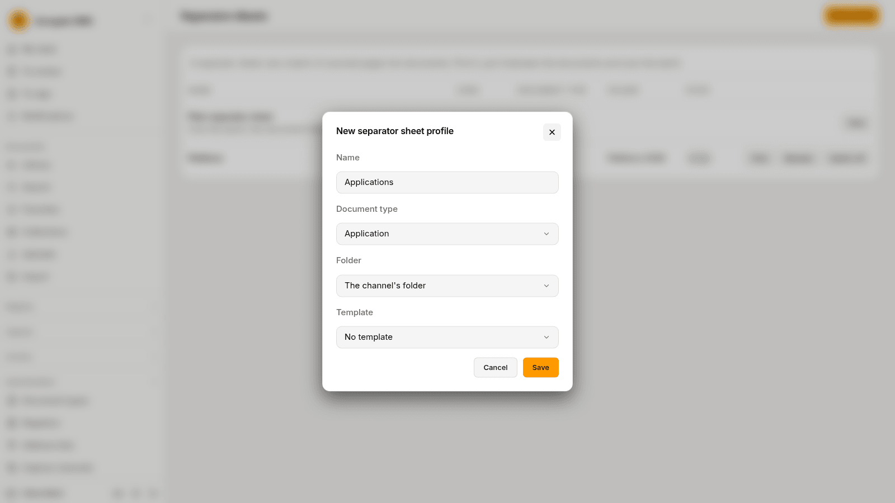
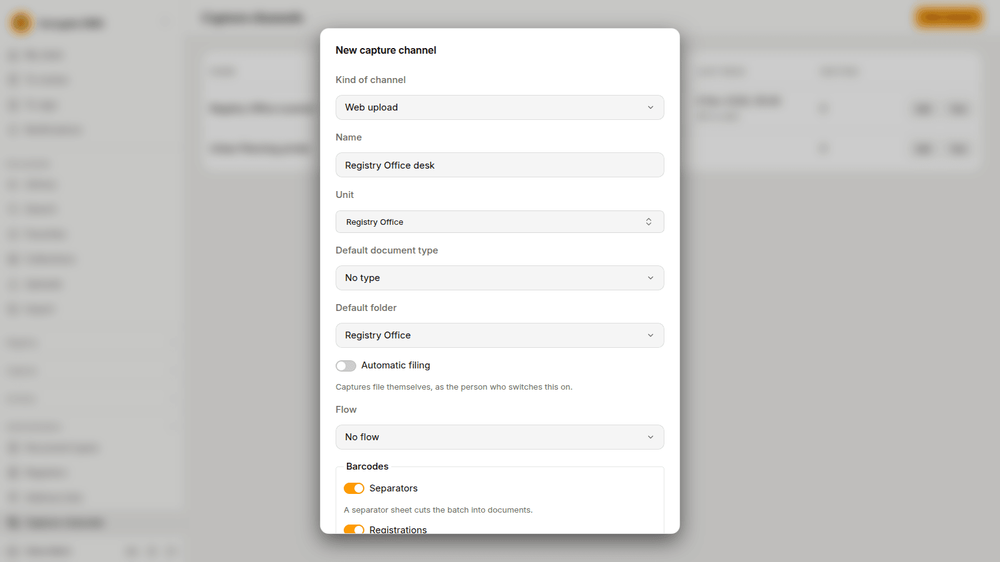
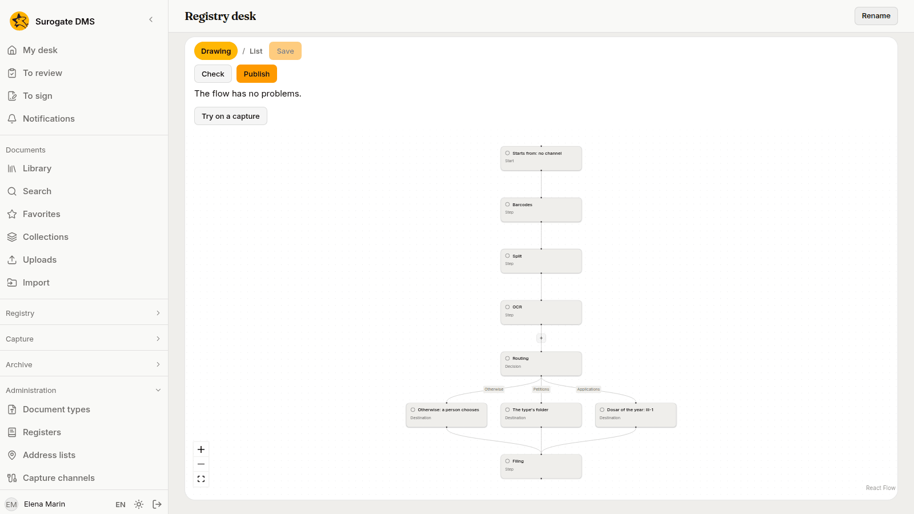
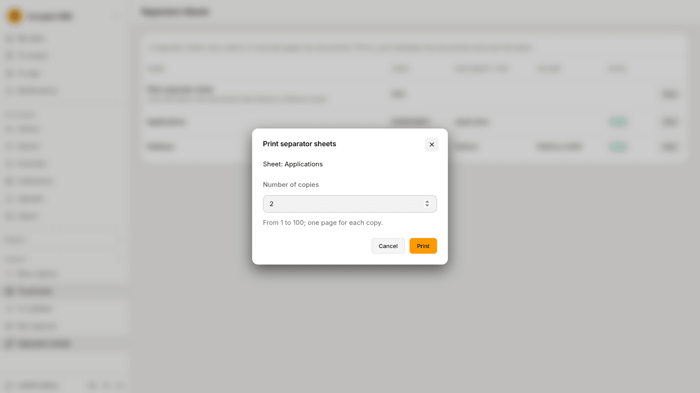
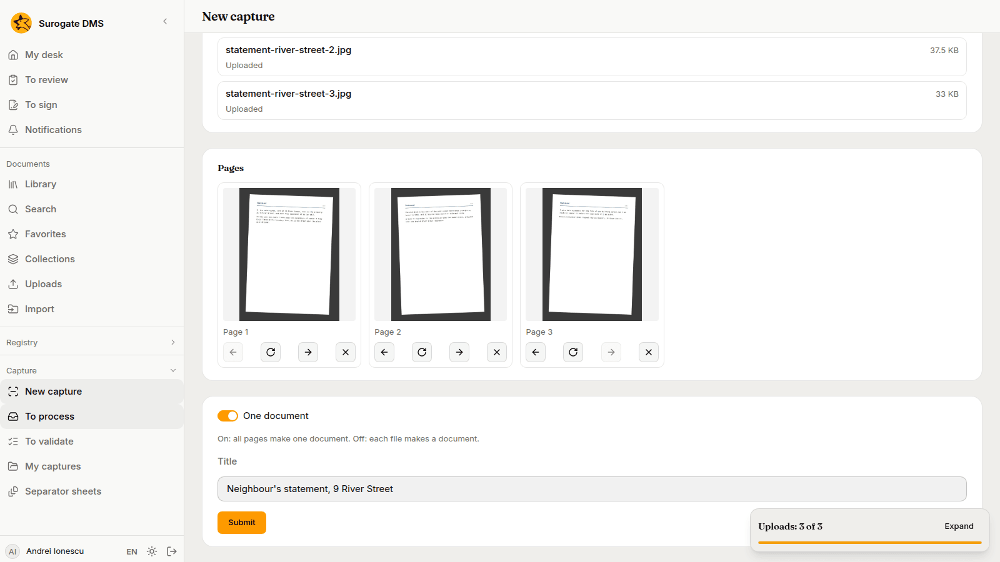
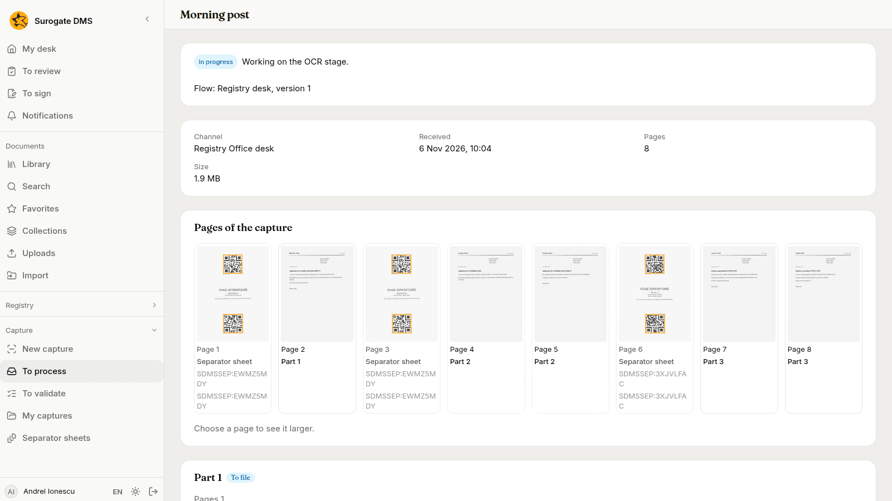
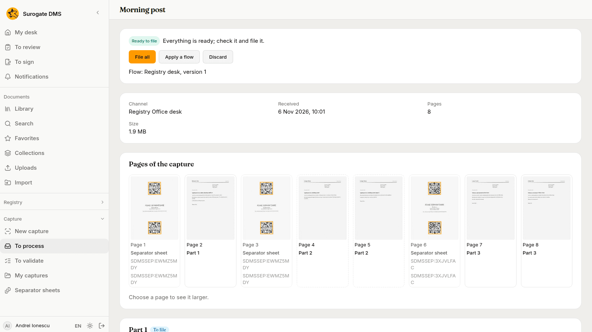
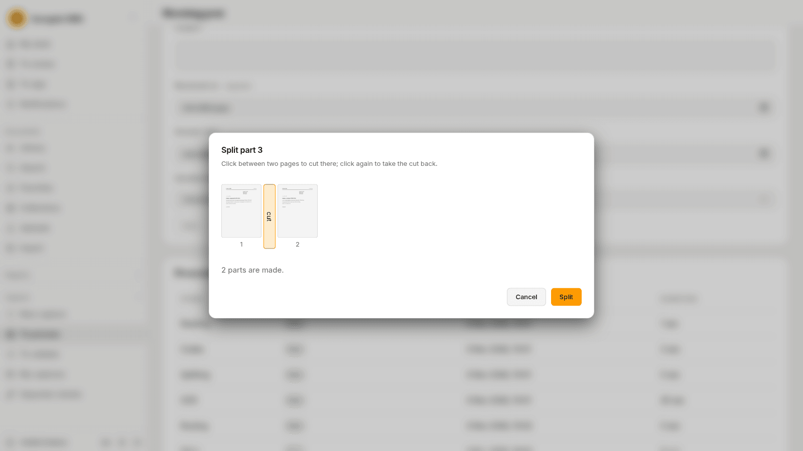
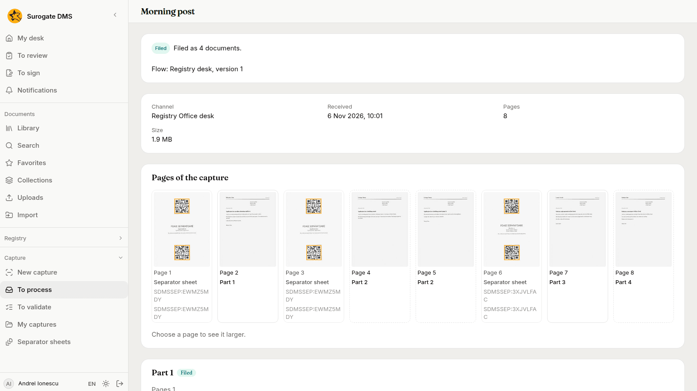

This page takes you from a stack of paper to filed documents: you make a channel and a flow, print separator sheets, scan a stack, check how the DMS cut it, and file it. It takes about twenty minutes.

The pictures were taken in a demo city hall, Example City Hall, with made-up people and documents. You are Elena Marin, the administrator, for steps 1 to 4, and then Andrei Ionescu, the registry clerk, for steps 5 to 10.

You need:

- the [Quickstart for administrators](/dms/quickstart-admin/) done: the org chart, the folders, the nomenclator and the document types **Application** and **Petition**;
- for Elena, **Manage capture** for the whole institution, which the Archive administrator role holds;
- for Andrei, **Process captures** in the Registry Office, which the Registrar role holds. The role also holds **Access to documents with personal data**, which the inbox needs;
- a scanner that saves a PDF, or a phone that takes photographs.

## 1. Make the separator sheet profiles

Open **Administration** › **Separator sheets** and choose **New profile**. Write the **Name** Applications, choose the **Document type** Application, leave the **Folder** at **The channel's folder** and the **Template** at **No template**, and choose **Save**.

The page says "The profile was made." and gives the code of the sheet. Make a second profile named Petitions in the same way, with the type **Petition**. A sheet of a profile starts a new document and says what that document is. See [Separator sheets and registration labels](/dms/admin/separator-sheets/).

## 2. Make a channel

Open **Administration** › **Capture channels** and choose **New channel**. Choose **Web upload** as the **Kind of channel**. Write the **Name** Registry Office desk, choose the **Unit** Registry Office and the **Default folder** Registry Office, and choose **Save**.

The channel is now in the list, **Active**. It is the destination Andrei will choose when he sends a stack. See [Capture channels](/dms/admin/capture-channels/).

## 3. Draw a flow

A flow says what the DMS does with the captures of a channel. Open **Administration** › **Capture flows**, choose **New flow**, write the **Name** Registry desk and choose **Create**. The new flow opens with the two steps every flow has: **Split** and **Filing**.

1. Choose **List** in **How the flow is shown**, then **Add a step**, and add **Barcodes**, **OCR** and **Routing**. The steps keep their order.
2. In **Routing**, choose **Add a rule**. Write the **Name** Applications. Under **When**, choose **all the conditions fit** and **Add a condition**: the **Fact** is **The separator sheet**, the **Operator** is **is**, and the value is the code of the Applications profile, which you copy from the **Code** column of **Separator sheets**.
3. Under **Then**, choose the **Destination** **The dosar of the year of a position**, the **Unit** Urban Planning Department and the **Position** III-1 Building permits. Write the **Title** `Application received on {date}`.
4. Add a second rule named Petitions, for the code of the Petitions profile. Choose the **Destination** **The type's folder** and the **Title** `Petition received on {date}`.
5. Leave **Otherwise** at **a person chooses the folder**, and **Filing** at **A person files**.

The sheet already gives each document its type, so the rules do not set it. Choose **Check**. The page says "The flow has no problems." Choose **Drawing** to see the flow.

See [Capture flows](/dms/admin/capture-flows/).

## 4. Publish it, switch it on and give it to the channel

Choose **Publish**, write a **Note** such as First version, and choose **Publish**. Then choose **Switch on**. Open **Capture channels**, choose **Edit** on Registry Office desk, choose the **Flow** Registry desk and choose **Save**.

From now on, a capture sent to that channel runs the flow. A capture keeps the version of the flow it started with.

## 5. Print the sheets

Andrei opens **Capture** › **Separator sheets** and chooses **Print** on **Applications**. The stack in this quickstart has two applications, so he writes 2 in **Number of copies**. Then he prints one copy of **Petitions**. He prints at full size and does not write on the sheets.

## 6. Scan the stack and send it

Andrei puts the stack together: a separator sheet before each document. The stack has an Applications sheet and an application of one page, an Applications sheet and an application of two pages, and a Petitions sheet and two petitions of one page each, with no sheet between the two petitions. He scans the stack to one PDF of eight pages.

He opens **Capture** › **New capture**, chooses **Registry Office desk** as the **Destination**, and chooses the file with **Choose files**. He writes the **Title** Morning post and chooses **Submit**. The destination cannot change once the first file is chosen, so he chooses it first.

The picture shows three photographs, as a phone sends them. A scanned stack is one file, and the list **Files** shows that one file. See [Capturing documents](/dms/work/capture/).

## 7. Watch it being read

After **Submit**, the page of the capture opens. It says where the capture is: **Waiting**, then **In progress** with the step it is working on. The page refreshes by itself.

When the DMS has read the pages, the state becomes **Ready to file**.

## 8. Check the parts and split one

Andrei opens **Capture** › **To process** and opens **Morning post**. Under **Pages of the capture**, he checks what the DMS did.

Pages 1, 3 and 6 are marked **Separator sheet**. They are left out of the documents. Page 2 is part 1, pages 4 and 5 are part 2, and pages 7 and 8 are part 3. Part 3 holds the two petitions, because no sheet lay between them. Each part's card says **Rule “Applications”** or **Rule “Petitions”**, and shows the title, the type and the folder the rule chose.

To cut part 3, choose **Split** on its card. Click between the two pages, and check that the dialog says "2 parts are made." Choose **Split**.

The capture now has four parts.

## 9. File the capture

Choose **File all**. The page says "Filed as 4 documents." Each part shows **Filed** and **Open the document**.

## 10. Find the documents

Open **Library**. The two applications are in **Urban Planning Department** › **Building permits 2026**, titled "Application received on" and the day of the capture. The two petitions are in **General Secretariat** › **Petitions 2026**. Each document says in its header that it was captured through Registry Office desk.

## Next steps

- [Example: scan a day's incoming mail](/dms/examples/incoming-mail/), with registration labels, a form read with a template and a flow that files by rules.
- [Processing captures](/dms/work/capture-inbox/), for what to do when a capture waits.
- [Capture templates](/dms/admin/capture-templates/), to read the data of a form.
- [Capture flows](/dms/admin/capture-flows/), for the rules and the check.
