This page takes you from signing in to a signed document that you can find again: you file a building permit, fill in its metadata, validate it, find it with Search, mention a colleague and ask for a signature. It takes about ten minutes.

The pictures were taken in a demo city hall, Example City Hall, with made-up people and documents. You are Ioana Dobre, an urban planning inspector; your colleague is Mihai Stan, the Secretary General.

You need:

- the address of your institution's DMS and the e-mail address and password of your account (ask your administrator);
- the right to file documents in the folder **Building permits 2026**, which your administrator grants;
- a file to upload, such as a PDF.

## 1. Sign in

Open the address, type your **Email address** and **Password**, and press **Sign in**. Leave **Remember me on this computer** ticked if the computer is yours.

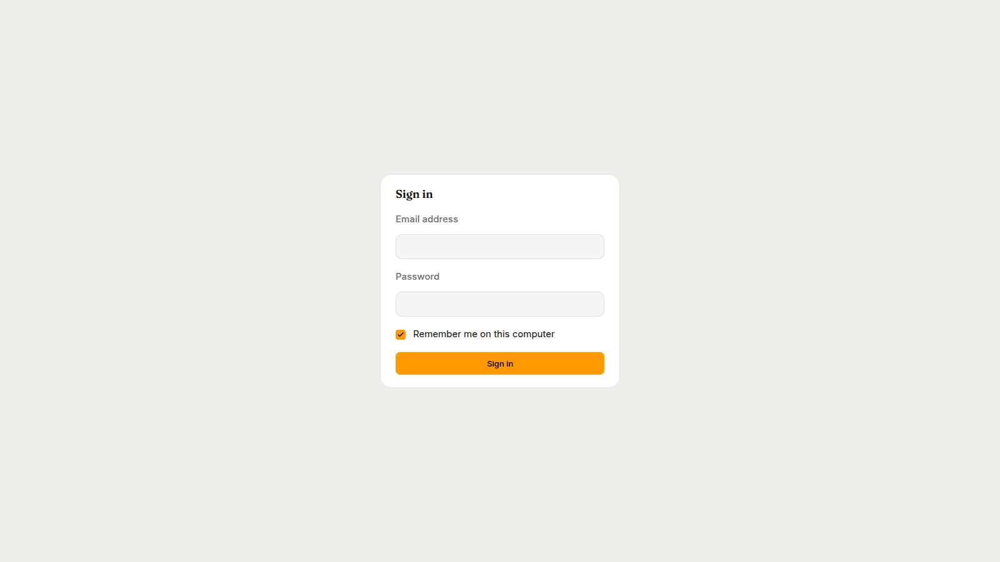

You land on **My desk**. On a new account it is empty: there is nothing to review or sign, and the sidebar lists only the pages your roles allow.

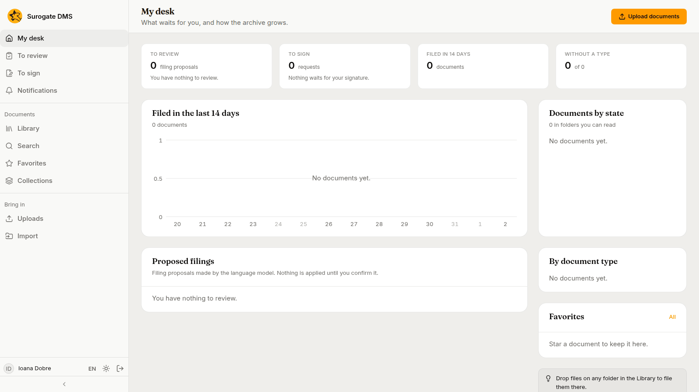

## 2. Open the library

Choose **Library** in the sidebar. You see the folders you may read.

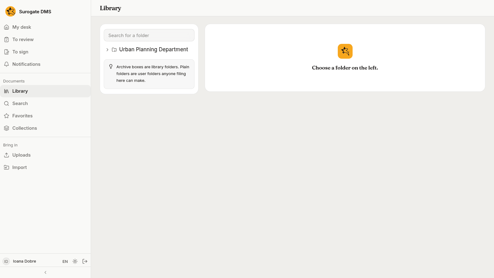

Open **Urban Planning Department**, then **Building permits 2026**. The top of the page tells you what kind of folder it is: this one is a dosar, with the nomenclator entry **III-1 Building permits**, the year **2026**, a **Permanent** retention and the closing rule "Open, closes on 31 Dec 2026". Under it the table lists the documents, and the user folder **Pending applications**.

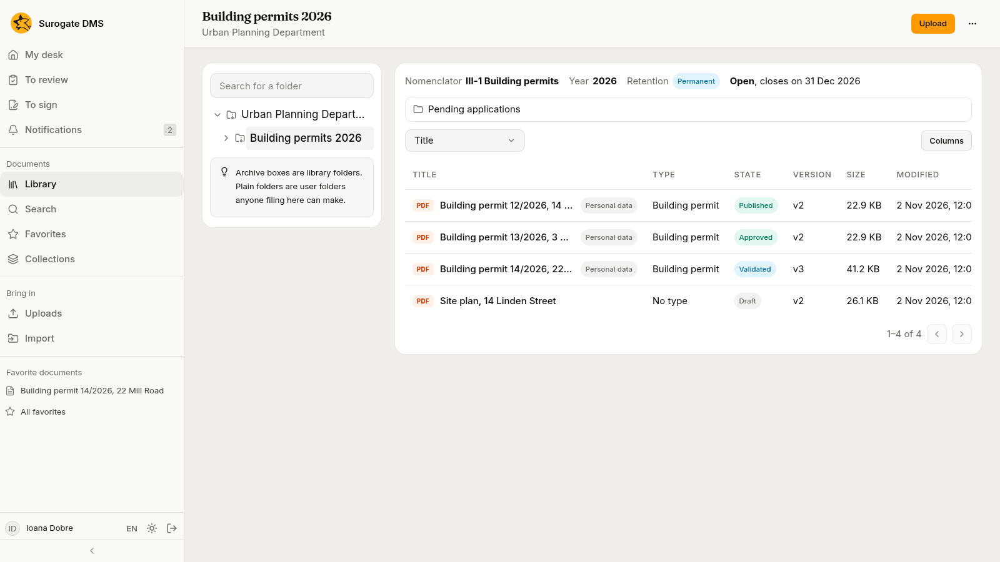

## 3. Upload a document

Press **Upload**. In the dialog choose the **File**, give it a **Title** and choose the **Document type**. The fields of the type that are required, **Permit number** and **Applicant** here, appear under it. Fill them in and press **Upload**.

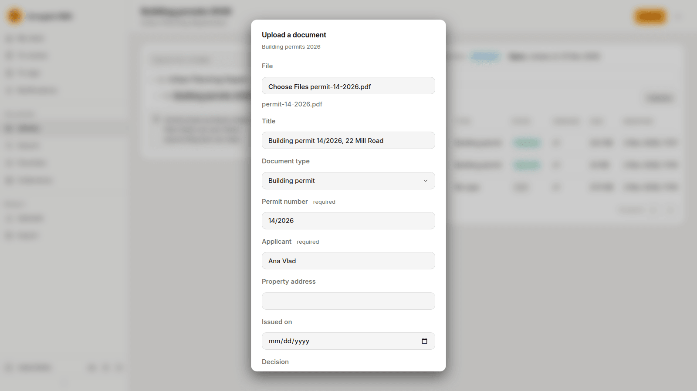

## 4. Look at the document

When the upload ends, open the document from the folder's table. The header shows its title, its state (**Draft**) and the pill **Personal data**. The viewer is on the left. On the right the **Metadata** tab shows what is filled in and, for the rest, "Not filled in".

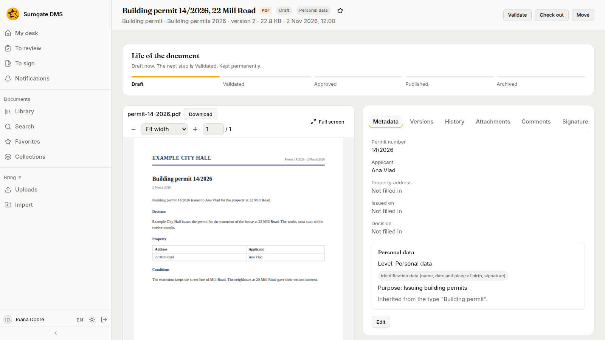

## 5. Fill in the metadata

On the **Metadata** tab press **Edit**, fill in the **Property address**, **Issued on** and **Decision**, and press **Save**.

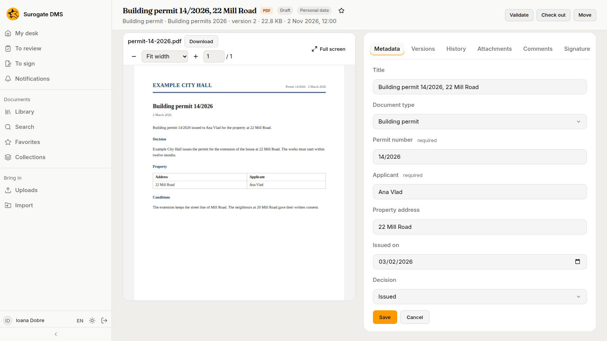

## 6. Validate it

The card **Life of the document** shows where the document is and what comes next. Press **Validate** at the top right. A document needs a type and its required fields before it can be validated; the page tells you when something is missing.

## 7. Find it

Choose **Search**, type `Mill Road` and press Enter. Search finds words inside the files as well as in the titles and metadata.

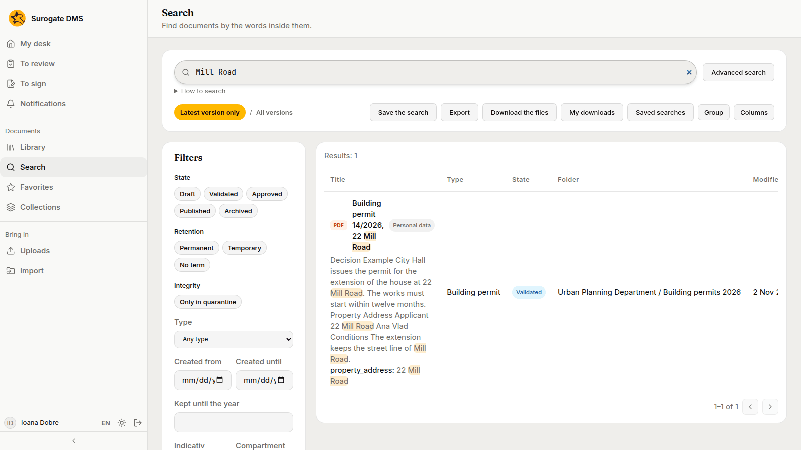

Open the result: the matches are marked in the viewer and the bar over it counts them.

## 8. Mark it a favorite

Press the star next to the title. The document appears under **Favorite documents** in the sidebar, and on the **Favorites** page.

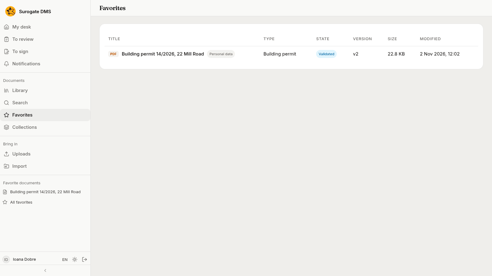

## 9. Mention a colleague

Open the **Comments** tab. In **Your comment** type `@Mih` and choose **Mihai Stan** from the list that opens, finish the sentence and press **Send**. Mihai gets a notification.

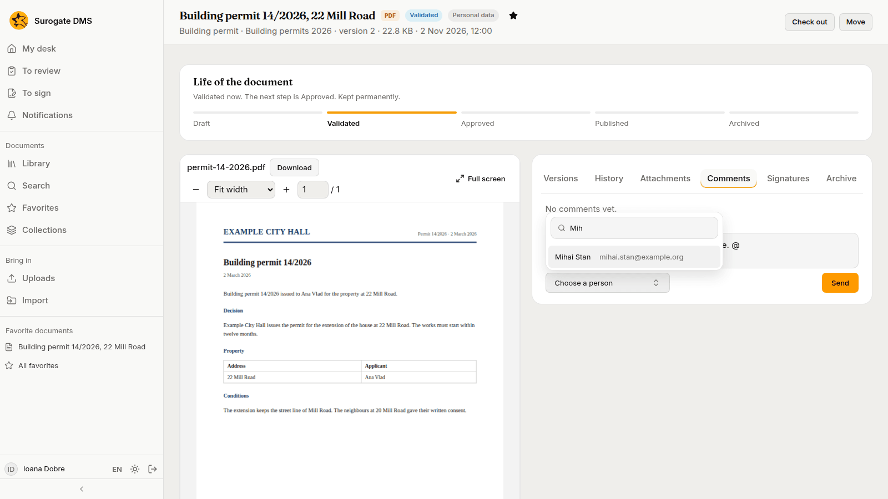

## 10. Ask for a signature

Open the **Signatures** tab and press **Request a signature**. Choose the **Signers**, leave **Internal allowed** selected and write a message for the signer if you wish. Press **Send the request**.

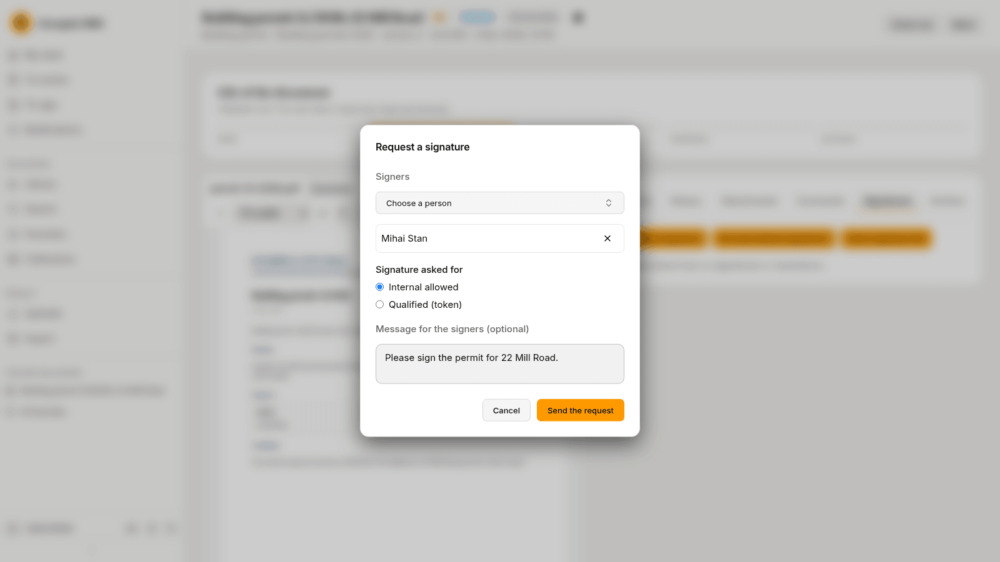

### What Mihai sees

Mihai has a notification for the request and for your mention, and the request waits on his **To sign** page.

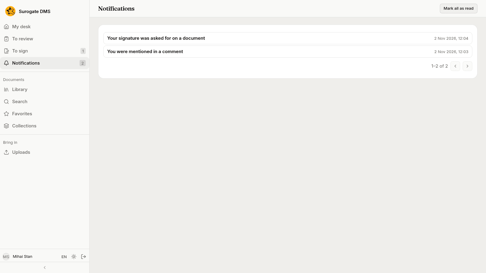

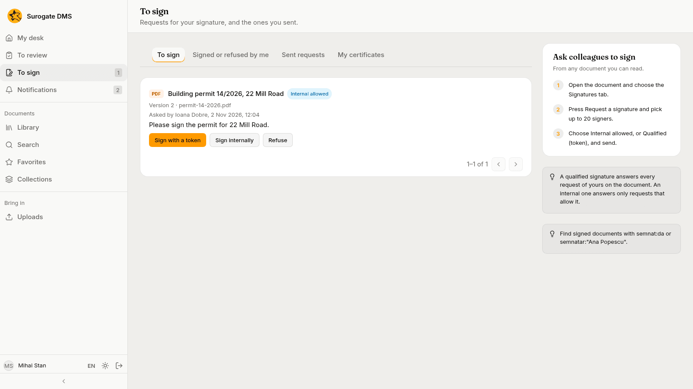

He opens the document, chooses **Sign** and then **Internal**, adds a note and presses **Sign internally**.

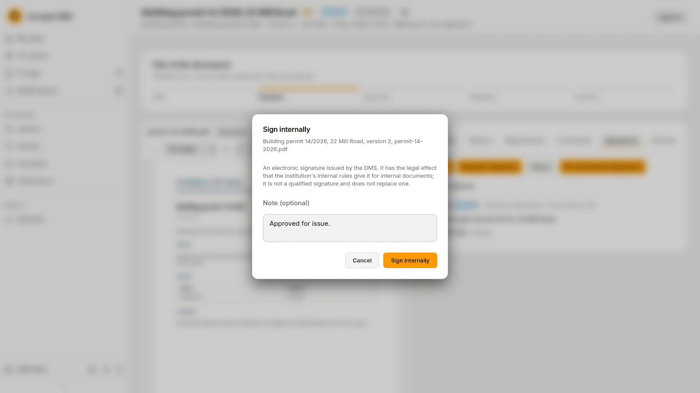

### What you see

On the **Signatures** tab the signature appears with the status **Valid · internal (not qualified)**, and the document shows the line "Signed: one valid signature, internal".

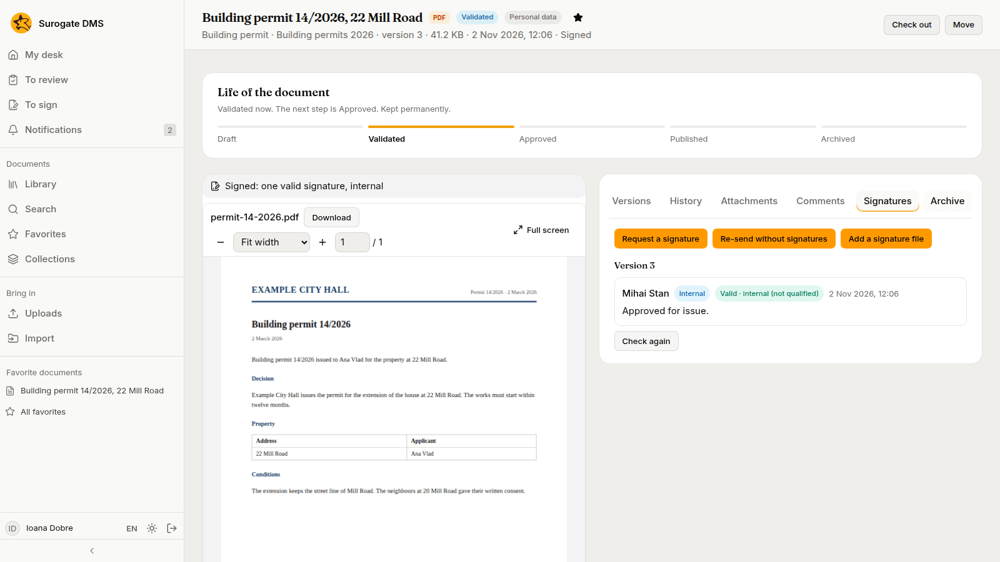

## Next steps

- [The document page](/dms/work/document-page/) explains every tab.
- [The life of a document](/dms/work/lifecycle/) shows who may approve and publish.
- [Search](/dms/work/search/) lists what you can search for.
- [File and approve a contract](/dms/examples/contract/) follows a document from upload to Published.
