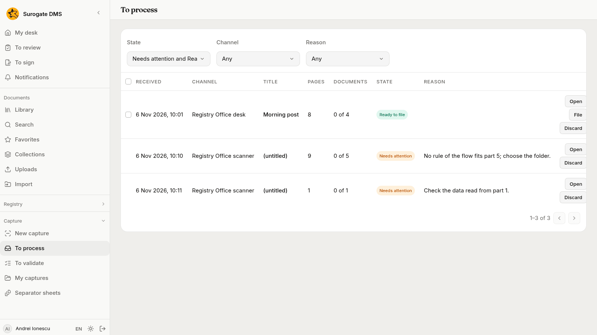
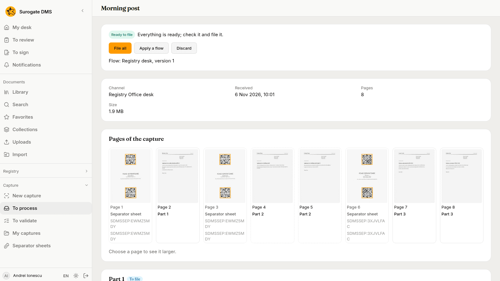
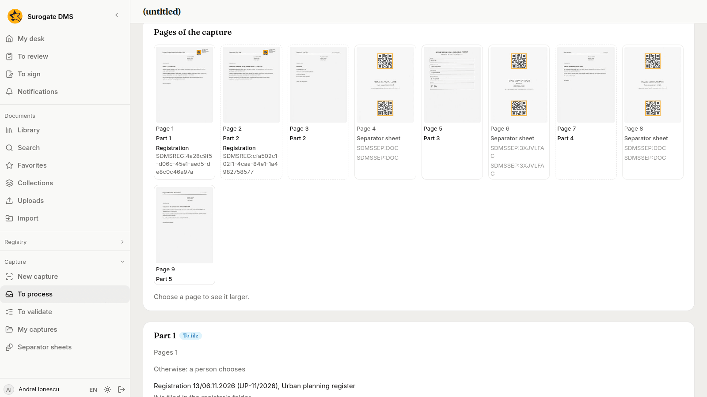
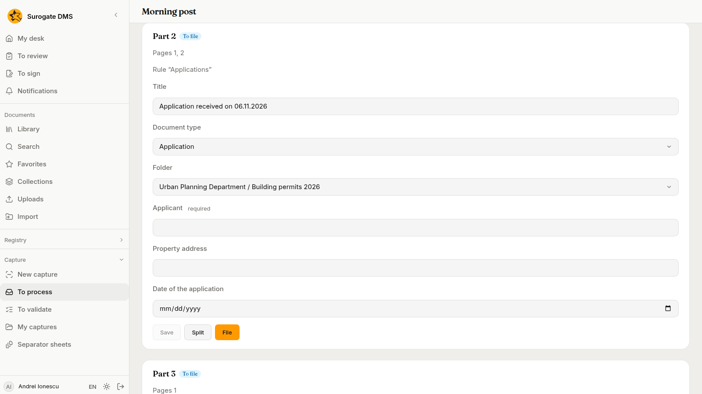
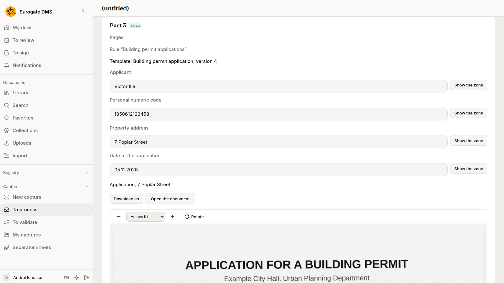
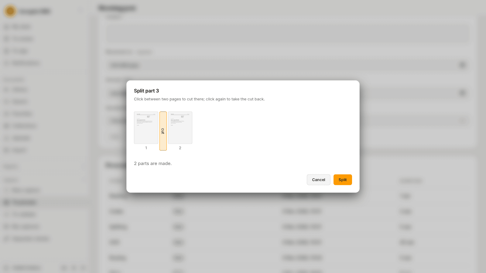
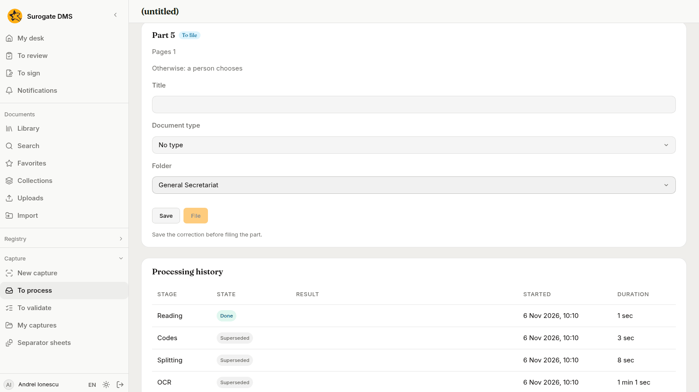

For staff who work the captures of a unit: reading the inbox, checking the parts the DMS made, splitting and filing them, and what to do when a capture waits.

## The list

**Capture** › **To process** lists the captures of the units where you process captures, and your own. The oldest come first, and a capture that has waited long is marked **old**.

The columns are **Received**, **Channel**, **Title**, **Pages**, **Documents** (such as "0 of 4": documents made out of parts), **State** and **Reason**. The filters are **State** (**Needs attention and Ready to file** by default, or **All**), **Channel** and **Reason**. A row has **Open**, **File** (when the capture is ready) and **Discard**.

Tick several rows and use the bar **Actions for the selected captures** to file or discard them together. The page tells you the result, for example "Filed 3 of 4.", and names each capture it could not file and why.

## A capture's page

Choose **Open**. The first card gives the state and its sentence and the buttons that fit it:

- **File all** files every part that is ready.
- **Try again** runs again the step that stopped. Use it after you fixed what the sentence says.
- **Continue without {step}** appears when a stopped step may be skipped, for example the reading of the data.
- **Apply a flow**, see below.
- **Discard** and **Restore**, see below.

When the capture runs a flow, the card says "Flow: Registry desk, version 1". A capture keeps the version it started with, even when a newer one is published.

The next card gives **Channel**, **Received**, **Pages**, **Size**, **How it arrived** (the file name or the sender) and a reference when there is one.

## The pages and their codes

**Pages of the capture** shows every page as a small picture with its part, **Part 1**, **Part 2** and so on. Choose a page to see it larger. A page that holds a code of the DMS shows it in words:

- **Registration**, the label of a registration. The page starts a part linked to that registration.
- **Separator sheet**, which cuts the stack. The sheet is left out of the documents.
- **Other code**, a bar code or QR code that is not the DMS's own. It changes nothing.

A page that was left out says why: "Blank page left out" or "Separator sheet".

## The parts

Each part has its own card: **Part 1**, **Pages 1** (the pages it holds), a title, a **Document type** and a **Folder**, and the fields of the type. The card says how the part got there: **Rule “Petitions”** when a flow's rule took it, or **Otherwise: a person chooses** when no rule did, or the line of its registration.

- **Save** keeps what you changed. The part cannot be filed before it is saved: "Save the correction before filing the part."
- **File** files this part as a document. The document is made as you.
- **Split** cuts the part in two or more, see below.
- **Open the document** appears once the part is **Filed**.

A part linked to a registration says "It is filed in the register's folder." and has **Remove the link**. The folder you see is not used, because a registered document always goes to the folder of its register. A link is made by a label on the page, never by hand.

A flow can fill the title, the type, the folder and some data of a part for you. What you type on a part is never changed by a rule.

A part that is filed shows the rule that took it and a button to open its document.

## Split a part

Two letters scanned without a sheet between them make one part. To cut it:

1. On the part's card, choose **Split**. The dialog **Split part 3** shows the pages of the part side by side.
2. Click between two pages to cut there. The gap is called **Cut after page 1**, and you can reach it with the keyboard. A cut shows as "cut". Click again to take it back.
3. The dialog says "2 parts are made." Choose **Split**.

A PDF that carries a signature is never cut; the DMS would break the signature. File it whole.

## When a capture waits

A capture that **Needs attention** says in words what is wrong. The usual ones, with what to do:

| Reason | What it says | What to do |
|---|---|---|
| **Data to check** | Check the data read from part {n}. | Open [To validate](/dms/work/capture-validate/). |
| **Template not settled** | Part {n} fits several templates. Choose one. | On the part, **Choose the template**, then **Try again**. |
| **No template** | Part {n} has no capture template. Choose one or go on without extraction. | Choose one, or **Continue without** the reading. |
| **No rule fits** | No rule of the flow fits part {n}; choose the folder. | On the part, choose the **Folder**, **Save**, then **Try again**. |
| **Dosar not open** | The unit has not opened the dosar of the position for the year; open it or choose the folder. | Ask the unit to open the dosar, or choose another folder, then **Try again**. |
| **The rule's folder is missing** | The flow cannot find the folder it sends part {n} to. | Choose the folder by hand, and tell the administrator of the flow. |
| **Filing refused** | Part {n} could not be filed, and why. | Read the reason on the part, correct it and **Try again**. |
| **Two codes on one page** | Page {n} has two different DMS codes; split the capture by hand. | Split the part. |
| **Separator sheet no longer in use** | The separator sheet on a page is no longer in use; choose the folder by hand. | Choose the folder of the part. |
| **Signed file with separator sheets** | A file is signed and is not split. | File it whole, or scan it again without the signature. |
| **Password protected file** | A file is password protected. | Save it without a password and capture it again. |
| **File cannot be read** | A file is damaged or in an unknown format. | Capture it again. |
| **No pages** | The capture has no pages. | Discard it. |
| **Missing program** | The reading program is missing on the server. | Tell the administrator. |
| **Stage failed** | The step failed. | **Try again**. |
| **Handwriting, reading off**, **Handwriting not read**, **Daily handwriting limit** | A handwritten field could not be read. | Fill the field in yourself. See [Checking the data read from forms](/dms/work/capture-validate/#handwriting). |

If a flow's rules sent a part nowhere, choose its folder and save.

## Apply a flow

**Apply a flow** runs a different flow on a capture that waits. It is offered only while no part is filed. Choose the **Flow** among those that are switched on and press **Apply**. The warning says: "The parts and the corrections made on them are lost; the order of the pages stays, and the capture is processed again with the flow chosen." A refusal is said in words and the capture stays as it was.

## Discard and restore

**Discard** asks for a **Reason for discarding**, between 3 and 500 characters. A discarded capture says who discarded it, when and why. **Restore** brings it back, as long as the files have not been deleted.

## Processing history

At the foot of the capture's page, **Processing history** lists each step with its **State** (**Running**, **Done**, **Skipped**, **Needs attention**, **Failed**, **Superseded**), the result, when it **Started** and how long it took. A step that was tried again shows each attempt. **Skipped by** names the person who chose to go on without a step.
