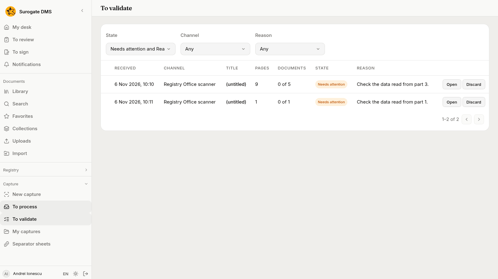
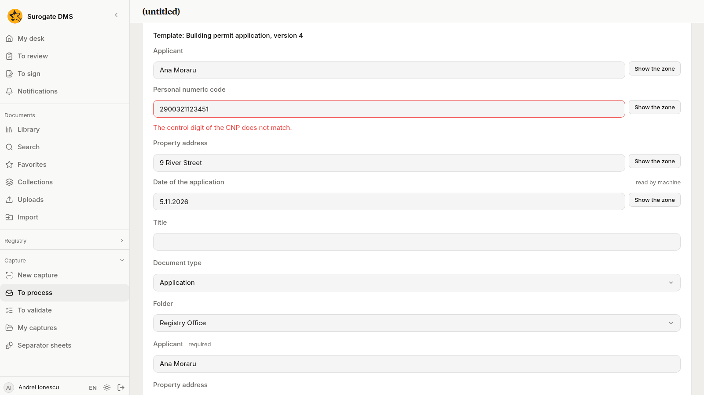
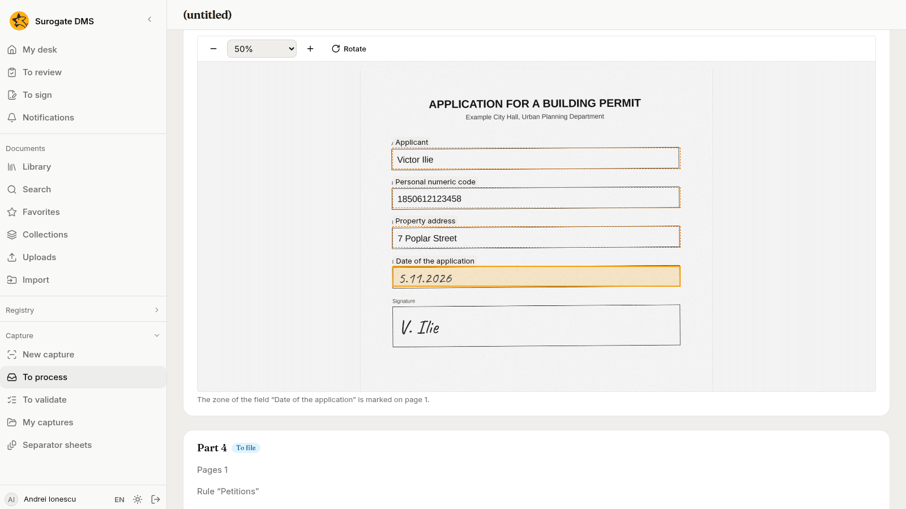
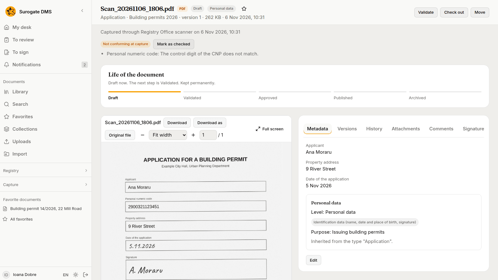

For staff who check what the DMS read from a filled form: how to correct a value, what to do with handwriting, and how to file a part that fails a check.

## The list

**Capture** › **To validate** lists the captures that wait for a person to look at the data read from a form. They need attention for one of these reasons: **Data to check**, **Template not settled**, **No template**, **Handwriting, reading off**, **Handwriting not read** or **Daily handwriting limit**. The columns and the buttons are those of [To process](/dms/work/capture-inbox/#the-list).

Choose **Open** on a row. The sentence says which part to look at: "Check the data read from part 1."

## The data read from a part

A part that was read with a template shows **Template: Building permit application, version 4** and, under it, the **Data read from the pages**. Each field has its label, the text that was read and, when a check fails, a red sentence in words, such as "The control digit of the CNP does not match."

- **Show the zone** marks, on the page below the card, the place the value was read from. The page opens beside the card and its zone is outlined; the sentence under the page says which zone it is.
- To correct a value, type the right one in the box and leave it or press Enter. The checks run again at once.
- You can also take the value from the page: choose **Select text** on the page, drag over the words, and drop them on the field. The field reads them as its kind asks, a date as a date, a number as a number.
- Under the title, the type and the folder, the card shows the fields of the document type. Values the template put there are already filled in; fill in the others.
- When no template could be chosen for the part, choose **Choose the template**, then **Try again**.

## Handwriting

When your institution has it, a handwritten field is read by a model: only the picture of that zone is sent, nothing else of the page. The value shows "read by machine" until you type it yourself, and a person always checks it. If the reading is off, failed or over its daily limit, the capture says so, and you fill the field in. See the reasons in [Processing captures](/dms/work/capture-inbox/#when-a-capture-waits).

## File the part

- **File** files the part when every check passes.
- **File as non-conforming** files it even though a check fails. The document carries a mark that says so, with the checks it failed.
- **Confirm** is for a part you checked and that fails a check you know to be wrong. It asks for a **Reason**, between 3 and 500 characters, and files the part as checked. The reason stays with the document.

A plain **File** on a part that fails is refused with: "Part 1 does not satisfy the template's keys. File it as non-conforming or confirm it." Use **File as non-conforming** when the data is wrong and someone must fix it later, and **Confirm** when the data is right and the check is too strict.

## The document afterwards

A document filed from a capture says in its header "Captured through Registry Office scanner on" the date. A document filed as non-conforming shows **Not conforming at capture** and the checks it failed. Someone who has looked at it can choose **Mark as checked** and give a reason; the mark then reads "Checked at capture by" the person "on" the date.

To find such documents, open **Search**, choose **Filters**, then **Capture**, then **Not conforming at capture**, or type `preluare:neconform` in the search box. See [Search](/dms/work/search/). The document can be downloaded as a PDF, a searchable PDF/A, a Word file or JSON with **Download as**; see [Versions](/dms/work/versions/).
