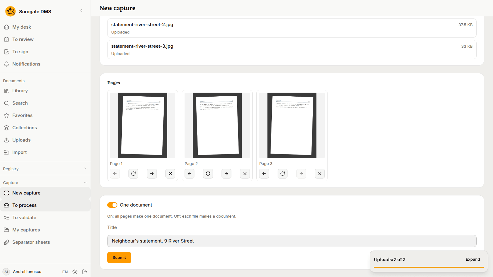
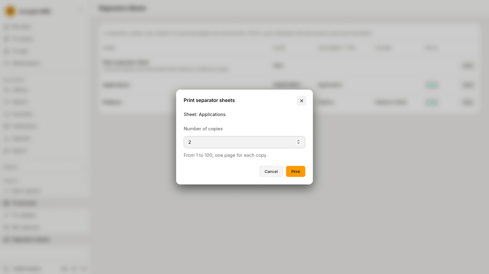
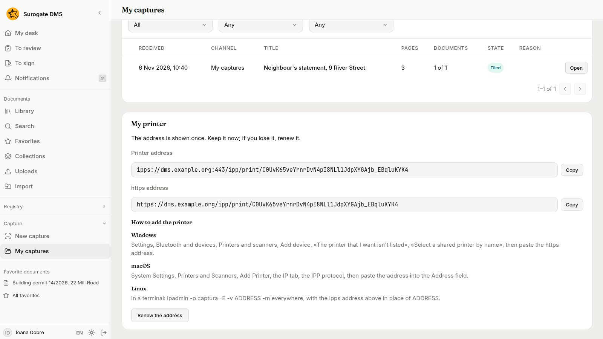
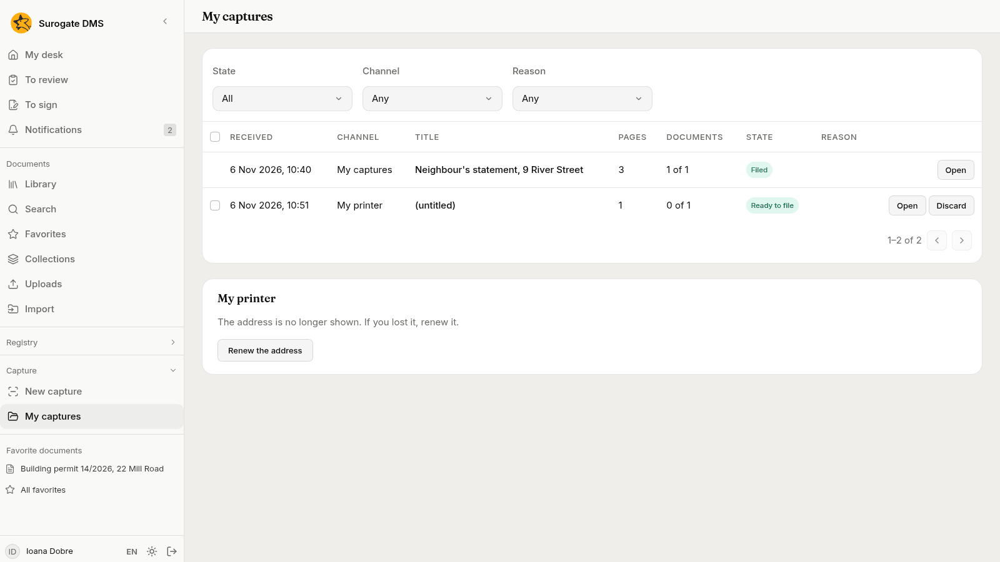

For staff who bring paper and files into the DMS: how to send pages from a computer, a phone or your own printer, what a capture is, and what happens to it before it becomes documents.

## What a capture is

A **capture** is a batch of pages on its way to becoming documents. It holds the files that came in (a scanned stack, photographs, a PDF, the attachments of a message) and the **pages** they make. The DMS reads the pages, cuts them into **parts** (a part is the pages of one future document) and files each part as a document. You check what it did and file what is left.

A capture reaches the DMS in one of these ways:

- **New capture**, a page of the DMS where you choose files or photograph the pages. It works on a computer and on a phone.
- A **scanner** that writes into a shared folder of a unit, a **mailbox** the unit reads, or a **virtual printer** of the unit, when your institution has them. See [Capture channels](/dms/admin/capture-channels/).
- Your own **virtual printer**: any program on your computer can print to it. See [My captures and My printer](#my-captures-and-my-printer).

## Who sees the Capture section

| Entry of the **Capture** section | Who sees it |
|---|---|
| **New capture** and **My captures** | People who hold **Uploads documents** somewhere, and people who hold **Process captures**. |
| **To process**, **To validate** and **Separator sheets** | People who hold **Process captures**. They also need **Access to documents with personal data** in the same unit. |
| **Capture channels**, **Capture flows**, **Separator sheets** and **Capture templates** in **Administration** | People who hold **Manage capture** for the whole institution. See [Roles and permissions](/dms/reference/roles/). |

## Send a capture

1. Open **Capture** › **New capture**.
2. In **Destination**, choose **My captures** or a channel of a unit, for example **Registry Office desk**. The page says "The destination cannot change once the first file is chosen." Choose it before the files.
3. Drop the files on the page or choose **Choose files**. On a phone you can also **Take a photo** of each page. The files upload at once and the list **Files** shows each one with "Uploaded" when it is done.
4. Look at **Pages**. Each page has buttons to turn it, to move it one place earlier or later and to take it out. A photograph shows its own picture. A PDF shows numbered tiles until you send it, and its pictures appear on the capture's page afterwards.
5. Choose how the pages become documents with the switch **One document**. On: all pages make one document. Off: each file makes a document. A channel may start with it off.
6. Write a **Title** if you want one. It is optional.
7. Choose **Submit**.

If you leave the page with files that were not sent, the DMS asks before it throws them away.

## Separator sheets and labels

A scanned stack of different documents can be cut by sheets you put between them. In **Capture** › **Separator sheets**, the **Plain separator sheet** cuts the stack and the document that follows is filed as usual. A **profile**, such as Applications, also says the type and the folder of the document that follows. Choose **Print**, write the **Number of copies** (from 1 to 100; one page for each copy) and print at full size. Do not write on a sheet.

A **label** of a registration does the same for a letter that was registered: stick it on the first page, and the part is linked to its registration. See [Print labels](/dms/work/registry-lists/#print-labels). How the DMS cuts a batch is in [Separator sheets and registration labels](/dms/admin/separator-sheets/#how-a-batch-is-cut).

## What happens next

The page of the capture says where it is, in words:

| State | What it says | What you can do |
|---|---|---|
| **Uploading** | The files are uploading; submit the capture when you are done. | Add files and **Submit**. |
| **Waiting** | The capture waits to be processed. It says how many captures are ahead of it. | Wait. |
| **In progress** | Working on the stage it names, such as Reading or OCR. | Wait. The page refreshes. |
| **Needs attention** | A sentence says what is wrong and which part. | See [Processing captures](/dms/work/capture-inbox/#when-a-capture-waits). |
| **Ready to file** | Everything is ready; check it and file it. | **File all**, or check the parts first. |
| **Filed** | Filed as the number of documents it made. | Open the documents. |
| **Discarded** | Who discarded it, when and why. | A person who processes captures may restore it. |

A unit's processors see the captures of the unit in **To process**. You see your own in **My captures**. The daily work of a processor is in [Processing captures](/dms/work/capture-inbox/).

## My captures and My printer

**My captures** lists what you sent, with filters **State**, **Channel** and **Reason**. A capture you sent to yourself, or printed to your own printer, is yours to check and file there.

**My printer** gives your computer a printer that sends pages to the DMS.

1. In **My captures**, choose **Create the printer**.
2. The card shows two addresses, the **Printer address** and the **https address**, each with **Copy**. They are shown once. Keep them now.
3. Add the printer to your computer as the card says for **Windows**, **macOS** and **Linux**: paste the https address in Windows, the address in the **Address** field on a Mac, and on Linux the command the card gives with the address in place of `ADDRESS`.
4. Print a document to it. A capture appears in **My captures**, named after the document.

If you lose the address, choose **Renew the address**. The old address stops working at once, and the printer must be added again with the new one.

## How long a capture's files are kept

The files of a capture are kept for a period your institution sets. The documents made from them stay. After that period the page of the capture says "The files of the capture were deleted on" the date, and its pages can no longer be shown.
