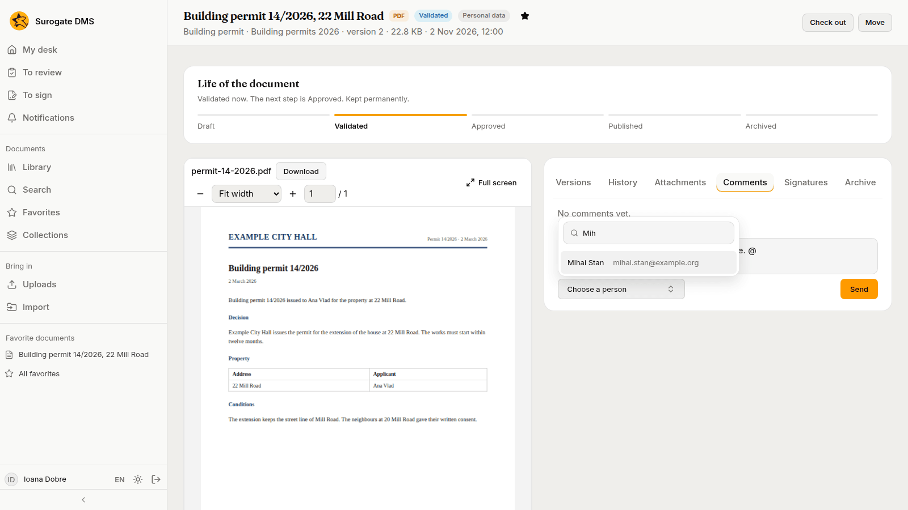
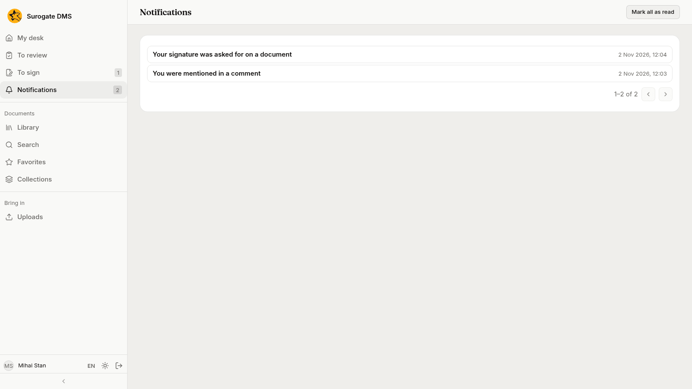

For everyone: writing a comment on a document, mentioning a colleague, and finding what needs your attention on the Notifications page.

## Comments

A document's **Comments** tab lists the remarks colleagues made. People who hold the permission **Comments** can comment on the documents they read, in every state, an archived document included.

To write one, type in **Your comment** and press **Send**. The button stays grey while the box is empty.

### Mention a colleague

Type `@` and the first letters of a name. A list of people opens: choose one and the name is put in the text. The person you mention gets a notification and can open the document if they may read it.

## Notifications

A notification tells you that something needs your attention. **Notifications** in the sidebar shows how many are unread.

| Line | When |
|---|---|
| You were mentioned in a comment | A colleague mentioned you |
| Your signature was asked for on a document | Someone asked you to sign |
| A document you sent for signing was signed | A signer of your request signed |
| A document you sent for signing was refused | A signer of your request refused |
| A signing request you sent has ended | The last signer of your request answered |
| A signing request that concerned you was cancelled | A request you were asked in, or sent, was cancelled |

**Mark all as read** clears the count. Some roles also receive notifications about integrity checks, the audit log and unusual activity.
