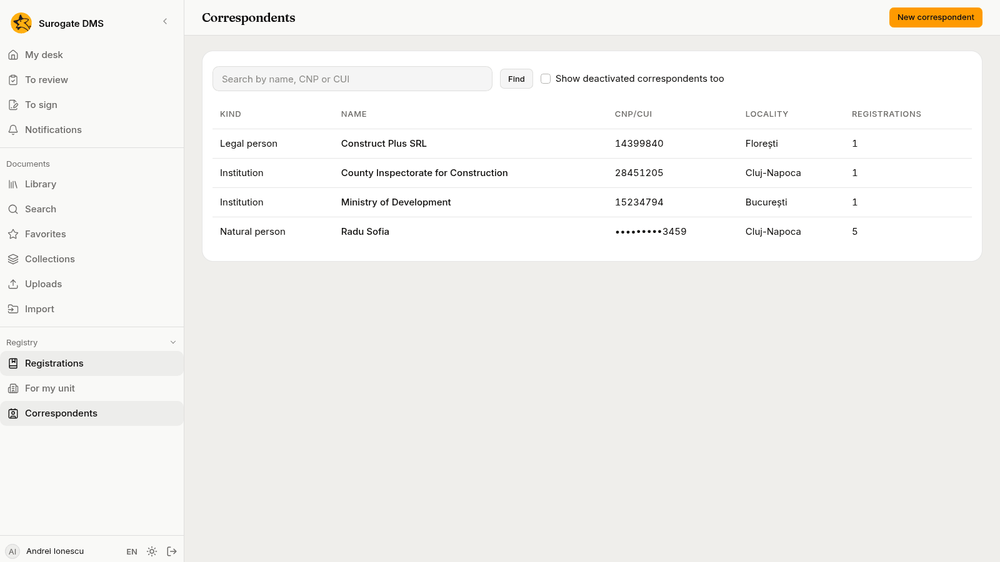
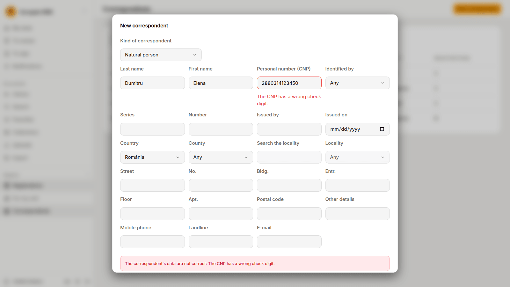

For staff who register: how to find the person, company or institution a registration comes from or goes to, how to add one, what the checks on a CNP and a CUI say, and how to change or deactivate a row.

## The directory

A **correspondent** is the person, company or institution a registration comes from or goes to. The directory keeps one row for each, so the next registration finds it by searching. A registration keeps the copy of the correspondent as it was when you saved it. When the row has changed since, the page of the registration says "The directory's data changed since."

## Find a correspondent

In the registration form, type in **Search by CNP, CUI or name**. The DMS offers up to twenty rows. A CNP or a CUI finds its row exactly. A name finds the rows with a word that starts with what you typed, whatever the case and the accents. Use the button **Choose** beside a row to pick it, and **Change** to go back to the search.

**Registry** › **Correspondents** lists the whole directory.

Search by name, CNP or CUI and choose **Find**. **Show deactivated correspondents too** adds the rows that were switched off. A row opens a page with the details and **This correspondent's registrations**. You see the page of **Correspondents** if you may register documents, manage the registers or see the personal-data register.

## Add a correspondent

Choose **New correspondent** in the directory or in the registration form, then the **Kind of correspondent**:

- **Natural person**: **Last name**, **First name**, **Personal number (CNP)**, and the identity document: **Identified by** (**Old identity booklet**, **Identity card**, **Provisional identity card** or **Electronic identity card**) with its **Series**, **Number**, **Issued by** and **Issued on**.
- **Legal person** and **Institution**: **Name**, **Tax id (CUI)**, **Trade register number** and the **Legal representative**.

Then the address: the **Country** and, for Romania, the **County**. Choose the **Locality** from the list, which offers only the localities of the county you chose, or type in **Search the locality** to find one among many. Add the **Street**, **No.**, **Bldg.**, **Entr.**, **Floor**, **Apt.**, the **Postal code** (six digits in Romania), **Other details**, and the **Mobile phone**, **Landline** and **E-mail**.

### What the checks say

The **CNP** has 13 digits and is checked: its first digit, the date of birth, the county code, the serial number and the check digit. The **CUI** has two to ten digits, with or without `RO` in front, and a check digit. When a rule fails, the message says which one.

A CNP and a CUI can be in the directory only once. When you type one that is already there, the message in the registration form offers that row: use it instead of making a second.

## Change and deactivate

Open a row and choose **Edit** to correct its data. In a registration form, **Correct the details** changes the row for that registration and the next ones, and **Keep the details as they are** leaves it. The registrations already made keep the copy they were saved with.

A correspondent is never deleted. A person who may manage the registers can **Deactivate** a row: it is no longer offered in the search of the form, and its registrations keep it. **Activate** offers it again.

## What is recorded

Making, changing and opening a correspondent are written in the audit log with the id of the row, never with a name, a CNP or an address. See [The audit log](/dms/admin/audit-log/).
