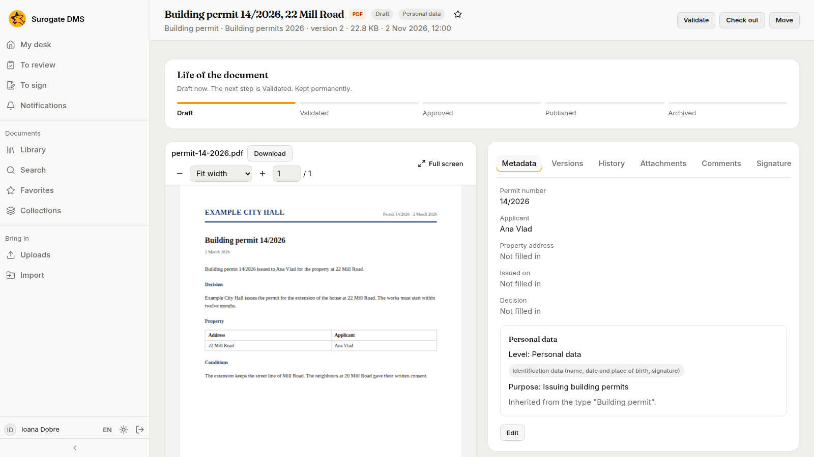
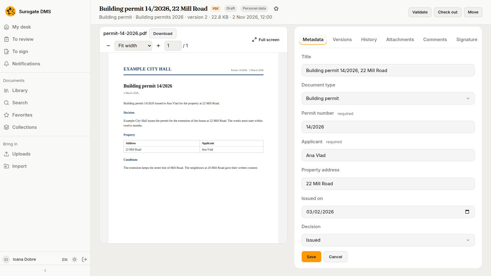
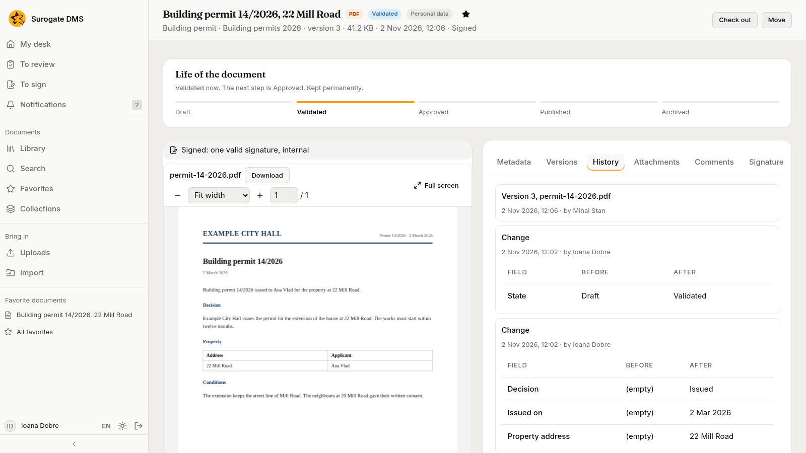
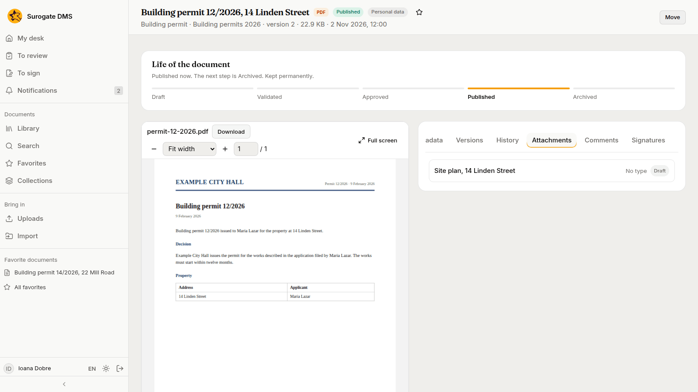
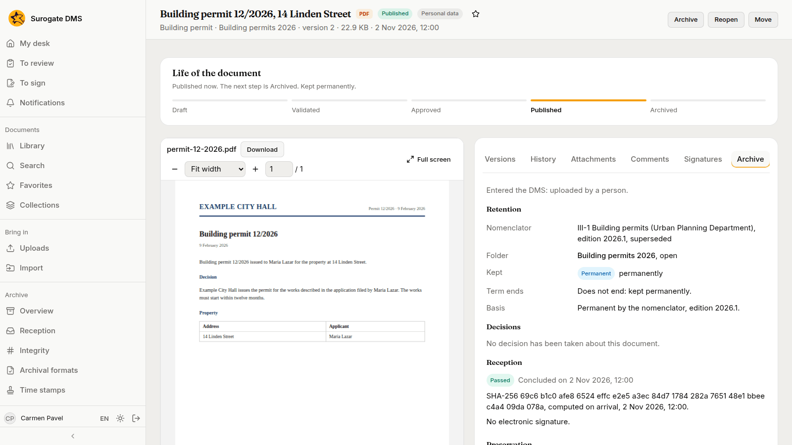
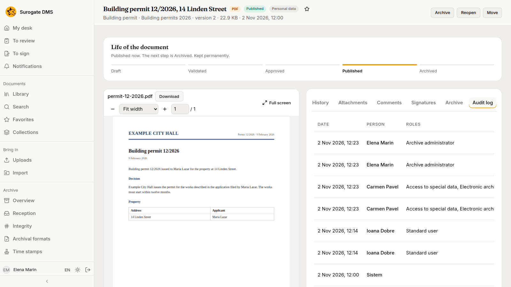

For everyone: the page of one document: its header, the card Life of the document, the viewer and the tabs on the right.

## The header

The header shows the title, the file's kind, the **state**, a **Personal data** pill when it applies, the star that makes the document a favorite, and a line with the type, the folder, the version, the size and the date. The buttons on the right are the ones you may use: **Validate**, **Approve**, **Publish**, **Archive** or **Reopen**; **Check out**; **Move**. A document that a registration holds shows the line **Registered as** with its numbers under the header: see [Registering documents](/dms/work/registry/). A document that was filed from a capture says "Captured through {channel} on {date}", with the channel and the date filled in. One whose data failed a check at capture shows **Not conforming at capture**: see [Checking the data read from forms](/dms/work/capture-validate/#the-document-afterwards).

## The viewer

The viewer shows the file page by page. Its toolbar zooms and moves between pages, and **Full screen** fills the window; Escape leaves it. **Download** saves the file. See [Viewing, editing and versions](/dms/work/versions/).

## The tabs

| Tab | What it holds |
|---|---|
| **Metadata** | The type and the values of the document, and **Edit** to change them. Fields the type requires are marked "required"; empty ones read "Not filled in". |
| **Versions** | Every saved file of the document |
| **History** | What happened to the document, newest first |
| **Attachments** | Documents attached to this one |
| **Comments** | Remarks by colleagues |
| **Signatures** | The signatures and refusals of each version, and the buttons to ask for or give a signature |
| **Workflows** | The Keel cases and processes that hold the document |
| **Archive** | How long the document is kept and why, and its reception and preservation |
| **Audit log** | For people who may consult the audit log: the entries about this document |

The tab **Workflows** is there when your institution connected the DMS to Keel. See [Workflows and cases with Keel](/dms/work/workflows/).

### Edit the metadata

Press **Edit**, change the title, the type or the values, and press **Save**. A change is possible while the document is a draft or validated. Changing the type to one with a default folder can move the document there.

### History

Each line says what changed, who changed it and when, with the value before and after.

### Attachments

A document can have other documents attached to it, for example a contract and its annex. **Attach** chooses a document you may read; **Detach** removes the link. A document takes attachments only while it is a draft or validated.

### Archive

The **Archive** tab says why and for how long the document is kept: the nomenclator entry of its dosar, the dosar and whether it is open, the term as **Kept** and **Term ends**, how the document **Entered the DMS**, and the result of its reception.

### Audit log

People who may consult the audit log see the entries about the document in a last tab.

