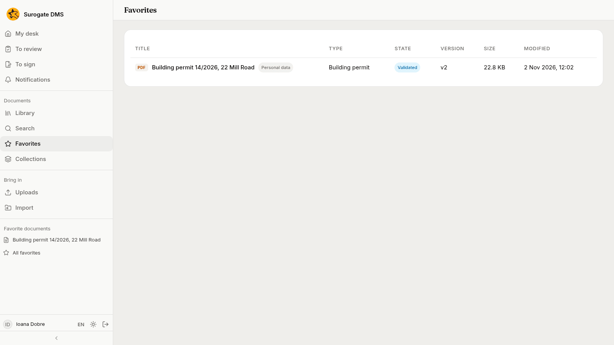
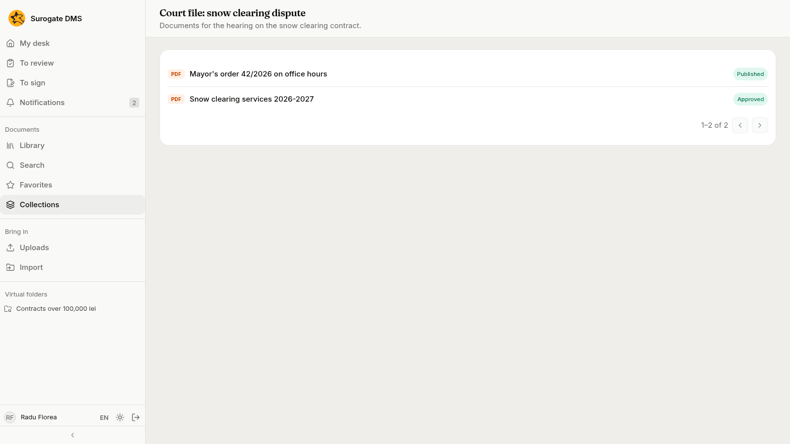
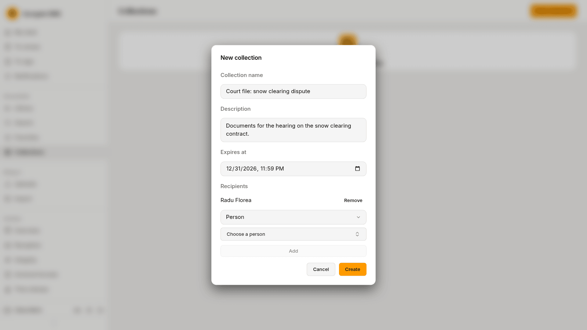

For everyone: keeping documents you use often within reach, and the collections your colleagues share with you.

## Favorites

Press the star beside a document's title, or **Add to favorites** in a row's menu, to mark it. Press it again to unmark it.

Your favorites appear in two places: under **Favorite documents** in the sidebar, which lists the first eight, and on the **Favorites** page, which lists them all.

A favorite is yours alone. If you lose the right to read a document, it drops out of your list.

## Collections

A collection gathers documents from different folders for some people for a limited time, for example the documents of a court file. **Collections** in the sidebar lists the ones you belong to.

While a collection has not expired, a member may, for each document in it, read it, download it, see its versions, history and attachments, compare versions and comment. Nothing more: no editing, no new version, no change of state. Access stops by itself when the collection expires. A collection does not open a document with personal data to someone who is not cleared for it.

### Make a collection

People who hold the permission **Manages collections** press **New collection**, fill in the **Collection name**, a **Description** and the date it **Expires at**, add the **Recipients** (each a **Person**, a **Position** or a **Unit**, with **Add**) and press **Create**. They add documents from the collection's page.

