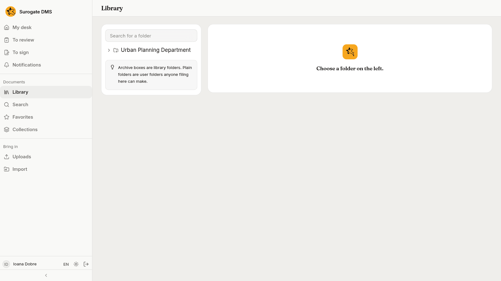
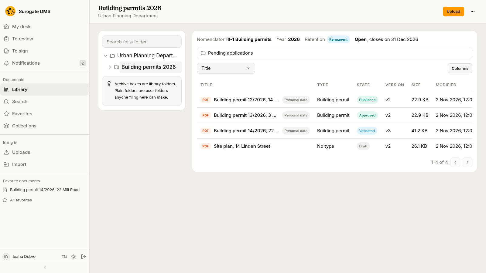
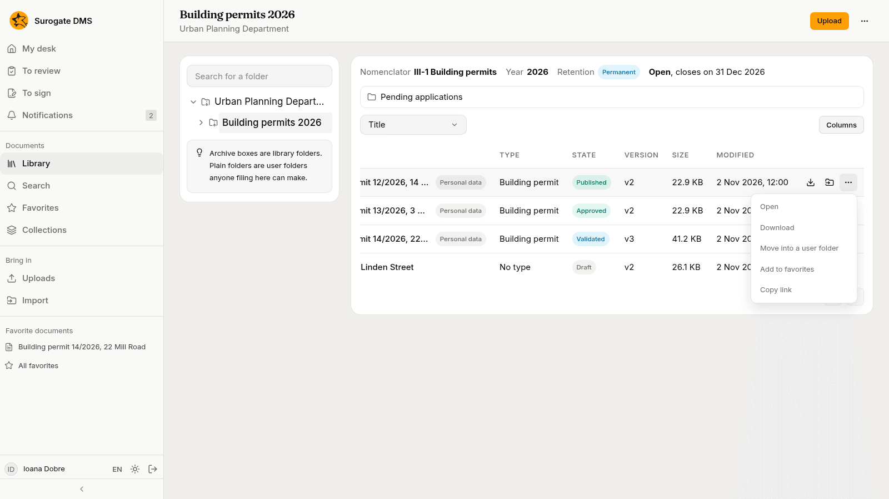
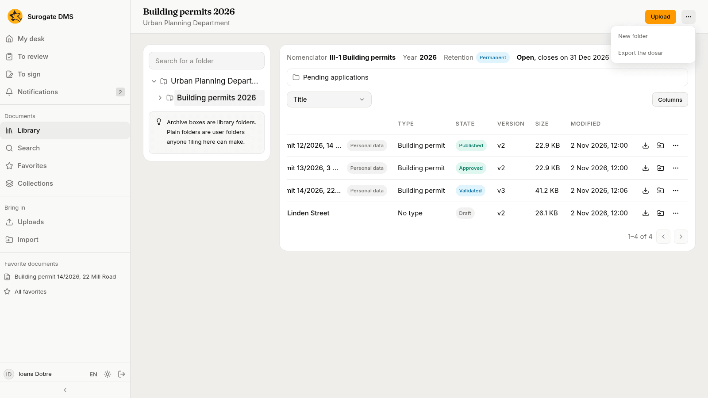
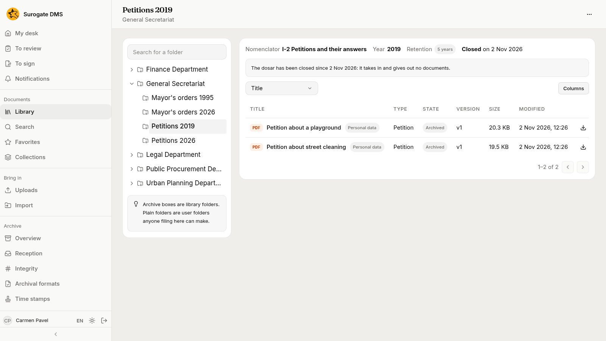

For everyone who files or reads documents: the folder tree, a folder's page and the folders you make yourself. The Library lists only the folders you may read.

## Find a folder

On the left is the tree of folders. Press the arrow beside a folder to open it; type in **Search for a folder** to find one by name.

## A folder's page

At the top of a dosar's page are its facts: the **Nomenclator** entry, the **Year**, the **Retention** and whether it is open or closed. Under them is the table of documents with the columns **Title**, **Type**, **State**, **Version**, **Size** and **Modified**. **Columns** chooses what the table shows and the box at the left sorts it. A user folder inside the dosar is listed above the table.

Each row has buttons to download the document, **Move into a user folder** and **More actions**.

The **Folder actions** menu at the top right of a page lists what you may do with the folder: **New folder**, and **Export the dosar**. People who manage dosare also see **Hold the dosar**, **Close the dosar** and **Choose the nomenclator entry**.

## User folders

Anyone who may add documents to a library folder can make a **New folder** inside it to arrange their files, and folders nest as deep as you like. A user folder is not private: everyone who can open the library folder sees it and its documents, with the same access.

## Closed dosare

A closed dosar takes in and gives out no documents: the page says "The dosar has been closed since" with the date. Its documents are still there to read. See [Folders and dosare](/dms/admin/folders/) for closing and reopening.

## Moving documents

**Move into a user folder** on a row moves a document within its library folder, and needs the right to edit documents there. **Move** on a document's page moves it to another folder and needs the right to move documents. An archived document cannot be moved.
