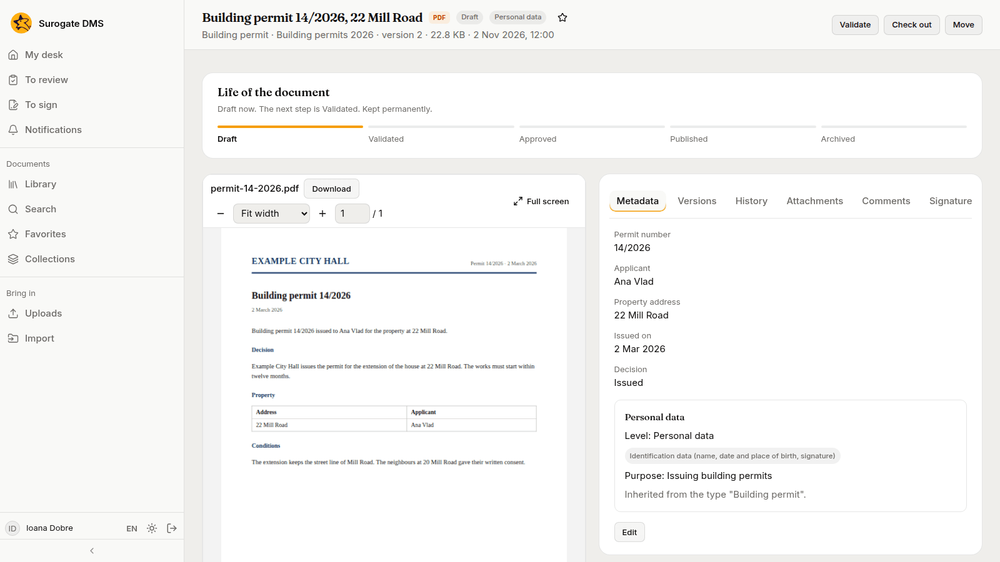
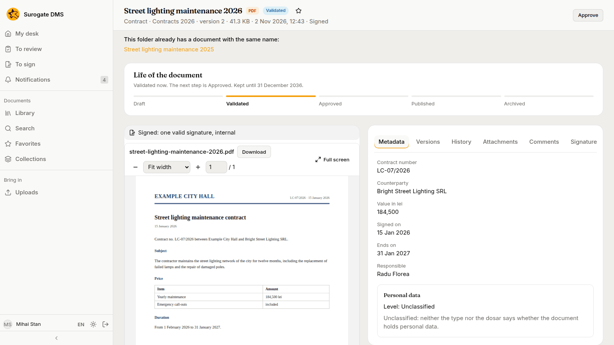
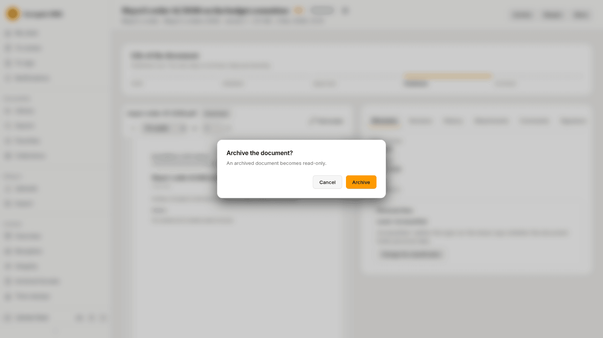

For everyone: the five states a document passes through, the button for each step and who holds it. A person moves a document on by hand; nothing routes it to someone.

## The states

| State | Meaning |
|---|---|
| **Draft** | Where every new document starts. Its content can change. |
| **Validated** | Someone has checked that the type and the metadata are complete. Its content can still change. |
| **Approved** | Someone with the right has approved it. Its content is fixed. |
| **Published** | Released for use. Its content is fixed. |
| **Archived** | Closed. Its content, metadata and place are fixed; people can still comment on it. |

The card **Life of the document** on the document page shows the state, what the next step is and how long the document is kept.

## The steps

| From | To | Button | Held by default by |
|---|---|---|---|
| Draft | Validated | **Validate** | Standard user, Electronic archivist, Archive administrator |
| Validated | Approved | **Approve** | Electronic archivist, Archive administrator |
| Approved | Published | **Publish** | Electronic archivist, Archive administrator |
| Approved or Published | Archived | **Archive** | Electronic archivist, Archive administrator |
| Validated, Approved or Published | Draft | **Reopen** | Electronic archivist, Archive administrator |

The last column lists the built-in roles; your administrator may have changed them or made others, such as an Approver who validates, approves and publishes. You see only the buttons you may use, and a step cannot be skipped. A role can be limited to a unit, to some document types or to some states.

## Rules for every step

- You must be able to read the document, and it must not be checked out.
- **Validate** needs a type and its required fields. The page says what is missing.
- **Archive** asks "Archive the document?" first and warns that an archived document becomes read-only. It also needs the document's file to have passed its reception, which the **Archive** tab of the document shows.
- If a colleague moved the document first, the step is refused and the page reloads with the buttons that fit.

Every change of state is written to the **History** tab and to the audit log.

## What each state allows

| Action | Draft | Validated | Approved | Published | Archived |
|---|---|---|---|---|---|
| Read, download, compare versions | yes | yes | yes | yes | yes |
| Comment | yes | yes | yes | yes | yes |
| Edit title, type and metadata | yes | yes | no | no | no |
| Add a version or go back to one | yes | yes | no | no | no |
| Attach or detach a document | yes | yes | no | no | no |
| Check out | yes | yes | no | no | no |
| Move to another folder | yes | yes | yes | yes | no |
| Ask for signatures, sign or refuse | yes | yes | yes | yes | no |
