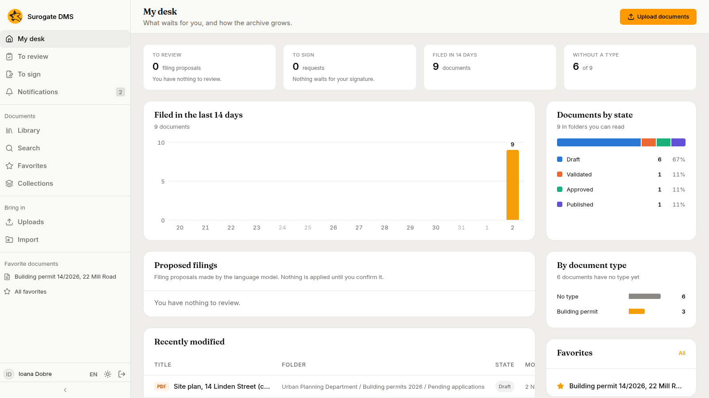
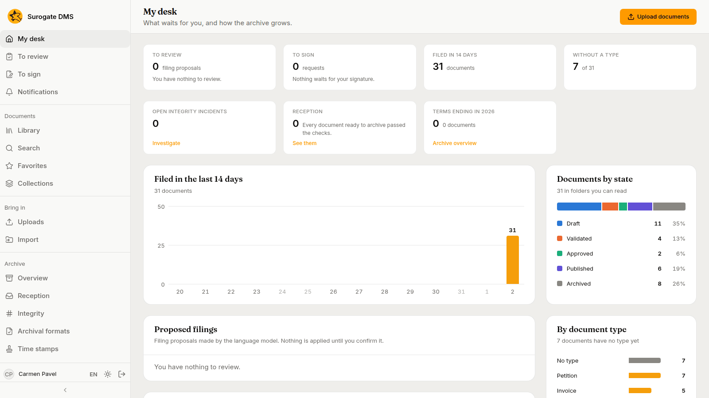

For everyone: the first page after signing in. It shows what waits for you, how many documents were filed lately and the documents changed last. Every count covers only the documents you may read.

## The counts at the top

| Count | What it is |
|---|---|
| **To review** | Filing proposals waiting for a decision, where your installation makes them |
| **To sign** | Signing requests waiting for you |
| **Filed in 14 days** | Documents filed in the last 14 days |
| **Without a type** | Documents that have no type yet, out of all you may read |

## The charts and lists

- **Filed in the last 14 days**: one bar for each day.
- **Documents by state**: one bar split by state, with each state's count and share.
- **By document type**: the types with the most documents, and **No type**.
- **Proposed filings**: the proposals waiting for a decision.
- **Recently modified**: the documents changed last, with their folder and state. A title opens the document.
- **Favorites**: your favorite documents, with **All** for the Favorites page.

**Upload documents** at the top right opens the Library, where you choose the folder to upload to.

## For archivists and administrators

People with the right roles see more tiles: the terms ending this year with **Archive overview**, **Reception**, and the open integrity checks.

Opening My desk is not recorded in the audit log.
