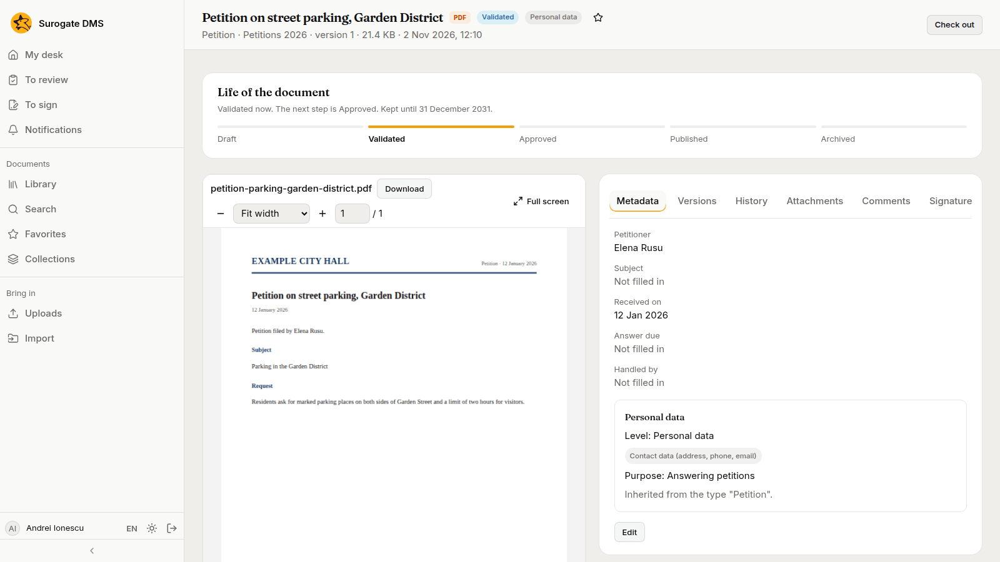
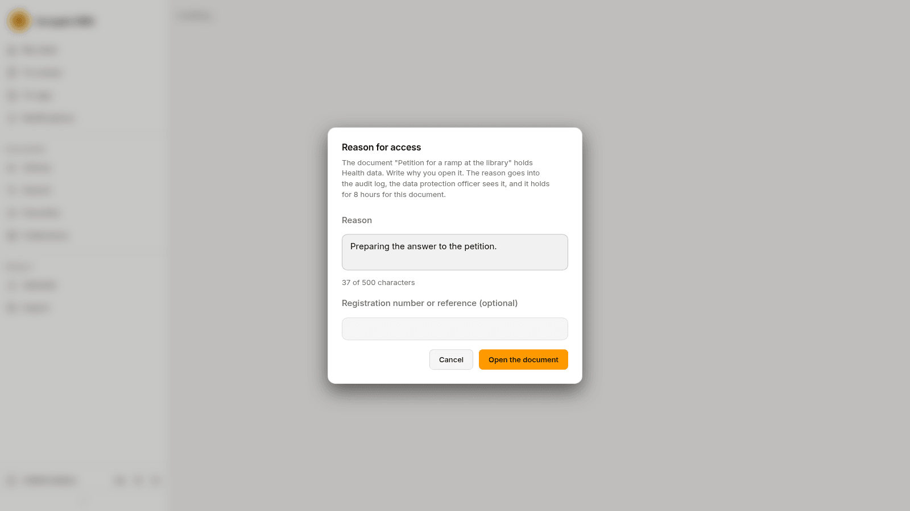
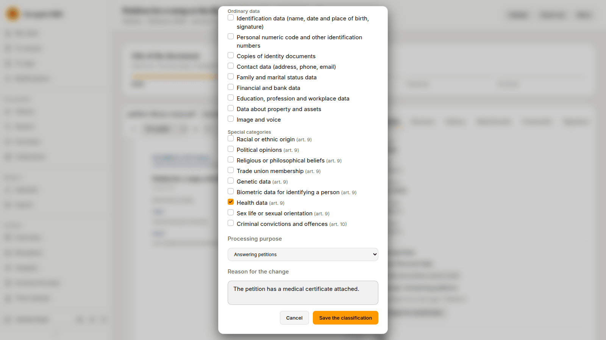
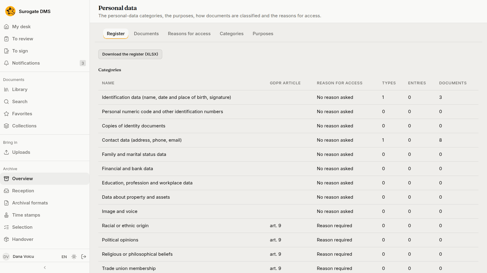
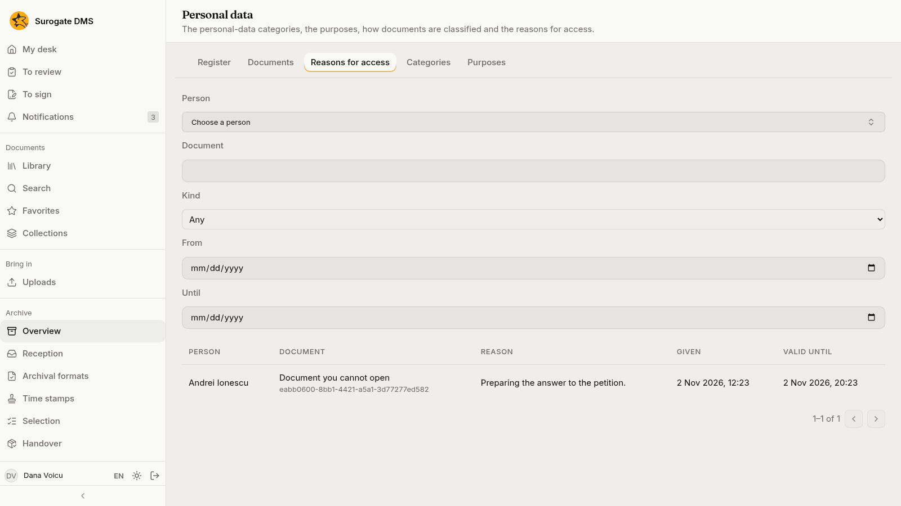
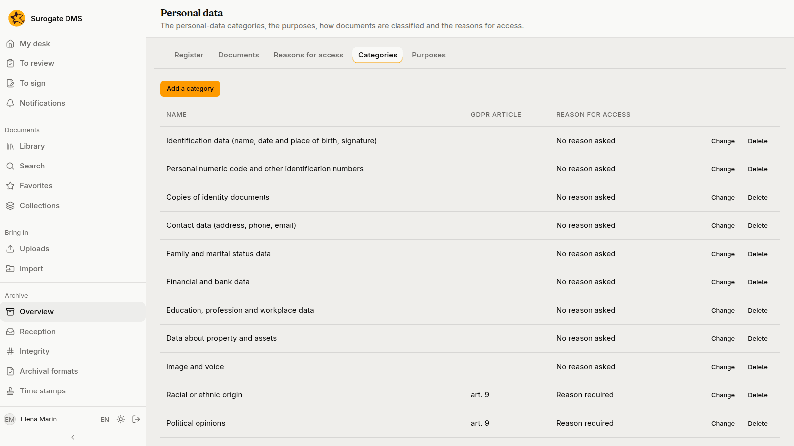
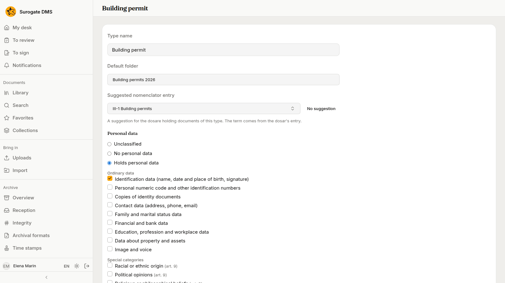

For everyone who opens documents: how a document that holds personal data looks, when the DMS asks why you open it, and who classifies documents. People who protect personal data find their pages at the end.

## What you see

A document that holds personal data carries a **Personal data** pill beside its title. Its **Metadata** tab ends with a **Personal data** card: the level, the categories of data and the purpose, and where they come from: the document's type, its dosar or a person's classification.

Opening such a document needs the permission **Access to documents with personal data**; the built-in role Standard user holds it. Special categories, such as health data, need **Access to documents with special data** as well.

## The reason for access

For some categories the DMS asks you to write why you open the document. The reason goes into the audit log, the data protection officer sees it, and it holds for 8 hours for that document. Write it in **Reason**, add a registration number or reference if there is one, and press **Open the document**.

## Classify a document

A document's personal data is usually inherited from its type and its dosar. People who hold **Classifies a document's personal data** can change it: **Change the classification**, choose **Inherited**, **No personal data** or **Holds personal data**, tick the categories and the processing purpose, write the **Reason for the change** and press **Save the classification**.

## For the data protection officer and administrators

**Archive** › **Personal data** has the tabs **Register**, **Documents**, **Reasons for access**, **Categories** and **Purposes**.

- **Register** lists the categories with the types, entries and documents that hold them, and **Download the register (XLSX)** saves it.
- **Reasons for access** lists who opened which document, why, when, and until when the reason holds. The data protection officer does not read the documents, so each reads "Document you cannot open".
- **Categories** and **Purposes** are the lists the classifications use. An administrator who holds **Manages the personal-data categories, the purposes and the defaults** adds, renames and removes them, and sets whether a category asks for a reason.

A type or a nomenclator entry can carry a default classification, so documents are classified when they are filed. See [Document types](/dms/admin/document-types/).

