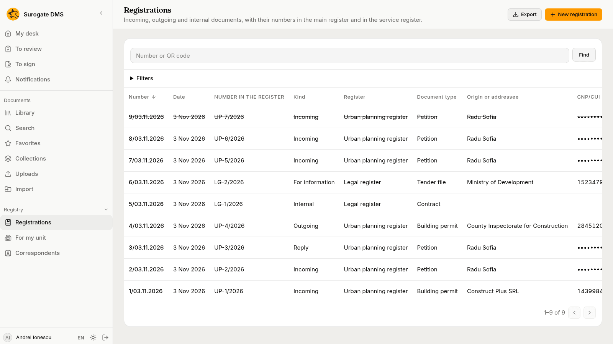
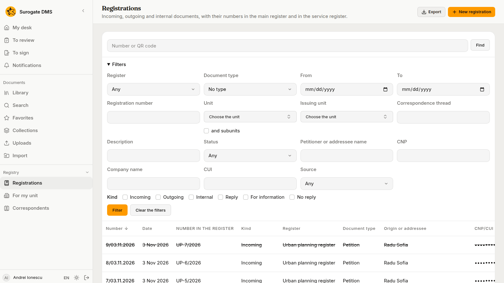
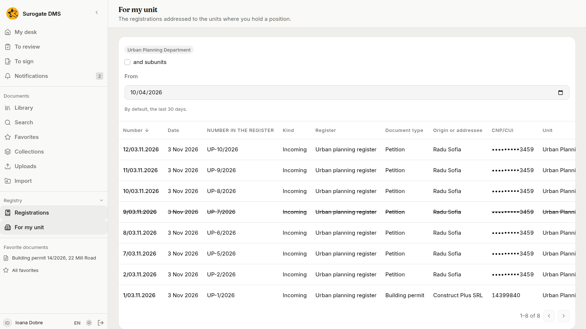

For staff who look for a registration: the list and its filters, the field for a number or a QR code, the export and the printed register, and the list of what is addressed to your unit.

## The list

**Registry** › **Registrations** lists the registrations you may read, newest first: those in the registers kept by a unit where you hold the right, those that name such a unit, and those you registered yourself.

The columns are **Number**, **Date**, **Number in the register**, **Kind**, **Register**, **Document type**, **Origin or addressee**, **CNP/CUI**, **Unit**, **Description**, **Thread** and **Status**. Click a heading to sort by it. A cancelled registration is struck through and marked **Cancelled**. The list shows a CNP as its last four digits and a CUI in full. The last column, **Actions**, has **Open**, **Print the receipt** and, where you may use them, **Reply**, **Add to the thread** and **Cancel the registration**.

## Find by number or by QR code

Type a number in **Number or QR code** and choose **Find**. The number may be written in any of its forms: `12/03.11.2026` from the main register, or `UP-10/2026` from a service register. A receipt carries a QR code: a scanner types its content into the same field. When one registration matches, its page opens.

## Filters

Choose **Filters** to narrow the list. The filters apply together:

- **Register**, **Document type**, **From** and **To**, **Registration number**.
- **Unit**, with **and subunits**, and **Issuing unit**.
- **Correspondence thread**, **Description** and **Status**.
- **Petitioner or addressee name**, **CNP**, **Company name** and **CUI**.
- **Source**, and **Kind**: **Incoming**, **Outgoing**, **Internal**, **Reply**, **For information**. **No reply** keeps only the incoming registrations that nobody has answered.

Choose **Filter** to apply them and **Clear the filters** to start again. The filters are kept in the address of the page, so you can send the link to a colleague.

A search by name, CNP or CUI is written in the audit log with the names of the filters and the number of rows it found, never the values you typed.

## Export and print

**Export** saves what the filters show as **CSV** or **XLSX**. An export holds at most 100,000 registrations; when the list is longer the DMS says so and you narrow the filters.

**Print the register** saves a PDF of the registrations of one register for a period. Filter the list by one register and choose **Print the register**, then choose **From** and **To**. An administrator can also print from the register's card on the **Registers** page. The period is at most 400 days and ends today at the latest. A print holds at most 2,000 registrations: for more, choose a shorter period or export to XLSX.

## For my unit

**Registry** › **For my unit** lists the registrations addressed to the units where you hold a position in the org chart. By default it shows the last 30 days: change **From** to look further back. **and subunits** adds the units below yours.

If you hold no position, the list is empty and says "You hold no position in the org chart, so the unit's list is empty." Ask your administrator to put you in a unit of the org chart.
