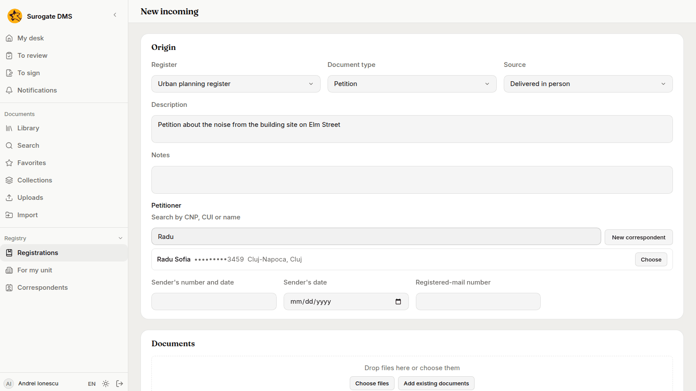
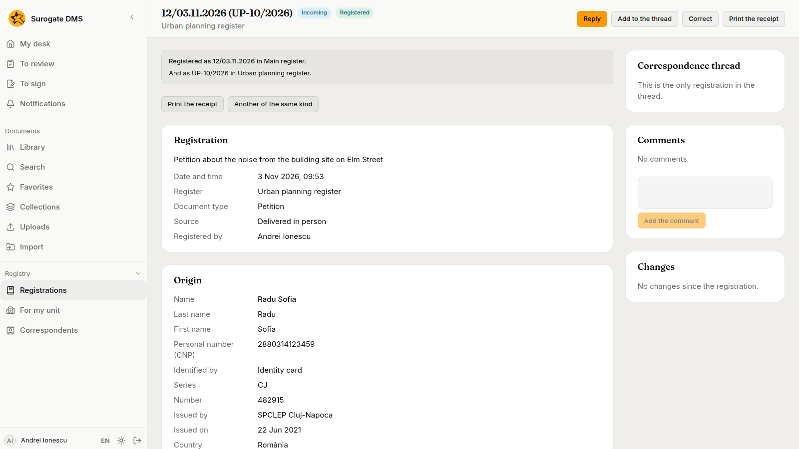
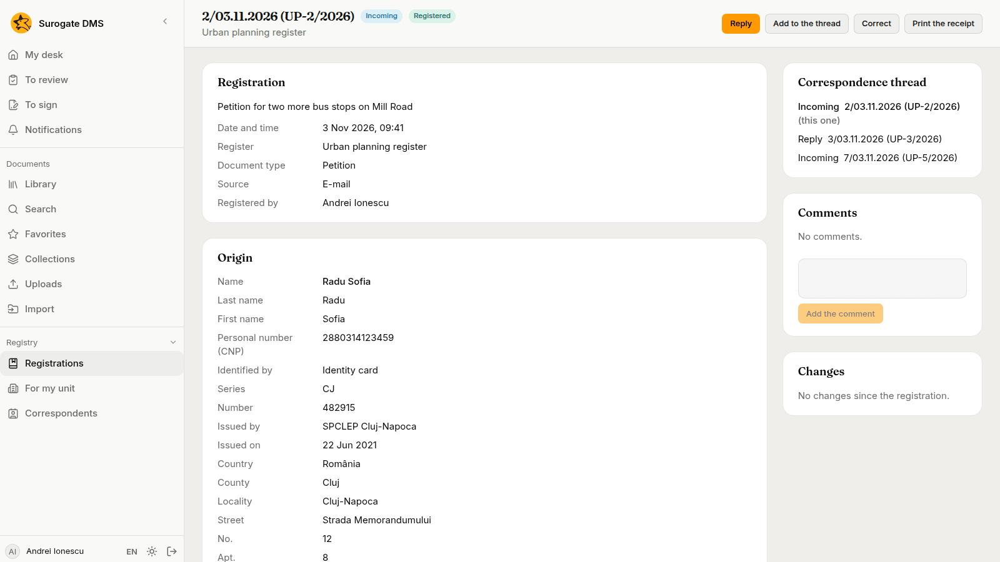
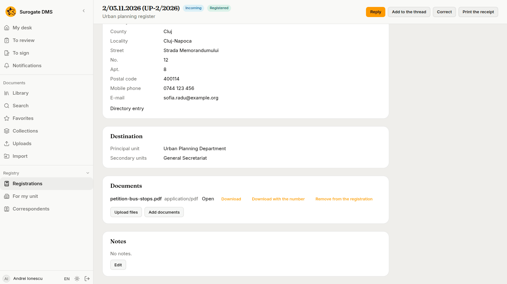
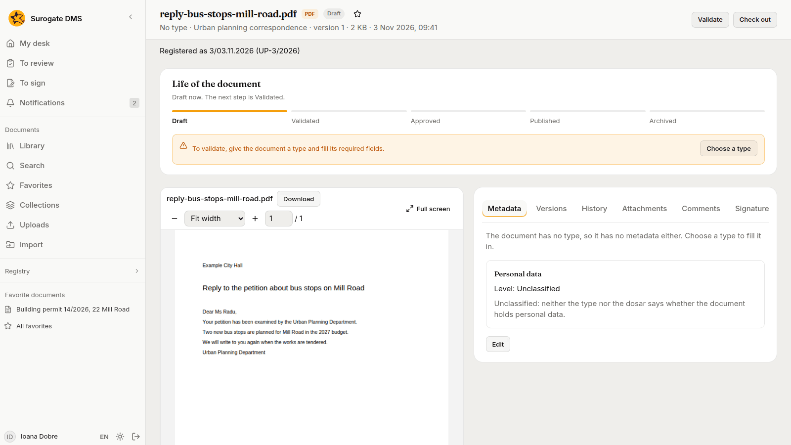
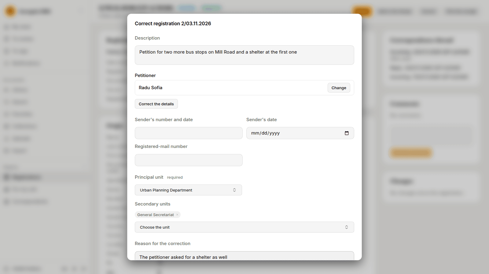
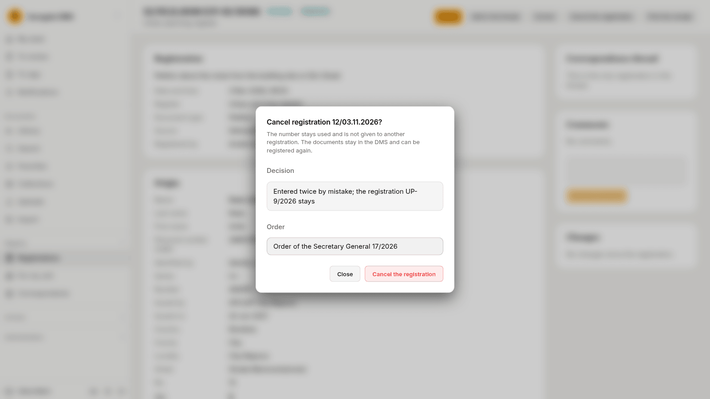

For staff who register the documents that come in, go out or stay inside the institution: how to register one, read its numbers, reply to it, correct it and cancel it.

## What a registration is

A registration gives a document a number. Every registration takes a number in the **main register** of the institution, such as `12/03.11.2026` (the number, then the day it was given). When it is made in a **service register**, kept by one unit, it also takes a second number from that register, such as `UP-10/2026`. The numbers are given when you save and never change. A number that was used is not given to another registration, even if the registration is cancelled.

There are five kinds of registration:

| Kind | What it is | Who it concerns | Units it names |
|---|---|---|---|
| **Incoming** | A document that arrives. | The **Petitioner**, required. | The **Principal unit** it is for, required. |
| **Outgoing** | A document that leaves. | The **Addressee**, required. | The **Issuing unit**, required. |
| **Internal** | A document between two units. | None. | The **Issuing unit** and the **Principal unit**, both required. |
| **Reply** | The answer to an incoming registration. | The **Addressee**: the petitioner of the incoming registration unless you choose another. | The **Issuing unit**, required. |
| **For information** | A document to be read, with no answer expected. | The **Sender**, optional. | The **Principal unit**, required. The **Issuing unit** is optional. |

An incoming, outgoing or reply registration also asks for the **Source**: **E-mail**, **Post**, **Courier**, **Delivered in person** or **Portal**.

The **Registry** section of the sidebar holds **Registrations**, **For my unit** and **Correspondents**. A registration is read by the people who hold the right in a unit it names and by the person who registered it. See [Finding registrations](/dms/work/registry-lists/).

## Register a document

1. In **Registry**, open **Registrations**, choose **New registration** and then the kind: **New incoming**, **New outgoing**, **New internal** or **New for information**. To answer an incoming registration, open it and choose **Reply**. To add a registration to the thread of another one, open that one and choose **Add to the thread**.
2. In the first card, choose the **Register**. Only the registers you may register in for this kind are offered, and the one you used last comes first. Then choose the **Document type**, which is one of that register's types, and the **Source**.
3. Write the **Description** and, if you need to, the **Notes**.
4. Choose the correspondent: type a CNP, a CUI or a name in **Search by CNP, CUI or name** and use the button **Choose** beside the right row. If the person or company is not in the directory, choose **New correspondent**. See [Correspondents](/dms/work/correspondents/).
5. Fill in the numbers the kind asks for: **Sender's number and date**, **Sender's date** and **Registered-mail number** for an incoming registration or one for information, **Registered-mail number** and **Date sent** for an outgoing registration or a reply.
6. In **Documents**, drop the files or choose them with **Choose files**. **Add existing documents** links documents that are already in the DMS and that you may read. For each file the form asks for the fields of the type, such as **Received on** for a petition.
7. In **Destination**, choose the units the kind needs and, if other units should get a copy, the **Secondary units**.
8. Choose **Register**. If something is missing or refused, the form lists "To fix before registering:" and nothing is numbered until it is right.

When you save, the page of the registration opens with the two numbers: "Registered as 12/03.11.2026 in Main register. And as UP-10/2026 in Urban planning register." The files are sent after that, so a number never waits for a large file. If a file fails, add it again from the page of the registration with **Upload files**.

**Print the receipt** makes a PDF with both numbers, the register, the kind, the name of the correspondent, the units and a QR code. The receipt never shows a CNP, an identity document or an address. **Another of the same kind** opens a new form with the same register, type and source.

## The page of a registration

The page shows the number or numbers in the header, with the kind and the status, and the buttons you may use: **Reply** (on an incoming registration), **Add to the thread**, **Correct**, **Cancel the registration** and **Print the receipt**. The cards are **Registration**, the correspondent (**Origin** or **Addressee**, as it was saved), **Destination**, **Documents** and **Notes**, and on the right **Correspondence thread**, **Comments** and **Changes**. When the correspondent has been changed in the directory since, the card says "The directory's data changed since."

### Documents

- **Open** and **Download** give the file as it is stored.
- **Download with the number** makes a copy of a PDF with the registration's number stamped on its first page. The copy is made when you ask and is not kept. The stored file is never changed. A file that is not a PDF, an encrypted PDF and a file with signatures get no numbered copy, because the stamp would break the signature. Download the original and the receipt instead.
- **Remove from the registration** asks for a reason. The line stays on the page and says who removed the document, when and why.
- **Upload files** and **Add documents** add more. A registration holds at most 100 documents, and a document belongs to one registration at a time.
- A document that a selection deleted shows as "Document eliminated" with its date.

Uploaded files go to the folder of the register. If the register has no folder, the DMS says so and the administrator chooses one in **Registers**. See [Registers and address lists](/dms/admin/registers/).

### Who reads the documents

While a registration is registered, the people of the units it names can read the documents linked to it, even when the folder is not theirs, if they could read documents of that type. The lending gives reading and nothing else: they cannot edit, comment, move or sign. It ends when the registration is cancelled, when the document is removed from the registration and when the document is deleted. The registration's page says "You read it because the registration lends it to your unit." beside such a document.

The page of the document says which registration holds it.

### The thread

Every registration belongs to a thread. A reply joins the thread of the incoming registration it answers, and any other kind can be added to a thread with **Add to the thread**. The card **Correspondence thread** lists the registrations of the thread in order and marks the one you are on. One you may not read shows only as "A registration you cannot read."

### Comments and notes

Write a remark under **Comments** and choose **Add the comment**. A comment has between 1 and 2,000 characters and cannot be changed afterwards. The **Notes** card changes in place with **Edit**.

### Correct a registration

Choose **Correct** to change the description, the correspondent, the units and the numbers of the sender and of the registered mail. Write the **Reason for the correction** (3 to 500 characters). Each correction is kept in the **Changes** card with who made it, when, which fields it touched and why.

The kind, the register, the type, the numbers and the registration a reply answers cannot be corrected. If one of them is wrong, cancel the registration and register it again. If someone changed the registration while you had it open, the DMS says who ("The registration was changed meanwhile by …") and you make the correction again from the new state.

### Cancel a registration

**Cancel the registration** is there for people who hold **Cancels registrations**. The dialog asks for the **Decision** (at least 10 characters) and the **Order** that gives effect to it.

The numbers stay used and are not given to another registration. The documents stay in the DMS and can be registered again. Nobody can reply to, add to the thread of or correct a cancelled registration. In the list it is struck through and marked **Cancelled**, and its page has a **Cancellation** card with who cancelled it, when, the decision and the order.

## When something is refused

| What the DMS says | Why | What to do |
|---|---|---|
| You cannot register this kind of document in any register. | No register of a unit where you hold **Registers documents** takes this kind. | Ask your administrator for the right, or for a register that takes it. |
| The register "…" does not accept documents of the type "…". | The register has a fixed list of types. | Choose one of its types or another register. |
| The register "…" does not accept registrations of the kind …. | The register was set up for other kinds. | Choose another register. |
| The register "…" is not active. | An administrator switched it off. | Choose another register, or ask for it to be switched on. |
| The document "…" is already in registration …. | A document belongs to one registration at a time. | Remove it from that registration first, or cancel that registration. |
| A registration holds at most 100 documents. | The limit is reached. | Register the rest in a second registration of the same thread. |
| The registration was changed meanwhile by …; reload the page and make the correction again. | Someone corrected it while you had it open. | Reload the page and correct again. |
| Write the decision (at least 10 characters) and the order or instruction that gives effect to the cancellation. | The cancellation needs both. | Fill in both fields. |
| The registration does not exist or you may not read it. | The link is wrong, or no unit you hold a right in is named by it. | Ask the person who registered it. |
