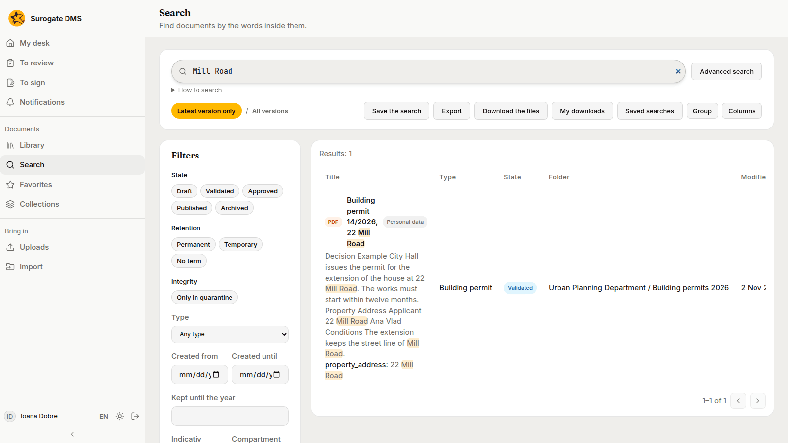
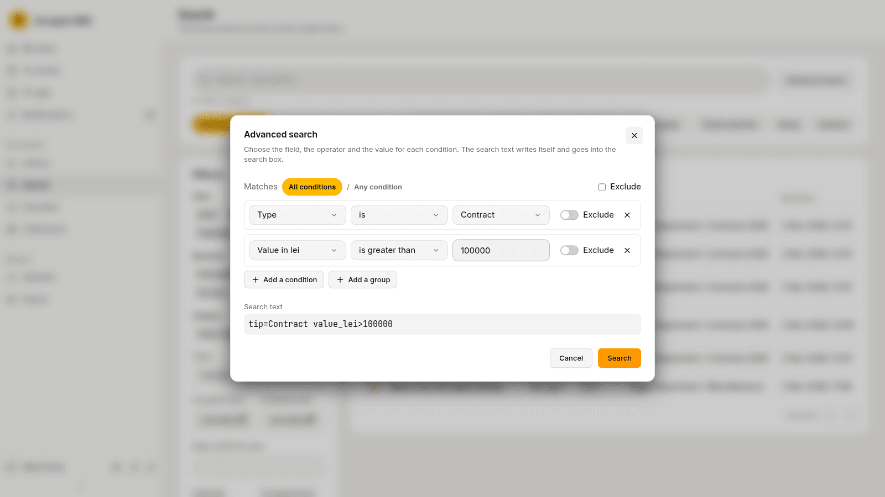
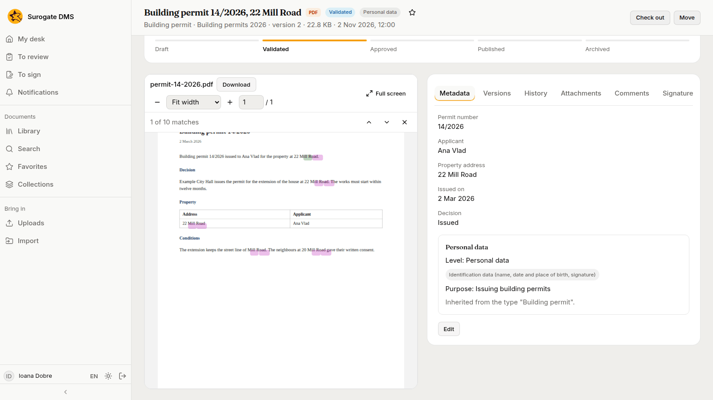
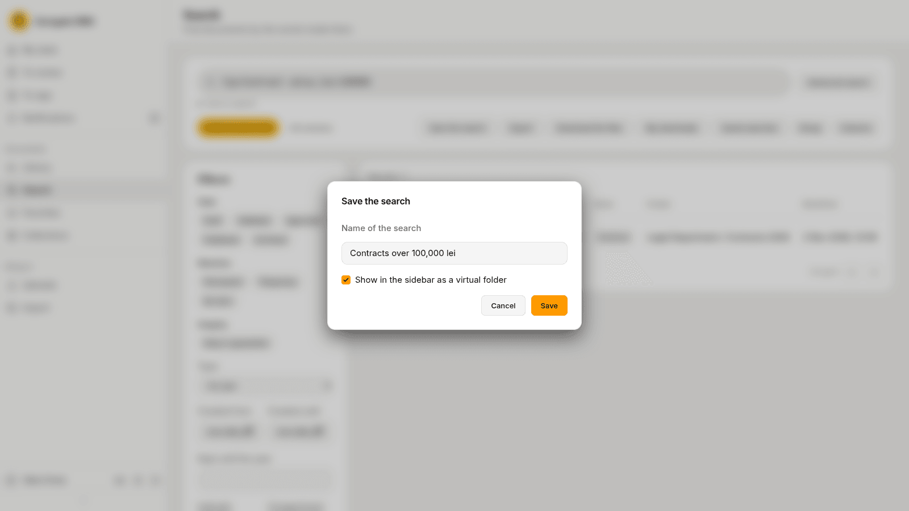
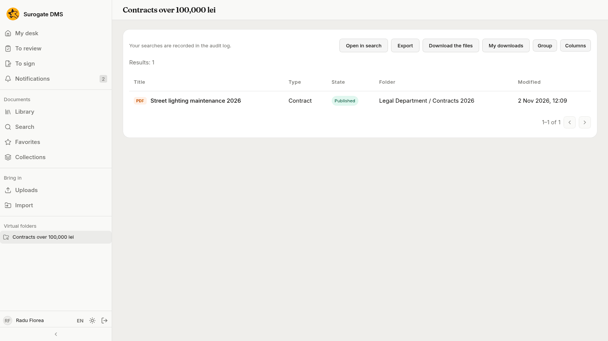

For staff who look for documents: the search box and the words it understands, the filters, the advanced builder, and saved searches that appear in the sidebar. Search finds words inside the files as well as in titles and metadata.

## Search

Choose **Search**, type in the box and press Enter. Search shows only documents you may read. Open **How to search** under the box for what you can type.

### What to type

The card **Search tips** on the page lists the words the box understands. The field names are the ones the card prints.

| Type | To find |
|---|---|
| `a b` | both words |
| `a OR b` | either word |
| `-plata` | without the word |
| `"plata se face"` | the exact phrase |
| `titlu:raport` | the word in the title |
| `tip=Contract` | documents of a type |
| `creat>=01.10.2026` | documents by date |
| `semnat:da` | signed versions |
| `semnatar:"Ana Pop"` | what a person signed |
| `pastrare=permanent` | documents kept permanently |
| `pastrare_pana<=2030` | documents whose term ends by 2030 |
| `indicativ=II-1` | documents in dosare with that indicativ |
| `sursa:api` | documents filed through the API |
| `referinta="1234/2026"` | documents filed by another system with that reference |

What you type is kept in the audit log for 12 months; when the month is archived, the text is not kept.

## Filters

The **Filters** card narrows the results: **State**, **Retention**, **Type**, the dates **Created from** and **Created until**, **Kept until the year**, and **Indicativ** and **Compartment**. Each filter writes its part into the box.

**Latest version only** and **All versions** switch between the current version of each document and every version.

## Advanced search

**Advanced search** builds the query for you. Choose a field, an operator and a value for each condition, add more conditions or groups, and choose whether all or any must match. The search text writes itself and goes into the box.

## The results

The table shows the title, the type, the state, the folder and the date. **Columns** chooses the columns and **Group** groups the rows. **Export** saves the results, and **Download the files** prepares them as a download you find under **My downloads**.

Open a result and the viewer marks the matches; the bar over it says "1 of 10 matches" and steps through them.

## Save a search

**Save the search** keeps the query under a name. Tick **Show in the sidebar as a virtual folder** to find it under **Virtual folders** in the sidebar. **Saved searches** lists the ones you made.

