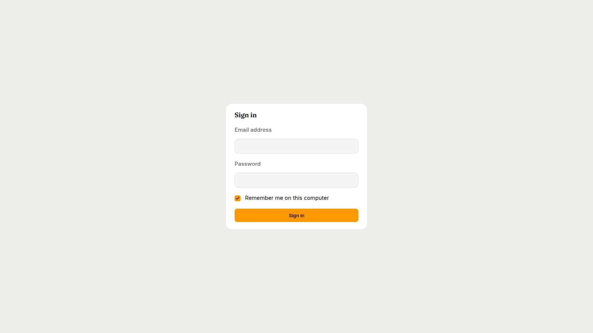
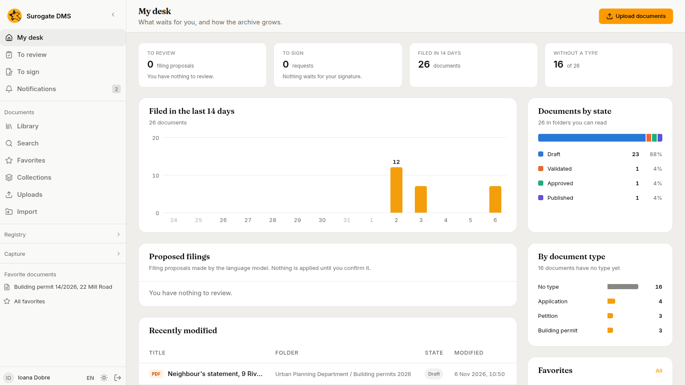
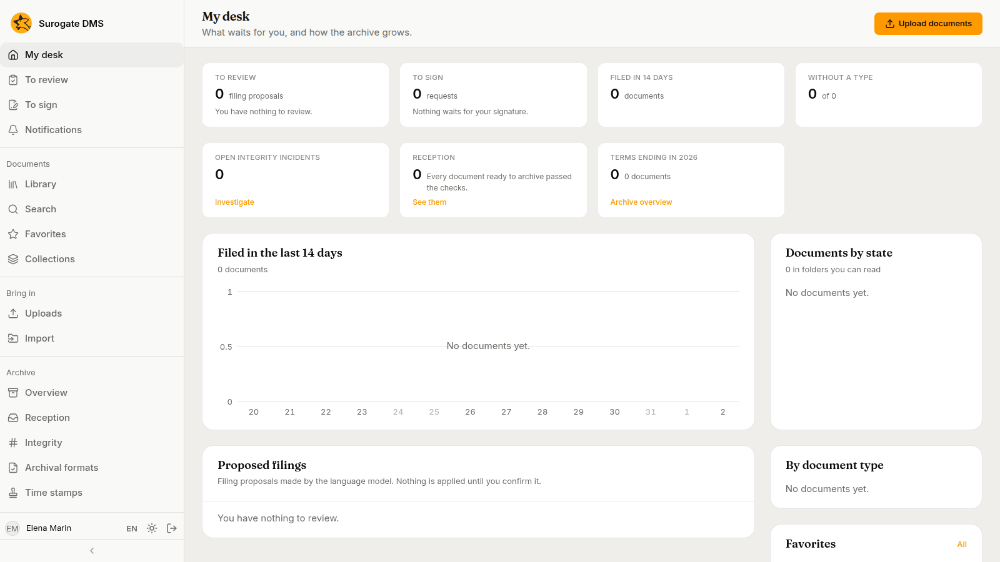

For everyone who uses the DMS: how to sign in, what the sidebar shows and which messages the sign-in page can give. Your institution has its own address for the DMS; your administrator gives it to you.

## Sign in

1. Open the address of the DMS.
2. Type your **Email address** and **Password**. They are the ones of your account in your institution's sign-in service; the DMS keeps no passwords and makes no accounts.
3. Leave **Remember me on this computer** ticked if the computer is yours, and untick it on a shared computer.
4. Press **Sign in**.

After you sign in you land on **My desk**, or on the page you had opened before. If your administrator added you before your first sign-in, your status is "Pending" until then, and the roles given to you work from that moment.

### Messages on the sign-in page

| Message | What to do |
|---|---|
| The email or the password is not correct. | Check both and try again. |
| Too many attempts. Wait a few minutes and try again. | Wait a minute and try again. |
| Sign-in is not available right now. Try again shortly; if it still does not work, tell the administrator. | Try again, then tell your administrator. |
| Your account does not belong to this institution. Ask the administrator to add you. | Ask your administrator. |
| Your account is deactivated. Ask the administrator to reactivate it. | Ask your administrator. |
| Your session has expired. Sign in again. | Sign in again. |
| You were signed out because you had not used the application for a while. Sign in again. | Sign in again. Unsaved text is lost. |

## The sidebar

The sidebar lists the pages your roles allow. A person who files documents and reads them sees the first two groups. The **Registry** group appears for people with a registry permission, the **Capture** group for people who may upload documents or work captures, and the **Archive** and **Administration** groups for people with the right roles. **Registry** and **Capture** are folded until you open them.

| Group | Pages | Who sees it |
|---|---|---|
| (no title) | **My desk**, **To review**, **To sign**, **Notifications** | Everyone |
| **Documents** | **Library**, **Search**, **Favorites**, **Collections**, **Uploads**, and **Import** for people who may file documents | Everyone, **Import** with the right to file |
| **Registry** | **Registrations**, **For my unit**, **Correspondents** | People with a registry permission; **Correspondents** also for people who may read the directory |
| **Capture** | **New capture**, **To process**, **To validate**, **My captures**, **Separator sheets** | **New capture** and **My captures** for people who may upload documents; all of them for people who hold **Process captures** |
| **Archive** | **Overview**, **Reception**, **Integrity**, **Archival formats**, **Time stamps**, **Selection**, **Handover**, **Procese-verbale**, **Personal data**, **Reports**, **Alerts** | People with archive, audit, personal-data or alert roles |
| **Administration** | **Document types**, **Folders**, **Nomenclator**, **Org chart**, **Roles and permissions**, **People**, **Signatures**, **Audit log** | Administrators and auditors, each page by its own permission |

A first administrator sees every group.

Under the groups the sidebar lists your **Favorite documents** and your **Virtual folders**, when you have any. At the bottom are your name, the language button (**EN** or **RO**), the theme button and **Sign out**.

## Sign out

Press **Sign out** at the bottom of the sidebar. The DMS also signs you out after 30 minutes without use, with the message above.
