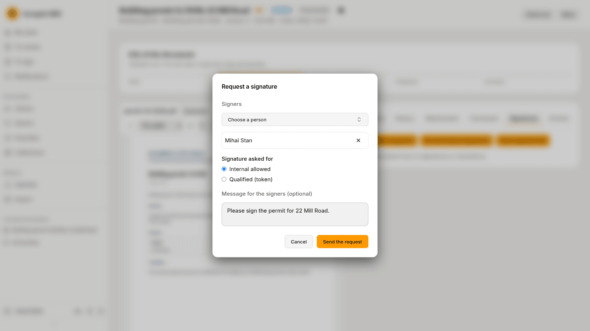
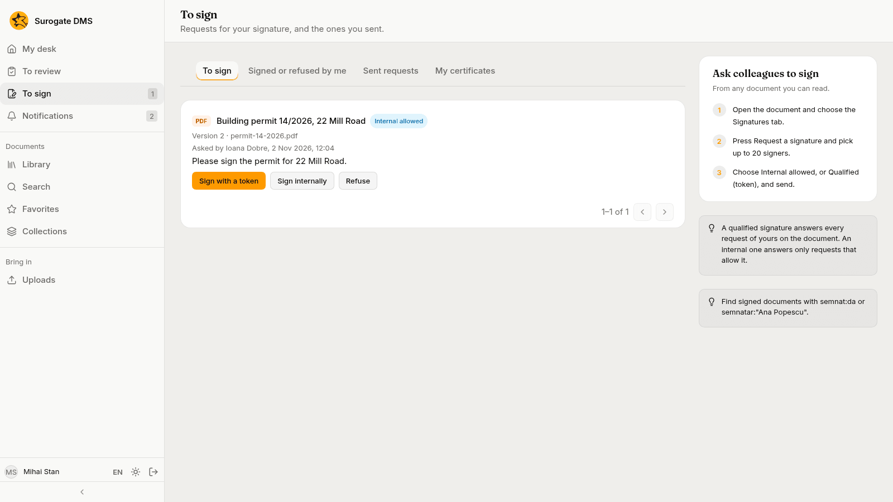
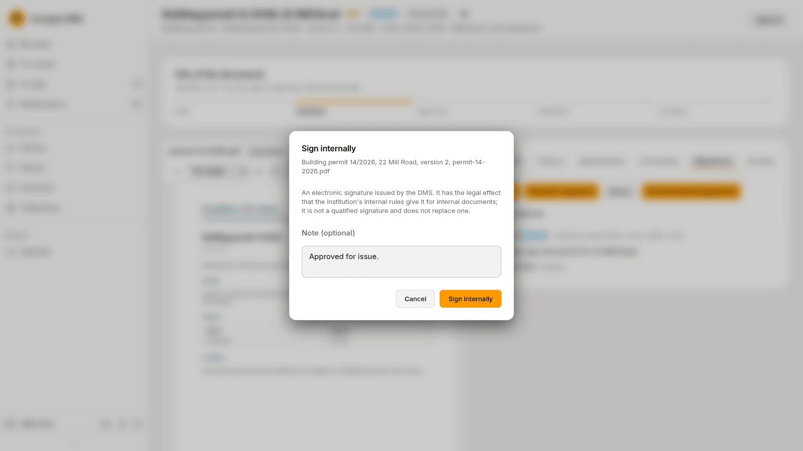
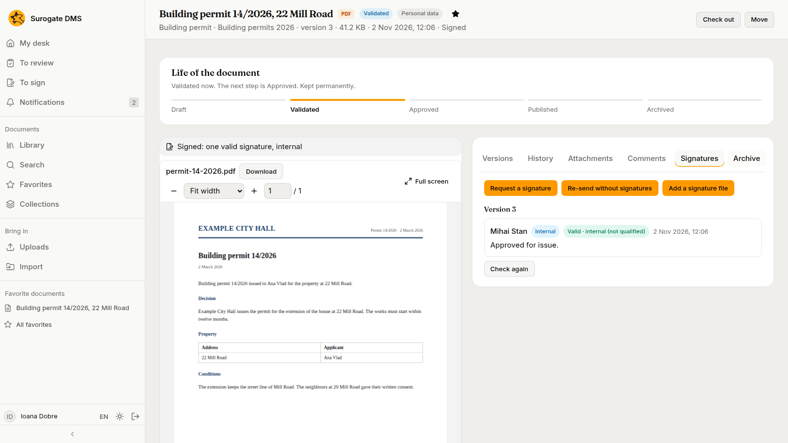

For staff who ask for or give signatures: requesting a signature, the To sign page, signing internally or with a token, and refusing. A signature in the DMS is always of a named person on a named version of a document.

## Ask colleagues to sign

1. Open the document and choose the **Signatures** tab.
2. Press **Request a signature**.
3. In **Signers**, choose a person; repeat for each signer, up to 20.
4. Under **Signature asked for**, choose **Internal allowed**, which accepts an internal or a qualified signature, or **Qualified (token)**, which accepts only a signature made with a qualified certificate on a token.
5. Write a message for the signers if you like.
6. Press **Send the request**.

A request names the version it concerns. The document shows "Waiting for one signature" until the signers answer. You can follow and cancel the requests you sent on the **To sign** page, under **Sent requests**.

## See what waits for your signature

The **To sign** page lists the requests that wait for you. Its tabs are **To sign**, **Signed or refused by me**, **Sent requests** and **My certificates**. Each request shows the document, who asked, the version and the message, with **Sign with a token**, **Sign internally** and **Refuse**.

## Sign internally

1. On the document's **Signatures** tab press **Sign** and choose **Internal**, or press **Sign internally** on the To sign page.
2. Read the notice: an internal signature is an electronic signature issued by the DMS. It has the effect your institution's internal rules give it for internal documents, is not a qualified signature and does not replace one.
3. Write a **Note (optional)**.
4. Press **Sign internally**.

## Sign with a token

A request that asks for a qualified signature, or a document that needs one, is signed with a certificate on a token. On the **Signatures** tab press **Sign** and choose **With a token**, or press **Sign with a token** on the To sign page, and follow the steps in the dialog: download the version, sign the file in your certificate provider's app, and upload the signed file. The DMS checks the signature after it is uploaded.

## Refuse to sign

Press **Refuse**, on the To sign page or on the Signatures tab, write the **Reason for refusing** and confirm. The person who asked is notified.

## Read the signatures

The **Signatures** tab lists, for each version, who signed or refused, when, how (**Internal**, or with a certificate) and the status. After an internal signature the status first reads "Being checked", then **Valid · internal (not qualified)**. **Check again** repeats the check.

A new version of a signed document has no signatures; **Re-send without signatures** starts a new round for a new version. A document that has open requests can be changed only after the requests are cancelled or answered.
