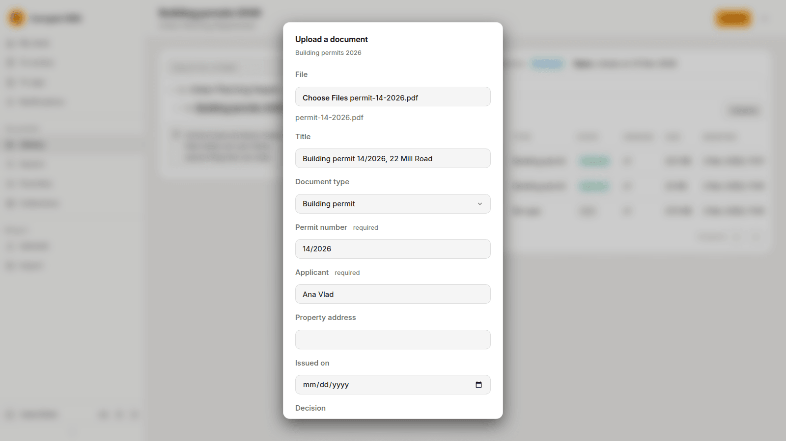
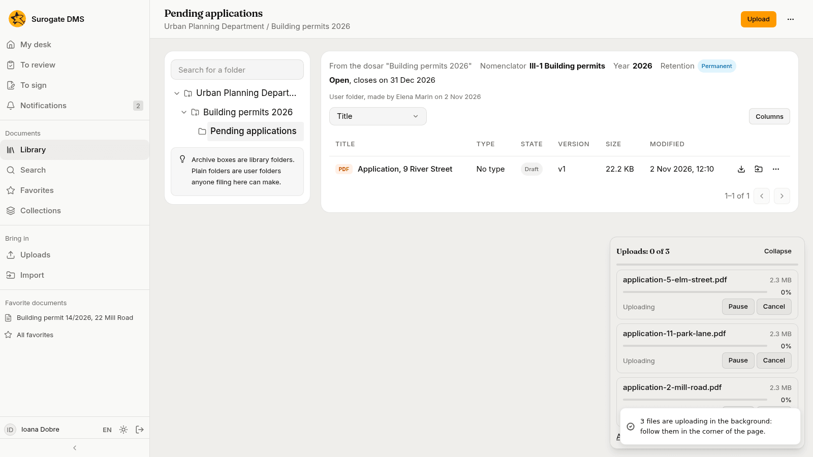
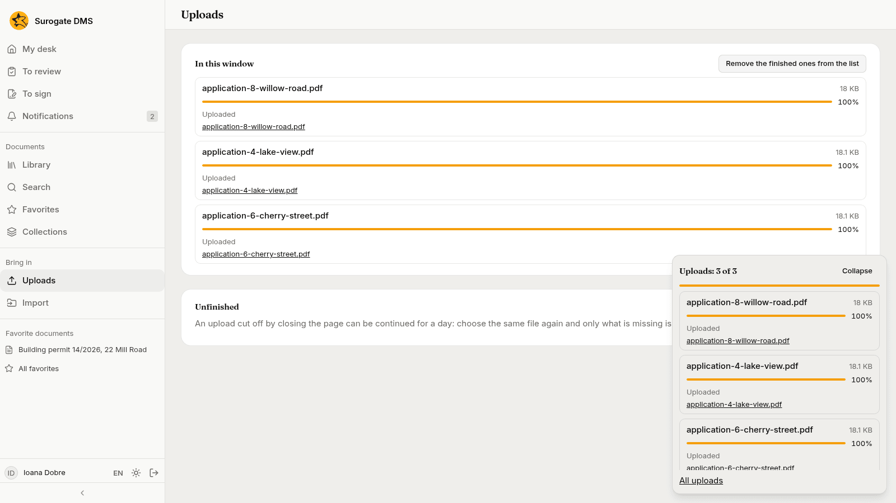
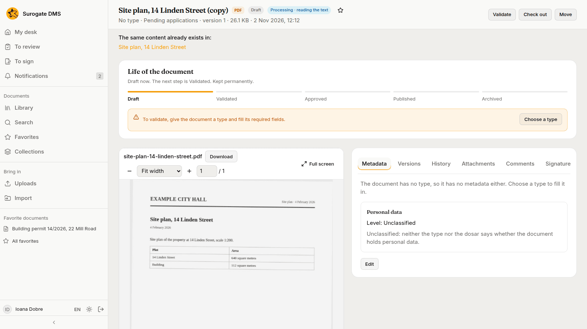
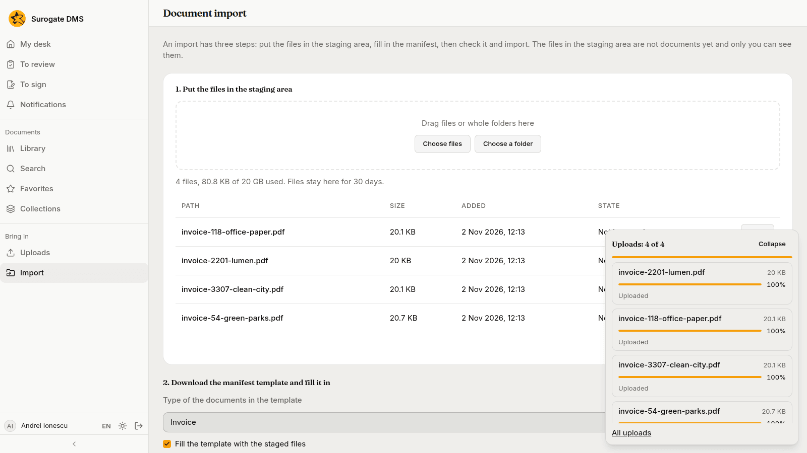
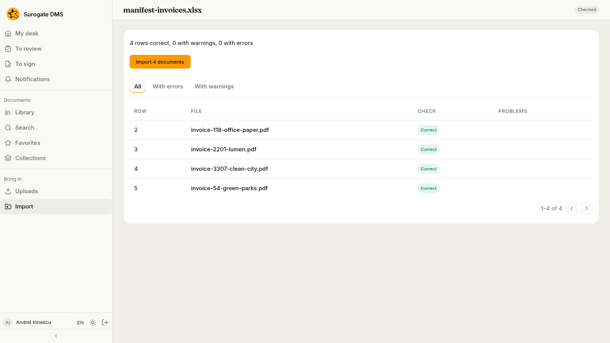

For staff who file documents: uploading one or many files into a folder, following uploads in the tray and on the Uploads page, and bringing many documents in at once with their metadata.

## Upload a document

1. Open the folder in the **Library** and press **Upload**. The button shows only where you may file.
2. Under **File** choose one file, or several together.
3. Give the document a **Title**. With several files, each file's name is its title.
4. Choose the **Document type**. The list holds the types you may file from this folder.
5. Fill in the fields of the type that are required, and the others if you wish.
6. Press **Upload**.

You can also drop files on a folder in the Library to file them there.

## Follow the uploads

Uploads go on in the background. A card at the bottom right of every page, the **tray**, shows how far each file is, with **Pause** and **Cancel**.

The **Uploads** page, under **Bring in**, lists every file of this window and what each is doing. **Remove the finished ones from the list** tidies it. A file whose upload was cut off by closing the page can be continued for a day: choose the same file again and only what is missing is sent.

## After the upload

The DMS reads the file, and a chip next to the title shows where it is: **Waiting**, **Processing** with a step such as "reading the text", or **Processing failed**. Hold the pointer over a failed chip to read why, and tell your administrator if the reason says the server lacks a program.

When a finished upload looks like another document, the document's page tells you: "The same content already exists in:" with a link, or "This folder already has a document with the same name". It is a notice; both documents stay.

## Import many documents at once

When you have many files and their metadata, use **Import** under **Bring in**. It has three steps.

1. **Put the files in the staging area.** Drop the files or a whole folder, or choose them. The files wait there for 30 days and only you see them.
2. **Download the manifest template and fill it in.** Choose the **Type of the documents in the template**, tick **Fill the template with the staged files** and press **Download the template**. In the spreadsheet, one row for each file: the dosar it goes to, its title, and the values of the type's fields.
3. **Check the manifest.** Choose the filled file and press **Check**.

The check lists each row as **Correct**, with warnings or with errors, and changes nothing. When it is right, press **Import {count} documents**: the DMS files them.

