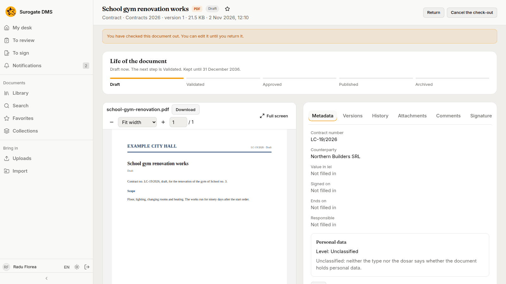
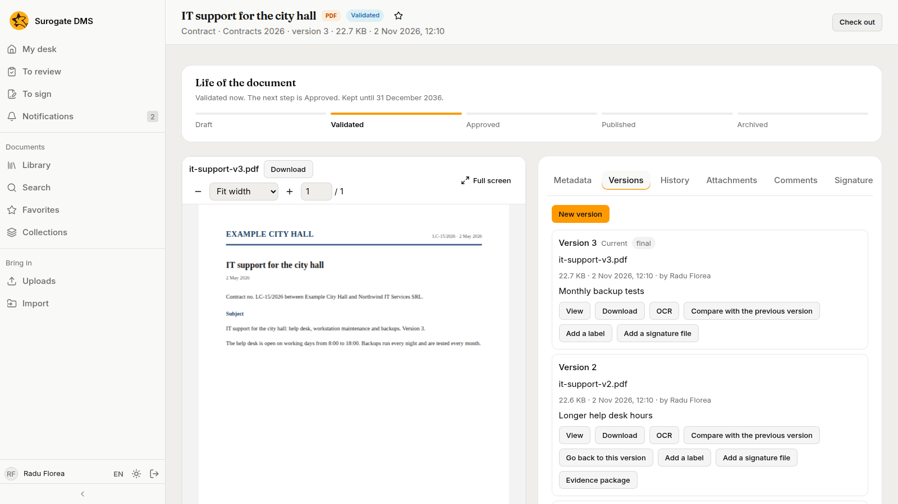
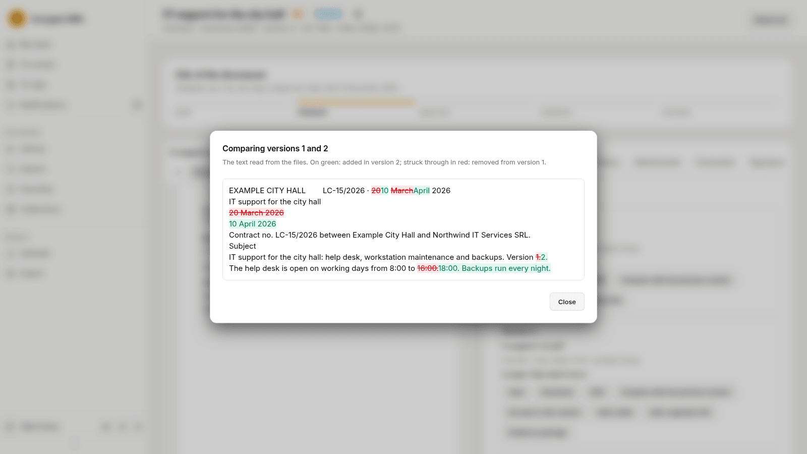

For staff who work on a document's file: viewing it, checking it out, adding versions, going back to an older one and comparing two.

## View a document

The viewer on the document page shows the file page by page. Use **Zoom in** and **Zoom out** or the zoom list to resize, the page box to jump to a page, and **Full screen** to fill the window. When you opened the document from a search result, the matches are marked and a bar counts them.

Where your institution has an online editor for office files, **Edit online** opens one in the DMS and **Close the editor** returns you to the document. Ask your administrator whether your institution has it.

## Check a document out

Check a document out to work on it without anyone else changing it. **Check out** locks it; the page shows "You have checked this document out…". **Return** gives the document back and **Cancel the check-out** gives it back unchanged. An administrator can unlock a document someone forgot.

## Versions

The **Versions** tab lists every file of the document, newest first, with who saved it and a comment. **New version** adds one. For each version you can **View**, **Download**, press **OCR** to read its text again, **Add a label** such as "final" and **Add a signature file**. **Go back to this version** makes an older version the current one.

## Compare two versions

On a version, **Compare with the previous version** shows what changed in the text read from the files: green for what was added, red struck through for what was removed.

A document can be edited and given new versions only while it is a draft or validated.
