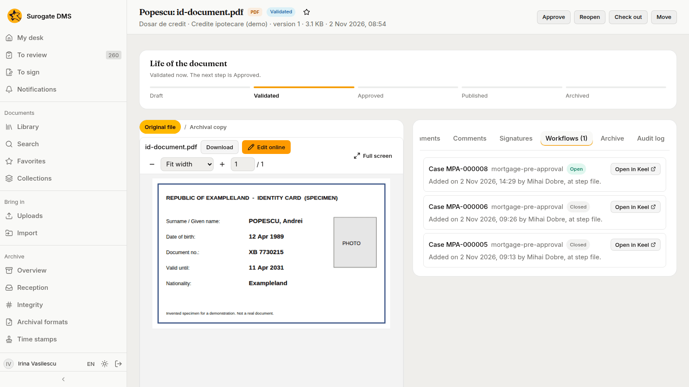
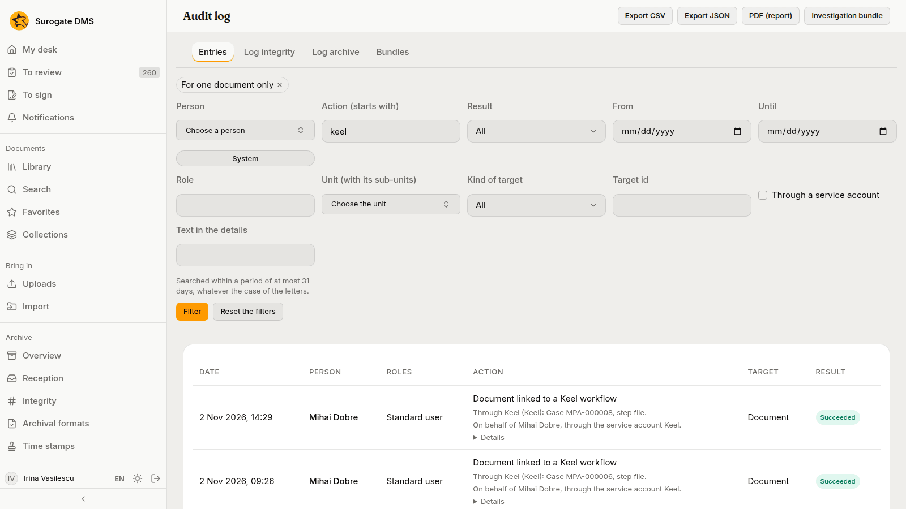

For everyone: what you see in the DMS when a Keel case or process holds a document, what such a flow may do with it, and what to do when a flow cannot go on.

Your institution may run [Keel](/keel/) beside the DMS. Keel runs business processes: a **case** is a long-lived file that moves through stages, and a **process** is a workflow of steps that people, agents and systems complete. Either one can hold a document. The DMS keeps the document and its rules, and Keel runs the flow around it. A flow can ask for an approval, ask colleagues to sign, wait until a document is archived, and so on.

If the document page has no **Workflows** tab, your institution has not connected the DMS to Keel.

## What a flow may do with a document

A flow can read a document, move it through its states (validate, approve, publish, archive), ask people to sign it and accept its reception. Two rules keep this safe:

- A flow acts **for a person** and with that person's access. If you may not approve a document, a flow acting for you may not either, and the refusal goes to whoever the flow sends it to. A step that nobody completed, such as a timer, acts as a service account with only the rights an administrator gave it.
- A flow never signs for you. Signing and refusing to sign stay yours alone.

A flow can also **start** by itself when a document is filed in a folder that your administrators chose, or when the retention term of a dosar ends. You do nothing for that: the new process holds the document from the start. See [Keel integration](/dms/admin/keel-integration/) for the rules behind it.

## The Workflows tab

Where the DMS is connected to Keel, every document has a tab called **Workflows**, after **Signatures**. The number in brackets counts the cases and processes that hold the document now. A document that none holds shows no number, and the tab says that it is in none.

Each row is one case or process, open ones first and the newest first:

- **Case MPA-000008** or **Process P-000123**, the key of its type, and whether it is **Open** or **Closed**.
- Who added the document, when, and the step of the flow that did it, for example "Added on 2 Nov 2026, 14:29 by Mihai Dobre, at step file". A flow that started by a folder's rule says "Started on … by the rule of the folder …".
- **Open in Keel**, which opens the case or process in Keel in a new browser tab. It is missing when your institution has not given the DMS the address of Keel's console.

A closed case or process stays on the list, and it no longer receives anything from the DMS. The tab only shows: Keel decides which documents a case holds, so there is nothing to attach or remove here. Anyone who may read the document sees its rows.

Keel shows the link from its side as well: the page of a case or process has a section **DMS documents** that lists the documents it holds that you may read, each opening in the DMS. See [A loan file held by a Keel case](/dms/examples/loan-file-with-keel/).

## "Through Keel" in the audit log

When a flow does something for you, the entry in the audit log is yours, with an extra line that names the case or process, the step and the service account: "Through Keel (Keel): Case MPA-000006, step file. On behalf of Mihai Dobre, through the service account Keel."

A signature request that a flow made for a colleague says "through Keel, process P-000123, step …" beside the person who asked. The signers are told as for any request, and nobody can sign or refuse through a flow.

## When a flow cannot go on

A flow meets the same refusals you do. Keel sends the work to a person, and these are the common cases:

| What the DMS says | Why | Who settles it |
|---|---|---|
| The document is already in the requested state. | The state was reached already, for example you approved it a moment earlier. | Nobody: the flow goes on. |
| You do not have the permission needed. | The person the flow acts for may not do this. | The owner of the flow sends the task to someone who holds the right. |
| The document is checked out, or open in the online editor. | Someone is working on it. | Wait: the flow tries again, or an administrator ends the check-out. |
| The reception of the current version has not concluded, or it failed. | Archiving needs a passed or an accepted reception. | An archivist, from the **Archive** tab. See [Reception](/dms/archive/overview/). |
| The metadata is incomplete. | The type needs fields before the document can be validated. | The owner of the document fills them in. |
| The signer is not known to the DMS. | The person has never signed in to the DMS. | Ask them to sign in once. Then the flow can ask them to sign. |

A message that names a header, a key or an account is a configuration error in the flow, not something you did. Tell your administrator.

## When a document is deleted

A document is deleted only by a selection, after the term of its dosar has ended. An open case does not stop that. On the **Selection** page the commission sees how many documents of a dosar are in open Keel cases and may hold the dosar. When the document is deleted the open cases are told, and the record of the deletion keeps the links the document had. See [Selection](/dms/archive/selection/).
