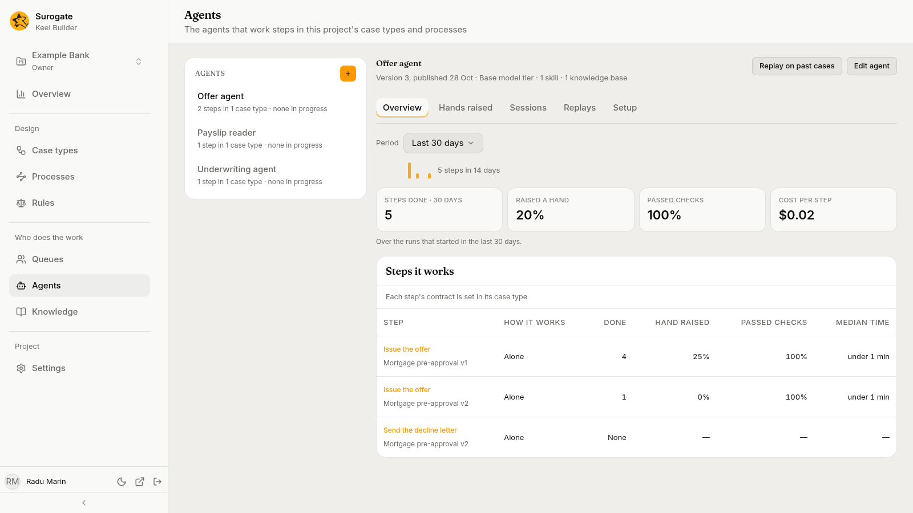
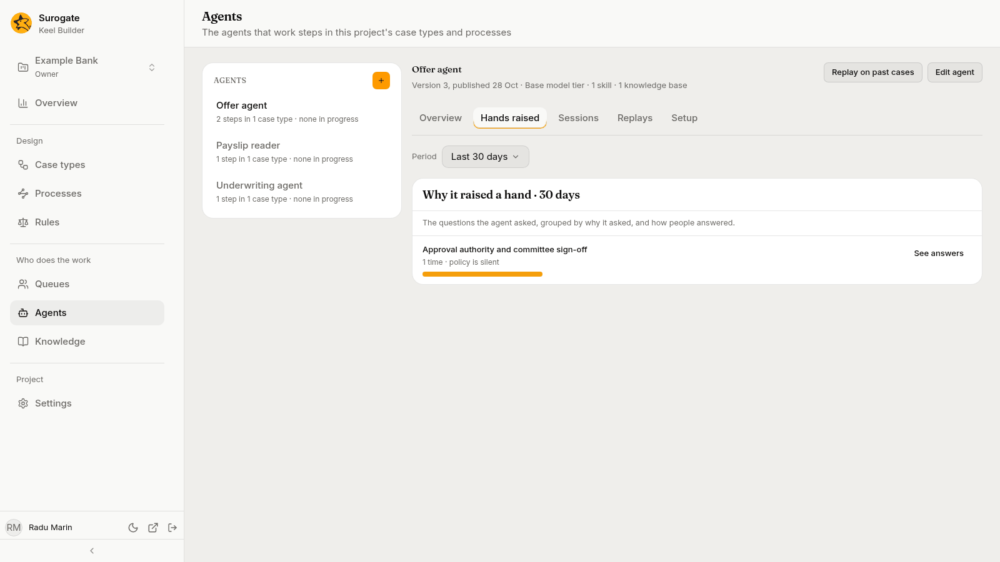
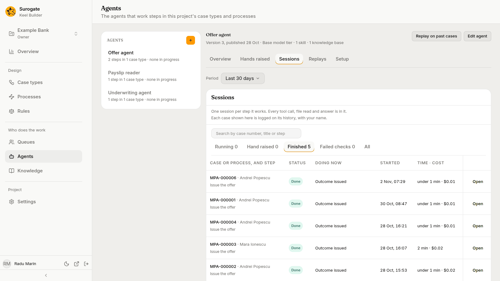
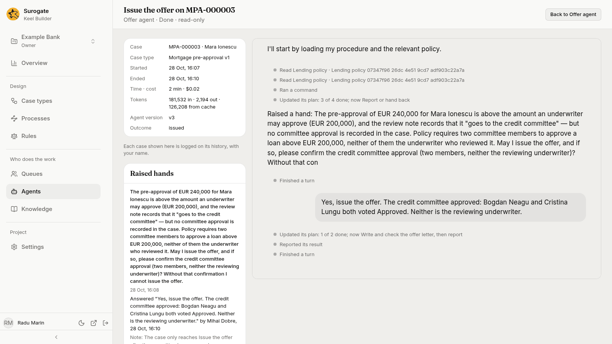
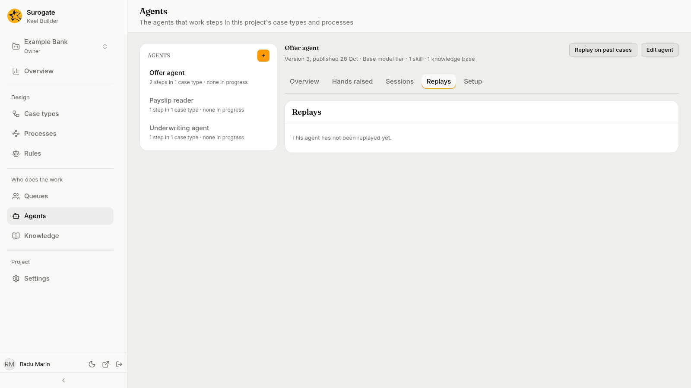
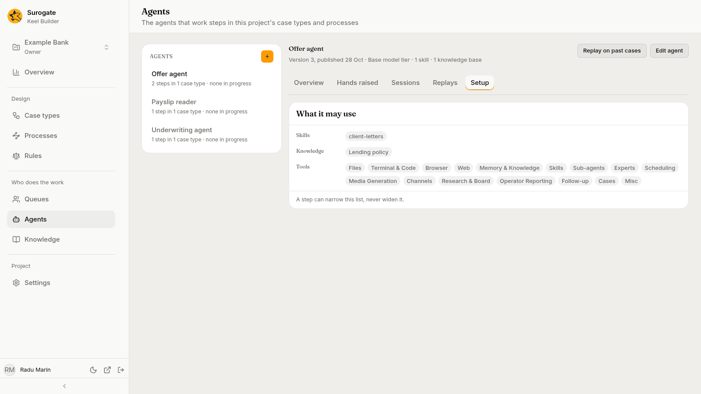

The **Agents** page shows how the agents of your case types are doing: "The agents that work steps in this project's case types and processes". Pick an agent in the list. Its tabs show what it did over a period (**Overview**), why it raised its hands (**Hands raised**), its **Sessions**, its **Replays** on past cases, and what it may use (**Setup**). An agent that works the tasks of a [BPMN process](/keel/processes/#calling-other-things), alone or drafting for a person, is listed and counted beside the ones that work case types' steps.

Hands raised, sessions, replays and **Export for audit** show case content, so only editors and owners see them; see [What your role lets you see](#what-your-role-lets-you-see). Keel records each case they show as your view of it, and the case's History in the business app lists it under **Read by builders**. The page says so where it applies: "Each case shown here is logged on its history, with your name."

## The list

The list, headed **Agents**, holds the agents named by the current published versions of the project's case types and processes, by name. An agent Keel has no name for shows by its id. A draft adds no agent until it is published.

Under each name Keel says how many steps and tasks the agent works and how many of its runs are under way, such as `3 steps in 2 case types · 4 in progress`, `3 steps in 1 case type and 1 process · none in progress`, or `1 step in 1 case type · none in progress`; an agent that works only a process's task reads `1 step in 1 process · none in progress`. A run waiting on a raised hand counts as in progress. An agent that only starts cases (an intake agent) reads `0 steps in 0 case types`. Pick a row to open the agent; the first opens by default.

The list holds only the agents your case types and processes name. The project's two helpers, the case agent and the designer agent, work no step and are not listed here; they show in Studio, marked **Helper**. See [The project's helpers](/keel/builder/designer-agent/#the-projects-helpers).

With no agent named, the list says "No case type or process of this project names an agent yet." Agents are made in Studio: the **+** button beside the **Agents** heading (**New agent**) opens Studio in a new tab. Editors and owners see it.

## The agent

Its name heads the detail. Under it, once Studio answers, one line says what Studio holds of it, such as `Version 12, published 18 Oct · Pro model tier · 3 skills · 1 knowledge base`. The model reads **Pro model tier**, **Base model tier**, or **Own model** with its name. The line ends with `Off in Studio` when the agent is switched off there. If Studio cannot be read, the page says "Studio's details of this agent could not be read." with **Try again**; the **Setup** tab then shows nothing, and everything from Keel stays as it was.

Two buttons sit beside the name:

- **Edit agent** opens the agent in Studio in a new tab. Every role sees it.
- **Replay on past cases** runs the agent again on past runs of one of its steps; see [Replays](#replays). Editors and owners see it.

Under them, the tabs: **Overview**, **Hands raised**, **Sessions**, **Replays** and **Setup**. Viewers see only **Overview** and **Setup**.

## Period

**Period** shows on the **Overview**, **Hands raised** and **Sessions** tabs. It offers **Last 7 days**, **Last 30 days** and **Last 90 days**, and opens on 30 days. The figures, the steps, the raised hands and the sessions are counted over the runs that started in the period, except as the sessions tabs say below. The period ends when you open the page or pick a period; reload to include later runs. While a new period loads, the last figures, hands and rows stay, dimmed, until the new ones arrive. The address keeps the agent, the tab, the period, the sessions tab and the search, so you can share a link to them. Picking another agent keeps the period and the tabs and clears the search.

## Overview

The **Overview** tab opens first. Over the figures, a small chart shows the steps the agent finished on each of the last 14 days, with their total, such as `5 steps in 14 days`.

### Figures

Four figures, with the caption "Over the runs that started in the last 30 days." The days follow the period, and so does the first figure's name, such as **Steps done · 7 days**.

| Figure | What it is |
|---|---|
| **Steps done · 30 days** | Runs the agent completed, including steps it drafted for a person to finish. Work items it took from a queue count when it completed them. |
| **Raised a hand** | The share of the runs of its own steps that raised a hand at least once. Work items taken from a queue are not counted. |
| **Passed checks** | Of the runs that were done or refused by a check, the share done without a refusal. |
| **Cost per step** | The cost its runs reported, divided by the runs done, in dollars. |

A figure with nothing to divide reads `—`, and a count of none reads `None`. A rate above 0 never reads `0%`; it reads `<1%`. A rate below 100% never reads `100%`; it reads `>99%`.

### Steps it works

The table **Steps it works** has a row for each step the agent works, each in its case type at its version, such as `Loan request v3`. The step's name opens the case type at that step. A process's task has a row too: its name is not a link, and its second line reads the process and its version, then "process", such as `Claim assessment v1 · process`. "Each step's contract is set in its case type"; see [Steps](/keel/builder/steps/).

| Column | What it shows |
|---|---|
| **How it works** | **Alone**; **Drafts, a person finishes**; **Works a person's step from a queue**; **Votes as a queue member**; or **Answers raised hands from a queue**. |
| **Done** | Runs of that step completed. |
| **Hand raised**, **Passed checks** | The same shares as above, over that step's runs. |
| **Median time** | The median time from start to end of the runs done, such as `under 1 min`, `10 min`, `23 h` or `2.3 d`. A step no run worked in the period shows `None` and dashes. |

## Hands raised

The **Hands raised** tab holds the card **Why it raised a hand · 30 days** (the days follow the period): "The questions the agent asked, grouped by why it asked, and how people answered."

Keel groups the agent's raised hands by **reason**. Each reason shows its name, then how often the agent raised a hand for it and how people answered, such as `3 times · answered "valid up to six months" 3 times`, `2 times · answers vary`, `1 time · no answers yet`, or `1 time · policy is silent` when the agent's policy says nothing about it and the answers do not agree. A bar shows how its count stands against the most frequent reason. Hands Keel has not grouped yet show last, under **Not grouped yet**, such as `2 times · no reason found yet`. With none, the card says "It raised no hand in the last 30 days."

**See answers** opens the reason's hands in a dialog, newest first, 25 at a time. Each shows the question, then its case number, the step and when it was raised, such as `LR-000001 · Check the file · 20 Oct, 09:00`; `Choices:` when the agent offered some; how it stands; and `Note:` when the person who answered added one. A hand reads `Waiting on` the queue, `Closed without an answer`, or `Answered` with the answer in quotes, who gave it and when, such as `Answered "valid up to six months" by Ana Marin, 20 Oct, 10:15`. A name Keel does not know reads `an agent` or `a person`. **Open** goes to the hand's session. **Show more** adds the next 25.

**Propose a rule** shows on a reason whose answers agree, when the project's designer agent is set up and on. It is not offered on a phone. Press it to have the designer agent draft a rule that answers the question. Keel starts a draft of the case type and opens it at the step, where the designer agent drafts the rule; review it there before you publish. A reason raised in several case types opens a menu of their names first. See [The designer agent](/keel/builder/designer-agent/).

## Sessions

The **Sessions** tab holds one session for each step the agent works: "One session per step it works. Every tool call, file read and answer is in it." Every tab but **All** carries Keel's count of its sessions.

| Tab | What it lists |
|---|---|
| **Running** | Every session at work now, whenever it started. |
| **Hand raised** | Every session waiting on a raised hand now, whenever it started. |
| **Finished** | Sessions that started in the period and ended. |
| **Failed checks** | Sessions that started in the period and were refused at least once. |
| **All** | Sessions that started in the period, and those at work now. |

**Running** opens first. An empty tab says so, such as "No session is running." or "No session finished in the last 30 days."

**Search by case number, title or step** finds sessions on the open tab once you type two characters and pause. It matches a case number's start, and the case title or step name anywhere. With none found, the card says `No session matches "text".`. A search narrows the list, not the tabs' counts.

Each row shows:

- **Case or process, and step**: the case number and title, or for a process's task the instance's number, such as `P-000001`, and the step.
- **Status**: **Starting**, **Working**, **Working with a person**, **Drafted, a person finishes**, **Hand raised**, **Done**, **Drafted**, **Returned to its queue**, **Stopped**, **Failed** or **Finished**.
- **Doing now**: for a running session, the item of its plan in progress, read every 30 seconds; for one with its hand raised, `Waiting on` the queue and the question; for a finished one, `Outcome` and its value, and how many checks it failed, such as `Outcome approve · 1 failed check`. A dash when there is nothing to say.
- **Started** and **Time · cost**: a running session's time so far, such as `41 min · $0.37`; `waiting 22 min · $0.37` for one with its hand raised; the time from start to end for a finished one. The cost shows `—` until the session reports one.
- **Watch** on a running session, **Open** on any other.

The card counts the rows, such as `1 of 4 sessions`, and **Show more** adds 25. It ends with "Finished sessions keep their full record and can be replayed on the agent as it is published now." and **Export for audit**.

### A session

**Watch** and **Open** open the session. The page is titled with the step and the case, such as `Check the file on LR-000001`, and says `Underwriting agent · Done · read-only` under it. With no name for the agent, it shows the agent's id and the button reads **Back to the agent**; otherwise **Back to** *agent name* returns to the agent's page with the period, tab and search you left. The session is read-only: it has no box to type in.

Beside the session, a list gives the **Case**, **Case type** with its version (for a process's task, the **Process instance** and the **Process** with its version), **Started**, **Ended** (`Still at work` while it runs), **Time · cost**, **Tokens**, **Agent version**, and **Outcome** once it has one. **Tokens** reads `41,000 in · 3,200 out · 12,000 from cache`; the cache part is left out when none was reported. **Failed checks** and **Raised hands** cards appear only when the session had some; a failed check shows its message and its code.

While the session is at work, the page reads its record again every 30 seconds and the session is live. When it ends, the session shows as it ended. What the session shows is what [Watch](/keel/business/watch/) shows staff.

| Message | Why |
|---|---|
| **No session of this project's agents has this id.** | The link is wrong, or the session belongs to another project. **Back to agents** returns to the page. |
| **This session could not be loaded** | Keel's words follow, with **Try again**. |
| **The agent's session cannot be reached now.** | **Try again** opens the session again. |
| **Watch cannot show this session.** | Keel's reason follows: "You cannot watch this session." or "This is not a step of the case." |
| **Nothing to show yet.** | No entry to show has arrived yet. |

## Replays

A **replay** runs the agent, as it is published now, again on past runs of one of its steps, and compares each result with the original. Use it after you change an agent in Studio, to see whether it would now decide the same cases the same way.

### Start a replay

1. Press **Replay on past cases** beside the agent's name. The dialog says: "Replays run *agent* as it is published now on past runs of one step, and compare each result with the original."
2. Pick the **Step**, by its name and case type.
3. Pick which **Runs**: **Finished runs**, **Runs that failed a check** or **Runs that raised a hand**. The runs are those of the period the page shows.
4. Pick **How many**, such as **Up to 10**.
5. When the agent has systems connected in Studio, the dialog offers **Let it use its MCP servers**. Tick it only if the replay may act on them: "Its MCP servers reach real systems with real credentials: what it does there really happens."
6. Read the preview. It says how many runs it replays, one per case, and what they cost when they ran, such as "Replays its latest 10 runs from the last 30 days, one per case." It says how many cannot be replayed because their files are no longer kept. Then: "Each replay runs the agent as it is published now, on the inputs and files the original step read, in a session that touches no case. It runs without terminal, process or browser tools, and is billed as the agent's runs are."
7. Press **Replay *n* cases**. The replay's page opens.

A replay never changes a case. Only a case type's step that the agent works alone or drafts for a person can be replayed. With no such step, the dialog says "This agent works no step that can be replayed."

### The Replays tab

The **Replays** tab lists the agent's replays, newest first, 20 at a time. Each shows the step and case type, when it was started and by whom, and how far it is, such as `10 cases · 8 same · 2 different`, with its state: **Running**, **Done** or **Stopped**. Pick one to open it. With none, the card says "This agent has not been replayed yet."

### A replay's page

The page is titled **Replay of** *step*. Under the title, it names the case type, which runs it took over which dates, and who started it when. Its figures are **Replayed**, **Same outcome**, **Different outcome**, **Failed checks**, **Raised a hand**, **Not replayed**, **Cost then** and **Cost now**: "Cost then is what the original runs cost; cost now, what their replays cost."

While it runs, a bar shows how many cases are replayed, and **Stop** ends it: "The cases not replayed yet are left out, and those at work are stopped. What is done stays."

The **Cases** card has a tab for **All**, **Not done** and each verdict, with its count. Each case shows what the original run came to (**Then**), what the replay came to (**Now**), with their costs, and its **Verdict**. A case not replayed says why, such as "Its files are no longer kept." **Open** shows the case: **Then beside now** compares the outcome, each field the step returned, failed checks, raised hands, agent version, tokens and cost, and marks each row that changed with **Changed**. A long text that changed is compared line by line below the table. The replay's own session shows under it, and **Open the original session** opens the session of the original run. **Back to the replay** and **Back to the agent** return.

## Setup

The **Setup** tab shows **What it may use**: what Studio gives the agent, in rows: **Skills**, **Knowledge**, **Tools** (the groups of tools it may use; a group with some tools never allowed reads `Browser, 1 of 2 tools`) and **Systems**, only when the agent is connected to some (one switched off reads `name, off`). A row with nothing says **None**. The foot names the groups it may never use: `Never: Web. A step can narrow this list, never widen it.` With no such group it says only "A step can narrow this list, never widen it."

To change what the agent may use, press **Edit agent** and change it in Studio.

## Process tasks

A run, a raised hand or a session of a process's task is named by the instance's number, its process and the task, where a case's is named by its case. Reading one logs a view of the instance, as reading a case's logs a view of the case: "Reading this session is logged as your view of the process instance, with your name." A process whose version no longer loads shows by its key made readable and the task by its element made readable.

**Propose a rule** and **Replay on past cases** work on case types' steps alone. A reason raised only in a process's task offers no proposal, a reason raised in both offers its case types, and the replay's list of steps leaves a process's tasks out.

## Export for audit

**Export for audit**, at the foot of the **Sessions** tab, saves a CSV file, one row for each run of the agent that started in the period shown, the oldest first: the run's case, step, session, times, outcome, failed checks, raised hands, tokens, cost in dollars and agent version. The case type of a process's run reads `process:` and the process's key, and its step is the task's label. A fact a run lacks is an empty field. The tab and the search do not narrow it. The button reads **Exporting…** and cannot be pressed again while the file is read. Keel refuses an export of more than 100,000 runs: "The export holds more than 100,000 runs; choose a shorter period." A refusal, or a file cut short, shows a short message and saves nothing.

## When a read fails

A part that fails says why, in Keel's words when it has some, and offers **Try again**. Otherwise it says "The agents could not be read.", "The agent's figures could not be read.", "The reasons could not be read.", "The answers could not be read.", "The sessions could not be read." or "The replays could not be read." When a read took too long, Keel says "The figures took too long to read. Try a shorter period." The period stays within reach. A **Show more** that fails shows a short message and keeps the rows.

## What your role lets you see

Viewers see the list, **Edit agent**, and the **Overview** and **Setup** tabs. Editors and owners also see **New agent**, **Replay on past cases**, and the **Hands raised**, **Sessions** and **Replays** tabs, a session's page, a replay's page and **Export for audit**. A viewer who opens a session's address reads "Sessions are for the project's editors and owners."; a replay's address reads "Replays are for the project's editors and owners." See [Roles and permissions](/keel/reference/roles/).
