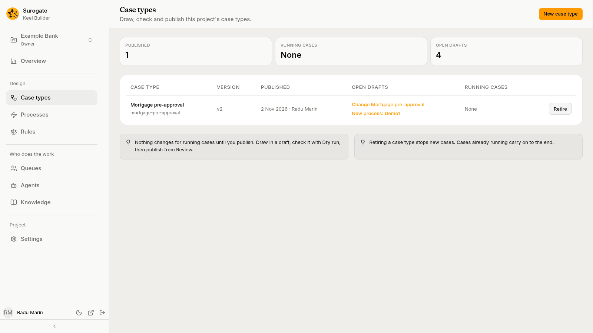
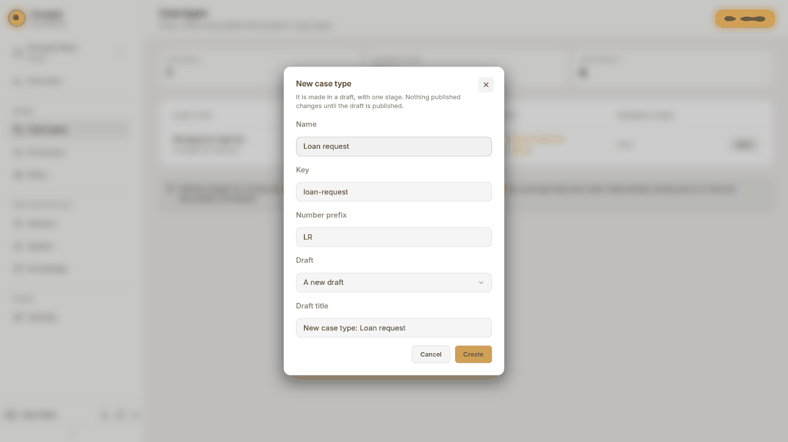
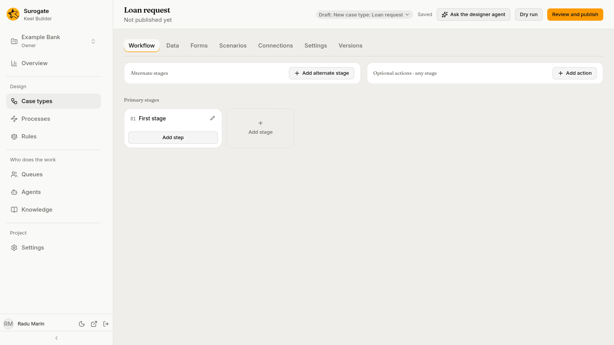

The **Case types** page lists the project's case types: "Draw, check and publish this project's case types." Press a row to open that case type in the designer.

## The list

Above the table, three figures count the case types **Published**, the **Running cases** and the **Open drafts**.

| Column | What it shows |
|---|---|
| **Case type** | The name, with the key under it. A retired case type is marked **Retired**. |
| **Version** | The current published version, such as `v3`. |
| **Published** | When the current version was published, and by whom; **Not published** for a case type only drafts hold. |
| **Open drafts** | The open drafts that change this case type. Each is a link that opens the designer in that draft. |
| **Running cases** | How many cases are open on each version, newest first, such as `41 on v3 · 2 on v2`; **None** when no case is open. |

A case type that exists only in a draft is listed too, under its key made readable. It opens in the newest draft that holds it. A project with no case types says **No case types yet**.

## Create a case type

Editors and owners see **New case type** in the page header.

1. Press **New case type**. The dialog says: "It is made in a draft, with one stage. Nothing published changes until the draft is published."
2. Type a **Name**, such as `Loan request`.
3. Check the **Key** and the **Number prefix**. Both fill in from the name; change them if you need to.
   - The key identifies the case type. It is letters, digits, `-` and `_`, starting with a letter or a digit, and no other case type may have it.
   - The number prefix starts every case number, such as `LR-000001`. It is up to 32 letters, digits, `-` and `_`, starting with a letter or a digit. Two case types of a project cannot share a prefix.
4. Pick the **Draft** to make it in: **A new draft**, or one of the open drafts. A new draft asks for a **Draft title**, which starts as `New case type: <name>`.
5. Press **Create**.

The new case type has one stage, **First stage**, with nothing in it, and no fields. The designer opens on it in the draft. Nothing published changes until the draft is published.

## Retire a case type

Retiring a case type stops new cases. Cases already running carry on to the end. Editors and owners see **Retire** at the end of each published case type's row.

1. Press **Retire**. The dialog asks **Retire *name*?**: "Nobody will be able to start new cases of *name*.", followed by how many running cases continue.
2. Press **Retire**.

A retired case type shows **Retired** beside its name, and **Reinstate** instead of **Retire**. **Reinstate** lets people start its cases again, at once. Neither needs a draft or a publish.

## The designer

The designer's header shows the case type's name and, under it, its published version: for example **Version 3 published 12 Oct 2026 · 41 cases running on it**, or **Not published yet**. On the right of the header is the [draft bar](/keel/builder/drafts/). In a draft, editors and owners also see **Ask the designer agent**, **Dry run** and **Review and publish** there.

Under the header are the designer's tabs:

| Tab | What it holds |
|---|---|
| **Workflow** | The stage board, each stage's flow, and the panel of the node you pick. See [Workflow](/keel/builder/workflow/). |
| **Data** | The case type's fields. See [Data](/keel/builder/data/). |
| **Forms** | The layout of each step's form and of the start form. See [Forms](/keel/builder/forms/). |
| **Scenarios** | Stored test cases that every dry run plays. See [Scenarios](/keel/builder/scenarios/). |
| **Connections** | The other systems its system steps call, and their credentials. See [Connections](/keel/builder/connections/). |
| **Settings** | Name, number prefix, calendar, service level, pinned rules, knowledge, intake agents, case events, title and summary fields. See [Case type settings](/keel/builder/case-type-settings/). |
| **Versions** | Every published version, and moving running cases. See [Versions](/keel/builder/versions/). |

The address of the page keeps the tab, the draft, and what is open on it, so you can copy a link to a node or a form and paste it to a colleague.
