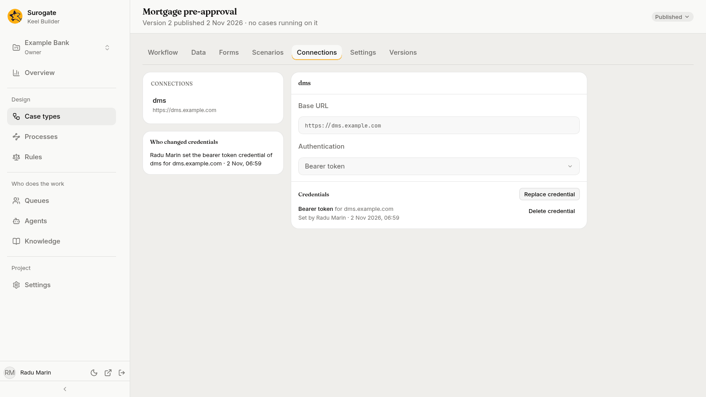
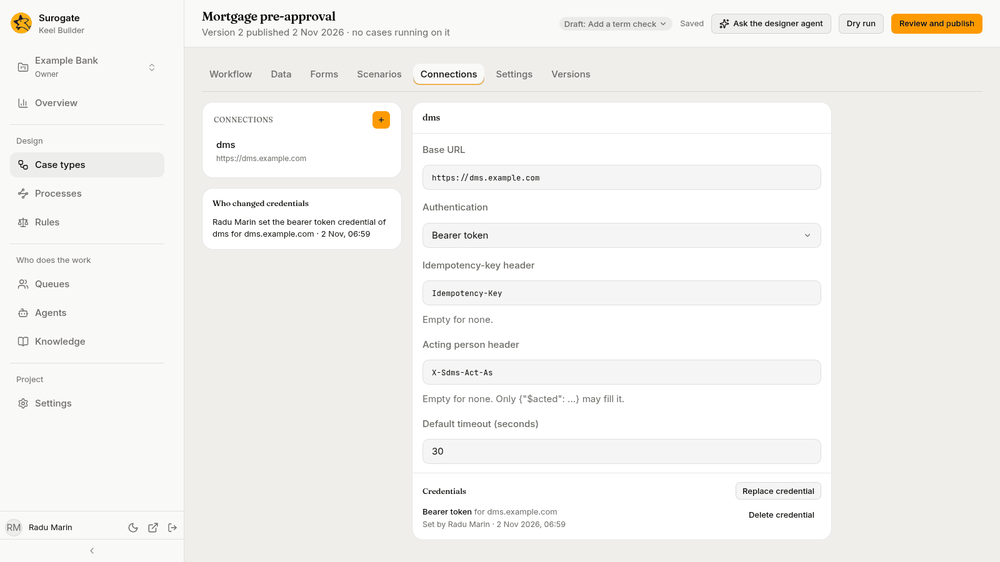

A **connection** is another system a case type's [system steps](/keel/builder/steps/#a-system) call: its address, how it signs in, and the credential it sends. Connections belong to the case type, so the case's history shows the case type making the call, not a borrowed account. The **Connections** tab holds them.

## The list

The left of the tab lists the case type's connections by name, each with its base URL. In a draft, the list is the draft's; with no draft open, it is the published connections, read-only, showing only their **Base URL** and **Authentication**. Editors and owners press **New connection** (the **+** beside the list) and give it a name: "It is made in the draft. Its calls need a base URL next."

## A connection

Pick a connection to see its settings. In a draft, editors and owners change them in place:

| Setting | What it is |
|---|---|
| **Base URL** | The other system's address, such as `https://dms.example.com`. A system step's **Path** is added to it. |
| **Authentication** | How the connection signs in to the other system: **None**, **API key**, **Basic**, **Bearer token** or **OAuth2 client credentials**. Pick what the other system's owners tell you. |
| **Header** | For an API key: the name under which the other system expects the key. |
| **Token URL**, **Scope**, **Audience**, **Client authentication** | For OAuth2 client credentials: the address where Keel gets its sign-in token, the scope and audience it asks for, and **basic** or **post**. The other system's owners give you these. |
| **Idempotency-key header** | The name under which the other system expects a key that lets it tell a repeated call from a new one. "Empty for none." |
| **Acting person header** | The name under which the other system expects the person who did the work. "Empty for none. Only {"$acted": ...} may fill it." See below. |
| **Default timeout (seconds)** | How long a call may take when its step does not say. |

A connection that sends a credential must use an address that starts with `https`; the dry run refuses one that does not.

These settings are part of the draft and are published with it.

### The acting person

Some systems record who did a piece of work, such as who filed a document. A connection to such a system can name, under **Acting person header**, where that system expects the person. Leave it empty unless the other system asks for the person.

When it is set, a system step's call can name the person who last completed a given step or task, such as the person who did the underwriting review. In a process's system task, the hint above the **Request** boxes shows how to write that value. The acting person header carries only that person: nothing else may fill it.

## Credentials

The credential is the secret a connection sends: an API key, a username and password, a bearer token, or an OAuth2 client's ID and secret. Credentials are not part of any draft: they are set on the **published** connection, and apply at once.

Under **Credentials**, editors and owners see:

- **Set credential**, or **Replace credential** when one is set. The dialog, **Set the *kind* credential of *connection***, asks for the secret's parts, such as a **Token**, a **Username** and **Password**, or a **Client ID** and **Client secret**. "Keel keeps it sealed for the connection's hosts. It is not shown again." Press **Set credential**. After you save, Keel Builder says **Credential set. It is not shown again.**
- **Delete credential**, which asks first: "Calls that need it fail until a new one is set."

Each credential shows its kind, the hosts it is sent to, and who set it and when. A credential is sent only to the hosts the connection had when it was set: after you publish a connection with a base URL on another host, set its credential again.

When the connection is new in a draft, the section says **Publish this connection before setting its credential.** A connection that authenticates with **None** says **It sends no credential.**

If your installation keeps no credentials, the tab says **Credentials are off in this installation.** Ask your administrator.

## Who changed credentials

Under the connections, **Who changed credentials** lists the case type's credential changes, newest first: who set, replaced or deleted which credential, of which connection, for which hosts, and when. With none, "No one has changed a credential of this case type yet."

## A process's connections

A [BPMN process](/keel/processes/) calls other systems through connections of its own. A process's connection holds the settings above. It is made and changed in a draft on the **Connections** tab of the process's page, as [Processes](/keel/builder/processes/#the-connections-tab) says, and is published with it. It is not a case type's: this tab never lists it, and a case type and a process of one key keep their connections and credentials apart.

Its credentials are set on the published connection, as a case type's are, on the **Connections** tab of the process's page: the same **Set credential**, **Replace credential** and **Delete credential**, and the list of who changed them.
