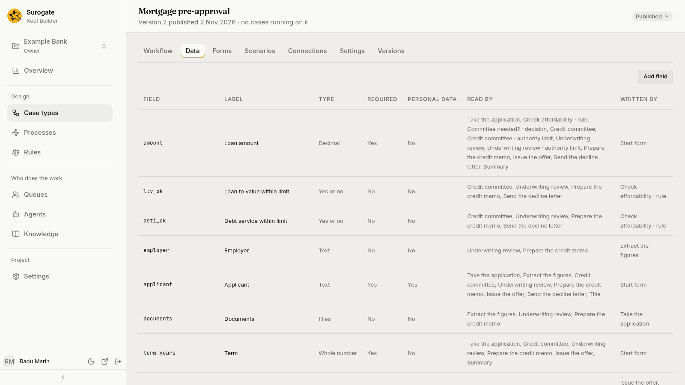
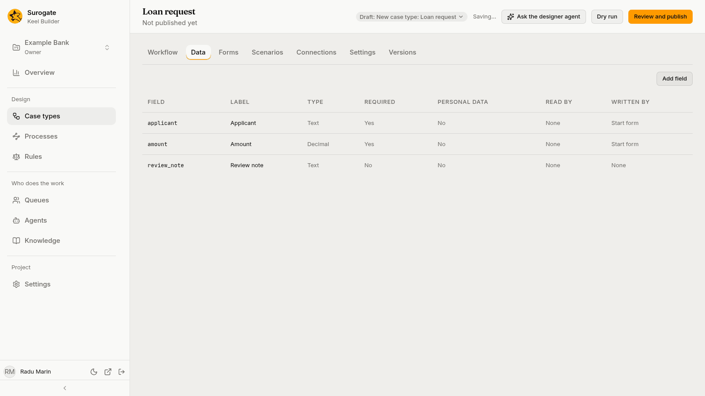
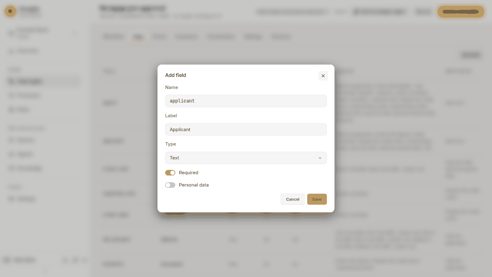
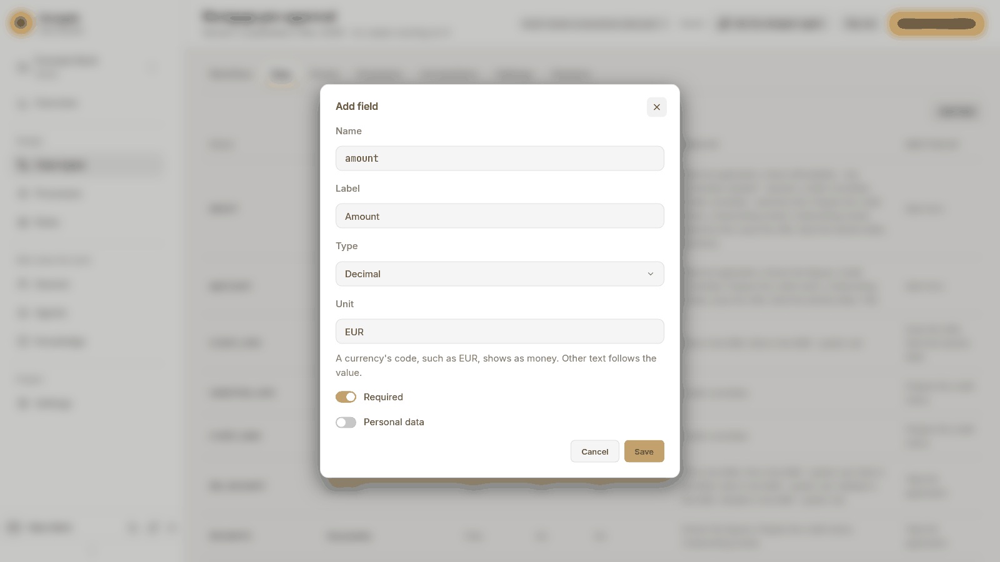

The **Data** tab lists the case type's **fields**: the data every case of the type carries. Steps read and write fields, decisions and rules test them, and forms are made from them.

## The field list

| Column | What it shows |
|---|---|
| **Field** | The field's name, as conditions and templates use it. |
| **Label** | What people see. |
| **Type** | The field's type in words, such as **Text**, **Decimal**, `Choice of 3` or **Files** for a list of files. |
| **Required** | **Yes** when every case must start with a value. |
| **Personal data** | **Yes** when the field is marked as personal data. |
| **Read by** | Where it is read: steps by name, and decisions, rules, waits, conditions, the title and the summary. |
| **Written by** | Where it is written: steps by name, rules, and the **Start form**. |

Keel works out **Read by** and **Written by** from the case type as you edit it. A field nothing reads or writes yet shows **None**. While Keel works, the columns stay empty; if it cannot work them out, a warning says why.

## Add or change a field

Editors and owners press **Add field**; anyone can press a row to open a field.

| Setting | What it is |
|---|---|
| **Name** | Lower-case letters, digits and `_`, starting with a letter, such as `loan_amount`. It cannot be changed once the field exists, and some words, such as `now`, `in` or `int`, are taken. |
| **Label** | What people see, such as `Loan amount`. |
| **Type** | **Text**, **Whole number**, **Decimal**, **Yes or no**, **Date**, **Date and time**, **Choice**, **File**, **List** or **Object**. |
| **Unit** | For a whole number or a decimal. "A currency's code, such as EUR, shows as money. Other text follows the value." |
| **Choices** | For a choice: each with a **Value** and a **Label**. **Add choice** adds one. |
| **Items** | For a list: the **Item type**, and what that type takes. A list of files holds several documents. |
| **Fields** | For an object: its own fields, each with a **Name**, a type and **Required**. |
| **Required** | A case must start with a value: the start form always asks for it. |
| **Personal data** | Marks the field as holding personal data. |

Press **Save**. Viewers see the same dialog with **Close**.

## Remove a field

Open the field and press **Remove field**. Keel Builder asks first, **Remove *label*?**: "No step requires it any more. Steps and forms that name it, and the case's title and summary, will need changing." Press **Remove**. Run a [dry run](/keel/builder/publish/#dry-run) afterwards to find them.

## Files and documents

A **File** field holds one file and a list of **File** items holds several. In the business app, a step that writes a file field lets the person add the file from its form, and the case's files panel lists every file of the case. Office documents open there in the web editor. See [Files and documents](/keel/business/open-case/#files-and-documents).
