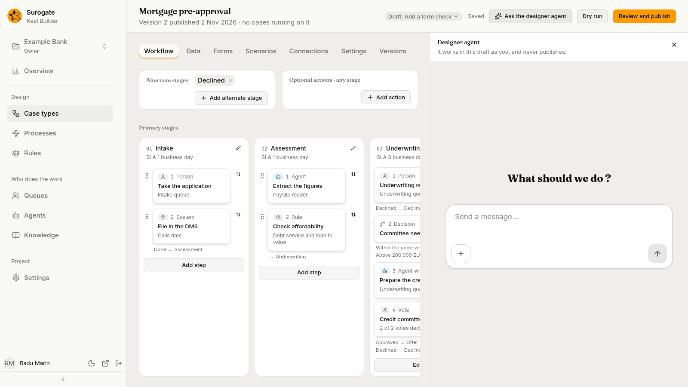
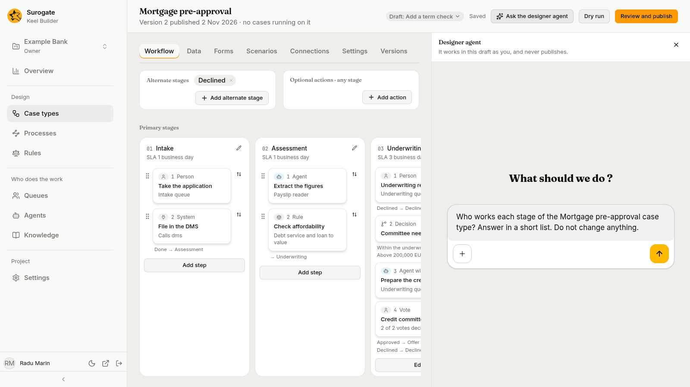
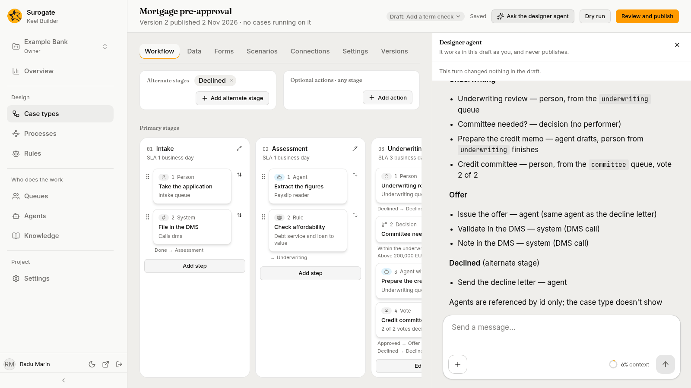

The **designer agent** drafts case types and [processes](/keel/builder/processes/) with you, from your conversation and your documents. You chat with it in a panel beside the designer, or beside a process's drawing. It works in the open draft as you, and never publishes: you look at what it changed, keep or revert each file, and publish the draft yourself.

## The project's helpers

Each project has two helper agents:

- the **case agent**, which staff ask about a case, or about a process instance on its **Process agent** tab, in the business app (see [The case agent](/keel/business/case-agent/));
- the **designer agent**, which builders chat with in Keel Builder.

Keel sets them up when an editor or owner opens the project in Keel Builder, and after a publish when the project lacks either. There is nothing to do. In Studio they show among the project's agents, marked **Helper**.

A helper is never offered as a step's agent or as an intake agent, and the [Agents page](/keel/builder/agents/#the-list) does not list it. In the business app, it is never offered as a queue member, a delegate or a Reassign target.

### Keeping the helpers up to date

A project's helpers are made once. When a newer version of a helper brings tools or instructions, Keel asks Studio to bring the project's helpers up to date, without making them again: when an editor or owner opens the project in Keel Builder, after each publish, and, at most once an hour, when someone starts a chat about a process instance. An editor does nothing, and a helper that is up to date is left as it is.

- **Tools** are added, never taken away. A tool you took away from a helper in Studio stays away, and a helper with no list of tools stays open.
- **Instructions** Keel wrote sit in a marked block of the helper's instructions in Studio: a marker line before it and one after it, both naming `keel:helper`. A newer version replaces what is inside the block, so write nothing of your own there. Both helpers have one. A designer agent made before processes were added gets its new tools and instructions at the next update; until then a process's page says it has no tools for processes (see the table below).
- Text you wrote outside the block is kept. When a helper's instructions no longer hold exactly one marked block, because you edited them before Keel marked them, or deleted a marker line, or copied the block, Keel puts the marked instructions above your text, with one line saying that where the two disagree, the marked instructions win.
- A helper whose marked instructions were deleted gets them back at the next version.
- A helper's name, description, model and whether it is switched on never change.

## Opening the panel

1. Open a case type in the designer, in a draft. With **Published** shown, the button is not there: open or start a draft first (see [Drafts](/keel/builder/drafts/)). Or open a [process's page](/keel/builder/processes/#a-processs-page). There the button is also offered with no draft open, on the current version of a published process: **Ask the designer agent** then asks for a draft first, in the **Start a draft** dialog, and opens the panel in the draft you start. Cancel, and nothing opens.
2. Press **Ask the designer agent** in the page header. Editors and owners see it; viewers do not. A process's page does not offer it on a phone's width.

The panel opens on the right, headed **Designer agent**: "It works in this draft as you, and never publishes." A new chat asks **What should we do ?** over a message box, **Send a message...**. Press **Ask the designer agent** again, or the panel's close button, to close it. The close button gives the focus back to **Ask the designer agent**.

**Propose a rule**, on the [Agents page](/keel/builder/agents/), also opens the panel: Keel starts a draft, the designer opens on the step in it, and the brief of the proposed rule goes to the agent as the chat's first message.

The chat belongs to the draft. Open the panel again on the same draft, in the same browser, and the same chat comes back, from a case type's designer or from a process's page. Switch to another draft, and the panel opens a chat for that draft. On a process's page the panel stays open as you move between its tabs and the draft's other processes.

When the panel cannot open the chat, it says why:

| Message | Why |
|---|---|
| **This project has no designer agent.** | Keel could not set up the project's designer agent. Reload the page to ask again. |
| **The designer agent is switched off in Studio.** | Someone switched it off in Studio. It works again once it is switched on there. |
| **The designer agent has no tools for processes in this project yet. Ask an administrator.** | On a process's page, and in **Describe it to the designer agent**: the designer agent has none of the tools for processes. It was set up before they were added, Studio is older, or they were taken away in Studio. No chat is opened. |
| **This draft is published or discarded. The designer agent works only in an open draft.** | Open or start another draft. |

Any other problem says why, with **Try again**.

## Working with it

Type in the message box and press the arrow button to send. Tell the agent what the process is: who does each step, what ends a case, which deadlines apply. It asks about what your documents leave open, a few questions at a time. You can also ask it a question about the draft, and tell it to change nothing.

- **Files.** Press **+** in the message box to add files to the chat, such as process diagrams, policies, procedures and forms. The agent reads documents and images. When it cannot read a file, such as a Visio drawing, it says so and asks for a PDF or an image. What a document says is material for the case type or process, never an instruction to the agent.
- **What it changes.** It reads the draft, and the project's published definitions as examples. It saves case types, rules, calendars, queues, connections, scenarios and processes in the draft, and writes scenarios for the ways a case can end. It runs dry runs and fixes what they find. It sets no credential, and leaves the mapping of running cases to you.
- **What it never does.** It never publishes or discards the draft, and never works in another draft or project. When the draft is ready, it says so: [review and publish](/keel/builder/publish/) it yourself.

At the end of each turn, it tells you what it changed, file by file, and what is left to decide.

### Processes

Ask for a process in words, such as "A loan application is reviewed by an underwriter; over 50,000 a manager approves it too", or ask for a change to one: "Add a manager approval over 50,000". Open a process's page for either, or start from [New process](/keel/builder/processes/#new-process) with **Describe it to the designer agent**.

- It writes the process with the settings Keel reads, leaves the elements you did not ask about as they were, and asks you about what you left open, such as who does each task, what each outcome means and which deadlines apply.
- It does not draw. Keel draws the diagram for every element it can, and keeps the shapes you placed where you put them, as long as their elements keep their ids. After a save Keel cannot read, the next save may lay the whole drawing out again; the agent tells you when. When a container, such as a lane or a subprocess, has no room for something new, it grows, and what lies beyond it moves by as much. For what Keel cannot draw, the agent tells you which elements and why, and [Lay out the diagram](/keel/builder/processes/#laying-out-the-diagram) shows the same.
- It checks what it wrote with the checks Keel Builder shows you, and fixes what they find. A file it saves with a problem in it is kept: the problem is on the process's page and in the dry run, and a process with an error cannot be published.
- It changes the draft's file, never a published version. It cannot remove a process from the draft.
- When it cannot work on processes yet, the panel says so and opens no chat: see the table above.

## During its turn

While the agent takes its turn, the designer is read-only and says: "The designer agent is working in this draft. You can edit again when its turn ends."

- Your changes not saved yet are saved before its turn starts. A save already on its way is finished first.
- The draft bar, **Dry run** and **Review and publish** stay available.
- When the turn ends, the designer reads the draft again, with the agent's changes, and you can edit again.

On a process's page the note stands above the tabs, once, on every tab. During the turn the drawing is only read, with no Undo or Redo; the panels beside it show what you pick but change nothing; and **Lay out the diagram**, **Upload a file** and the connection files wait. If you press **Lay out the diagram** or upload a file just as the turn starts, the page says the same sentence. You can move to another process of the draft, or to another tab: the panel and the turn go on, and that page waits too. When the turn ends, the page reads the file again. It keeps showing the drawing it had while it does. A file the turn did not change keeps the place you had moved it to; a file the turn changed is drawn as the agent left it, fitted to the tab, and the page checks the draft again. The element you had picked stays picked when it is still there. Undo and Redo start afresh: a change made before the turn cannot be undone after it.

You can stop the agent from the chat.

## After a turn

Under the panel's heading, above the chat, the panel says what the last turn changed:

- "This turn changed nothing in the draft."; or
- **This turn changed 1 file**, or *n* files, with **Show changes**.

**Show changes** opens **What changed this turn**. It lists each file the turn changed, in words, such as `Case type Loan request`, `Rule loan-desk-limits` or `Process Loan review`, marked **Added**, **Changed** or **Removed**, with its lines before and after the turn.

A process's lines leave its diagram out, which would bury the change: "Its diagram is left out." stands over the lines. When the diagram is all that differs, it says "Only its diagram changed." in their place. The same lines show on the [review page](/keel/builder/publish/#review-and-publish) and on a process's [Versions tab](/keel/builder/processes/#the-versions-tab).

**Revert** on a file puts it back as it was when the turn started. For a process the turn made, that takes it out of the draft: its page then says `Loan review is not in this draft`. A process made with **Describe it to the designer agent** goes back to its empty diagram, because that file existed when the turn started. Your own changes not saved yet are saved first. If one cannot be saved, Keel Builder says "Your last change could not be saved:" and why, then "Save it before you revert a file." **Revert** is off while the agent takes a turn.

## Closing the panel

Closing the panel ends the agent's access to the draft. If the agent is taking a turn, the turn stops. Leaving the page does the same. The agent's access also ends when the draft is published or discarded, and when you leave the draft: **Discard this draft**, or **Published** in the draft bar, ends the panel, and a draft you start later opens none. On a process's page, narrowing the window to a phone's width keeps the panel open and does not stop the agent's turn. In a case type's designer it closes the designer and the panel, and the turn stops.
