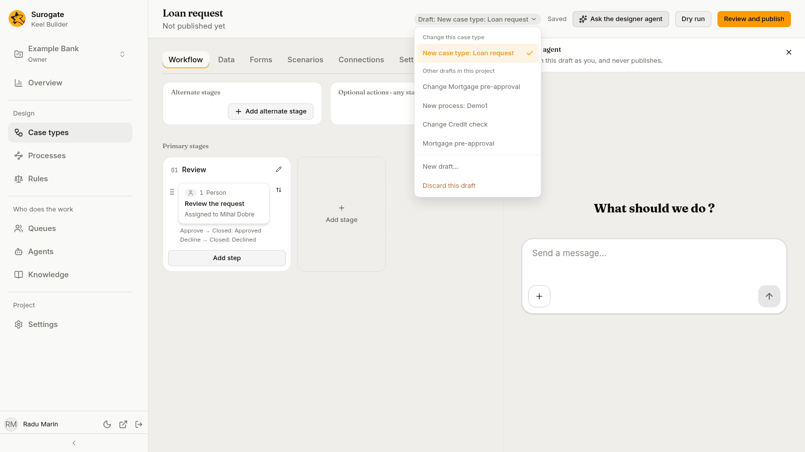
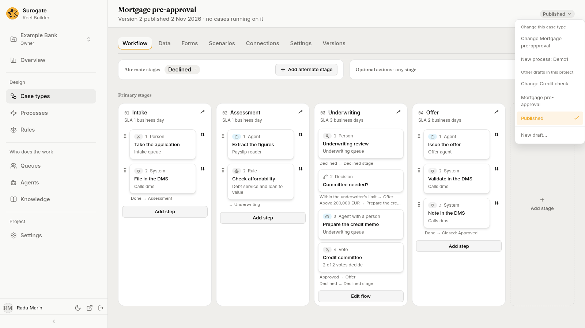
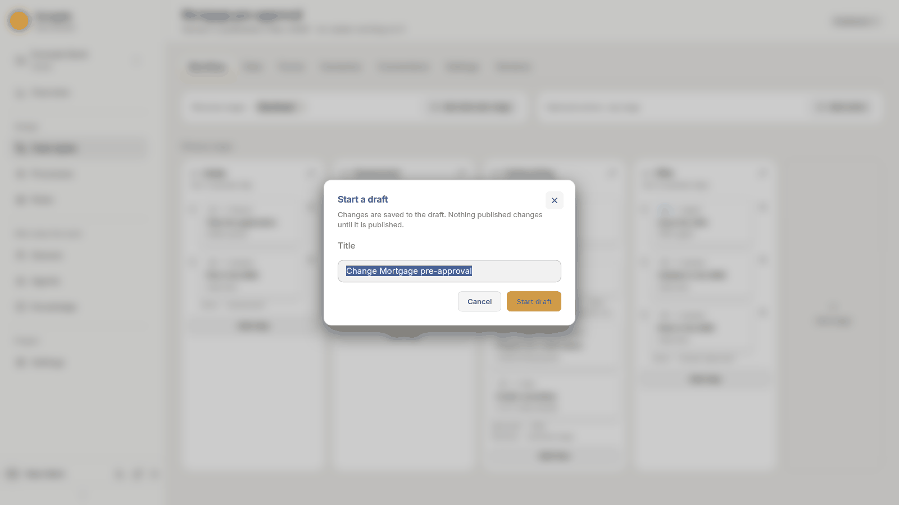
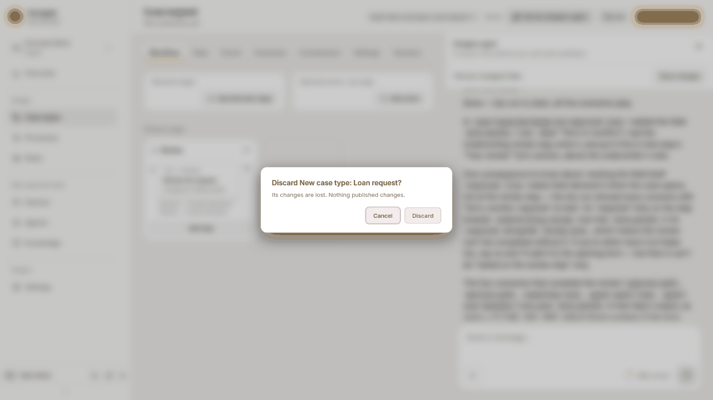

Every change in Keel Builder is made in a **draft**. A draft holds changed copies of the project's definitions: case types, rules, calendars, queues, scenarios, connections, processes and mappings of running cases. Nothing published changes until the draft is published. A project can have several open drafts at once.

## The draft bar

The designer, a process's page, the **Rules** page and the **Queues** page show a draft bar. In the designer and on a process's page it sits in the page header, on the right; on the Rules and Queues pages it sits under the header. It starts with a chip that says what you are looking at:

- **Draft: *title***: the open draft;
- **Published**: the published definitions, with no draft open.

Press the chip to open its menu:

- in the designer, under **Change this case type**, the drafts that change the case type you are looking at; on a process's page, under **Change this process**, those that change the process;
- under **Other drafts in this project**, or **Drafts in this project**, the project's other open drafts;
- **Published**, to show the published definitions. In the designer and on a process's page it is offered only when the case type or process is published;
- **New draft…**: start another draft (editors and owners);
- **Discard this draft**: throw the open draft away (see below).

Pick a draft, or **Published**, to show it.

Viewers see the chip and the menu, and the bar says: "You can view this project. Its editors and owners change it."

## Starting a draft

There are three ways:

- **New case type** makes a new draft for the case type, unless you pick an open one. See [Case types](/keel/builder/case-types/#create-a-case-type).
- **New draft…** in the draft bar's menu.
- Change something while **Published** is shown. Keel Builder asks for a draft first.

Either of the last two opens the **Start a draft** dialog: "Changes are saved to the draft. Nothing published changes until it is published." Its **Title** is filled in for you, such as `Change Loan request`, `Change rules` or `Change queues`; change it if you like. Press **Start draft**. If you started by changing something, your change is made in the new draft. Cancel, and the change is dropped.

## Saving

There is no save button. Each change is saved to the draft a moment after you make it. Beside the chip, the bar says:

- **Saving…** while a change is on its way;
- **Saved** once the draft has it;
- **Not saved:** and the reason, with **Try again**, when a save failed. Your change stays on screen until it is saved.

If the draft was published or discarded while you worked, the bar offers **Open another draft** instead of **Try again**.

While a change is not saved, the browser warns you before you close or reload the page.

## When someone else saves the same draft

Several builders can work in one draft. When someone else saved the draft since you opened it, a warning says: **This draft changed since you opened it. Each of your saves replaces the whole file as you have it.**

Each save replaces the whole file, such as the whole case type, so the last save of a file wins. Press **Load the latest** to read the draft again. If you have changes that are not saved yet, Keel Builder asks first, **Load the latest?**, because loading drops them.

## Working with the designer agent

In the designer, and on a [process's page](/keel/builder/processes/), **Ask the designer agent** opens a chat with the project's designer agent, bound to the open draft. The agent works in the draft as you and saves its changes there. It never publishes or discards the draft.

While the agent takes its turn, the designer, or the process's page, is read-only: "The designer agent is working in this draft. You can edit again when its turn ends." Your changes not saved yet are saved before its turn starts, and the draft bar stays available. After the turn, **Show changes** lists what it changed, with **Revert** for each file. See [The designer agent](/keel/builder/designer-agent/).

## Seeing what a draft changes

The **Review and publish** page lists, file by file, what the draft changes compared with what is published. See [Dry run and publish](/keel/builder/publish/).

When the published definitions changed after the draft started, because another draft was published, the dry run says **Main changed** and the review page offers **Update from main**.

## Discarding a draft

**Discard this draft** in the draft bar's menu asks **Discard *title*?**: "Its changes are lost. Nothing published changes." Press **Discard**.

The project's owners can discard any draft. An editor can discard a draft they created; the menu offers **Discard this draft** only to those who may. A viewer cannot discard, even a draft they created while they were an editor.

## Who can do what

| | Viewer | Editor | Owner |
|---|---|---|---|
| See drafts and their files | Yes | Yes | Yes |
| Start a draft, change it, dry run it | No | Yes | Yes |
| Ask the designer agent in a draft | No | Yes | Yes |
| Publish a draft | No | Yes | Yes |
| Discard a draft | No | Their own | Any |
