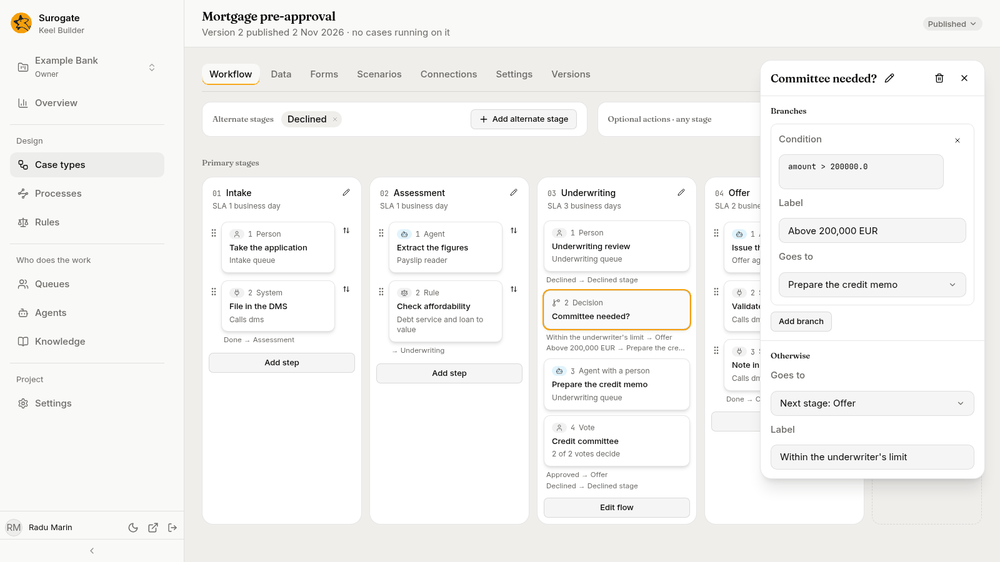
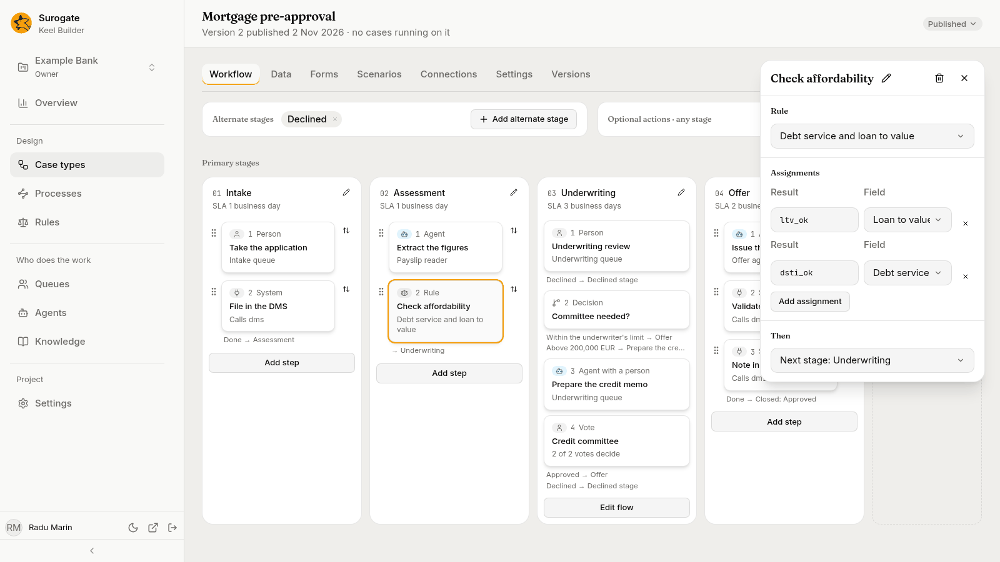

Besides steps, a stage's flow holds nodes that Keel works through by itself, and process nodes, which start one of the project's BPMN processes. Add them with the **+** on a line of a stage's flow, or, for a rule, a wait or a process, with **Add step** under a stage whose nodes run in one line; pick the **Kind**, and edit the node in its panel. See [The Workflow tab](/keel/builder/workflow/) for the board and the flow.

A condition in these nodes is a short expression over the case type's field names, such as `amount > 50000.0`. The word `now` stands for the current time. The [designer agent](/keel/builder/designer-agent/) can write a condition from a sentence, such as "the amount is over 50,000". Keel keeps a condition exactly as you type it; the [dry run](/keel/builder/publish/) reports one it cannot read.

## Decisions

A decision sends the case down one branch. It never calls a model: it checks its branches' conditions against the case's data, in order, and takes the first that holds.

The panel has two sections:

- **Branches**: each with a **Condition**, a **Label** that people read (such as `Over the limit`), and **Goes to**. **Add branch** adds one; the × removes it. With none, "It has no branches: every case goes the other way."
- **Otherwise**: where a case goes when no branch holds (**Goes to**), and its **Label**, such as `Within the limit`.

**Goes to** offers the same places as a step's outcome. See [Allowed outcomes](/keel/builder/steps/#allowed-outcomes).

On the board, a decision is a card marked **Decision**. Under it, the board lists each way out that the next card does not show, as its label and where it goes, such as `Above 200,000 EUR → Prepare the credit memo`.

## Rules

A rule node runs one of the project's [decision tables or scorecards](/keel/builder/rules/) on the case's data, writes its results into fields, and goes on.

- **Rule**: pick the rule.
- **Assignments**: which of the rule's results goes to which field. Each row has a **Result**, the result's key as the rule writes it, and a **Field**. **Add assignment** adds a row. A scorecard's results are `score` and `reasons`.
- **Then**: where the case goes next.

The case uses the version of the rule in effect at that moment, unless the case type [pins](/keel/builder/case-type-settings/#pinned-rules) the rule: then each case uses the version in effect when it started.

If the rule cannot give an answer, such as a table with no matching row and no default, Keel refuses whatever led the case to it, such as the completion of the step before. The person sees **Keel could not apply a rule on this step. Ask your supervisor.**

## Waits

A wait holds the case until something happens. Its panel has three sections.

**Waits for** picks what ends the wait:

| Choice | Setting | The outcome it leaves by |
|---|---|---|
| **An event** | **Event**, the name of a [case event](/keel/builder/case-type-settings/#case-events) another system sends | Arrived |
| **A time** | **How long**, a number and **Minutes**, **Hours** or **Days** | Elapsed |
| **A condition** | **Condition**: "It is checked each time the case changes." | Met |

**At most** sets a limit. When the limit passes first, the wait leaves by its **Deadline** outcome. When the case type has a calendar, these durations count business time: "Counted in business time, by the case type's calendar."

**Waiting on** says whom the case waits on: **The client**, **A third party** or **Inside the bank**. It shows in the business app, on the case list's tabs and on the case page. While a case waits on the client, its own service-level clock is paused.

**Outcomes** lists one outcome for each thing the wait waits for, each with a **Label** and where it **Leads to**. They come and go as you change **Waits for** and **At most**.

## Parallel splits and joins

A **parallel split** starts several paths at once. Its panel, **Starts in parallel**, lists where each path starts; a chip's × removes one, and the **Add** menu adds one. With none, it says **It starts no paths yet.** Steps on parallel paths are open at the same time, and their cards read `Parallel with` and the other paths. On the board, the split shows as `Parallel ·` and its name, with each path as a branch of cards under it.

A **join** waits until every path that leads to it has arrived, then goes on to its **Then**. On the board, it shows as `All branches meet at` and its name. A join needs at least two paths leading to it; the dry run reports one that could never fire.

A path can also stop on its own, with **End of this path**: the case goes on along its other paths. A case left open with nothing to do is refused, so every path must end somewhere a case can rest or close.

## Processes

A process node starts one of the project's [BPMN processes](/keel/processes/) and passes it values from the case's fields. It either waits for the process to end, and takes back what the process returns, or goes on at once. A new process node names no process yet, and both its ways lead on to the next stage.

Its panel has these sections:

- **Process**: the process it starts, among those the project published and those the open draft adds. The card then reads, for example, `Starts KYC check and waits`, or `Starts KYC check` for a node that goes on at once. If Keel cannot read the project's processes, the section says "The project's processes could not be read." with **Retry**. Picking another process clears what the node passed and received.
- **Waits**: **Waits until the process ends** or **Goes on at once**. A node that goes on at once receives nothing and leaves by one way, Started. Switching back while the panel is open brings back what it received and where it failed.
- **Passes in**: a row for each variable the process declares, with its type, such as `Text · required`. Pick the case field that fills it, among the fields of the variable's type, or **Not passed**. The variables come from the process as the draft would publish it: the draft's file when the draft adds or changes the process, else its published version.
  - Without a process, it says "Pick a process to see what it takes."
  - For a process neither published nor in the draft, "This process is not published, and this draft does not add it."
  - When Keel cannot read the variables, it says why, with **Retry**, and shows each variable the node fills by its name.
  - A variable the node fills that the process no longer declares shows by its name, marked "Not declared by the process". Pick **Not passed** to remove it.
- **Receives**, while the node waits: rows of a **Field** of the case and the **Variable** of the process it receives when the process ends. **Add a field** adds a row. With none, "It receives nothing when the process ends."
- **Outcomes**: each way the node leaves, with its **Label** and where it **Leads to**.

| Way | When the case leaves by it |
|---|---|
| Ended | The process completes or ends. The fields under **Receives** take the values the process ended with. |
| Failed | The process fails, is cancelled or cannot start, or ends with a value a field cannot hold. |
| Started | At once, for a node that goes on at once. |

When a case leaves a waiting process node another way first, such as by a case event, Keel cancels the process. A process a node does not wait on runs on, whatever the case does.

Publishing checks what each process node passes and receives against its process: see [Checking what starts what](/keel/processes/#check-and-publish). The business app shows the process on the case's page: see [An open case](/keel/business/open-case/#now-steps-others-hold).
