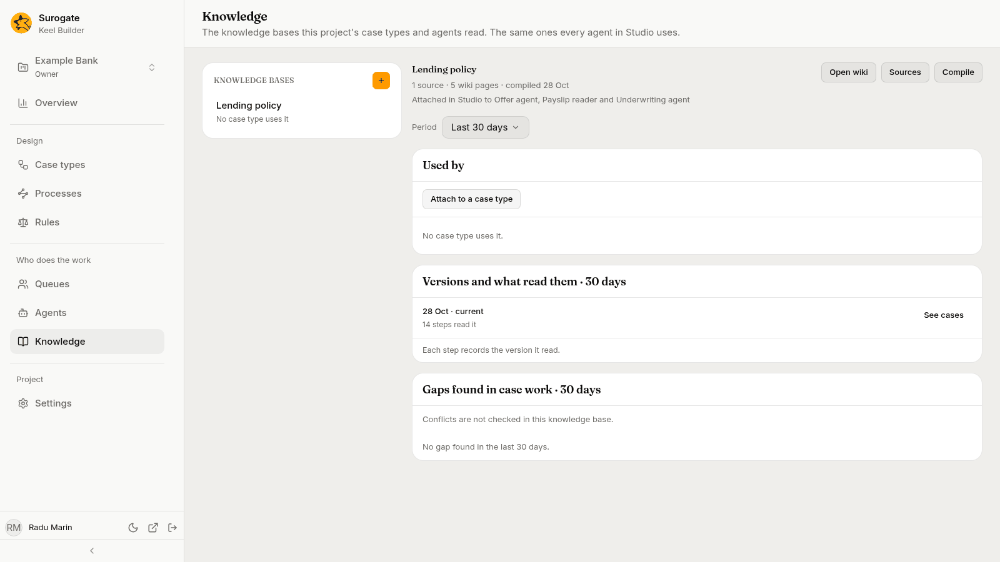
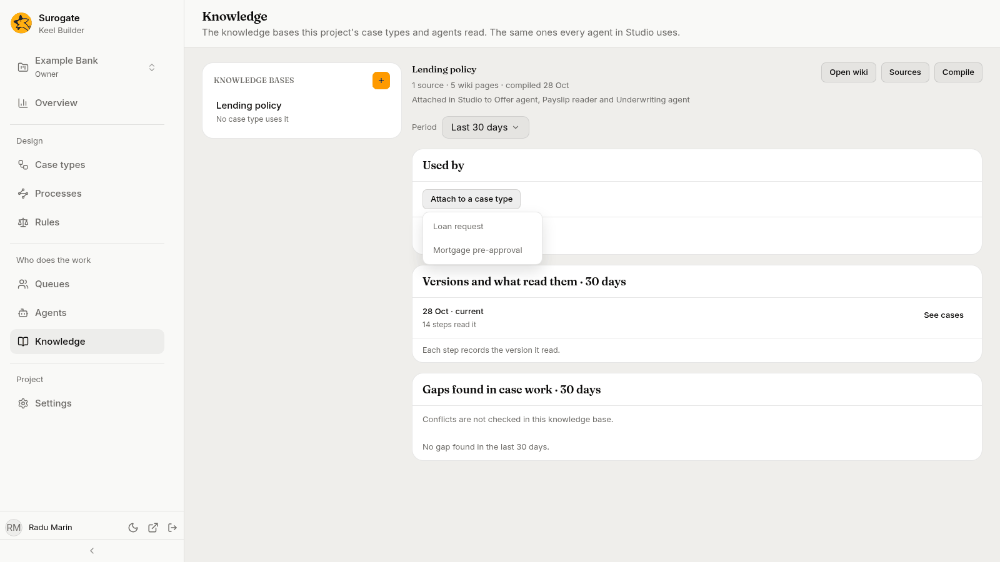
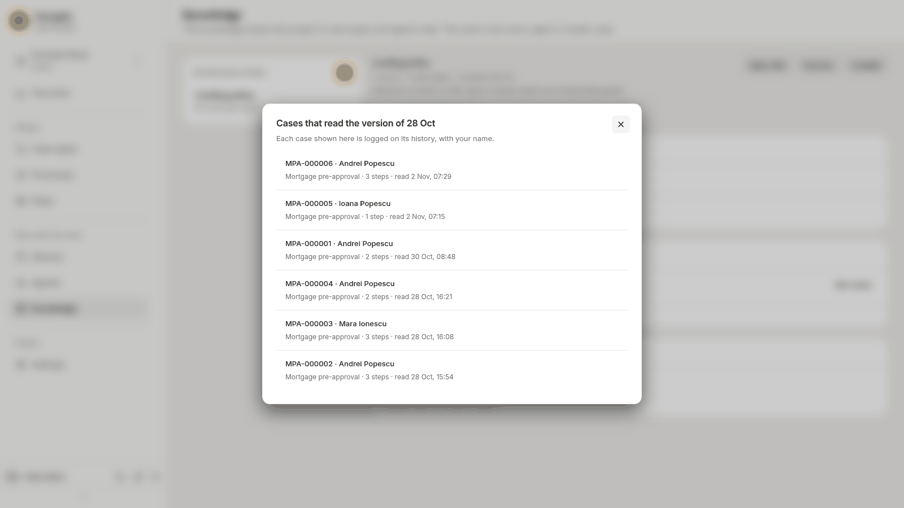

The **Knowledge** page shows the project's knowledge bases and how your case types use them: "The knowledge bases this project's case types and agents read. The same ones every agent in Studio uses." A knowledge base holds the policy and reference text that agents read while they work a step. Knowledge bases are made, filled and compiled in Studio; see [Knowledge Bases](/work/library/knowledge-bases/).

Pick a knowledge base in the list. On the right you see what Studio holds of it, which case types and agents read it, which versions of it were read, and the gaps found in case work.

## The list

The list, headed **Knowledge bases**, holds the project's knowledge bases in Studio, by name. After them come the ones your case types name that Studio no longer has. Under each name, one line says how the case types use it, such as `1 case type · narrowed to some steps · 2 gaps`:

- `Not in Studio`: Studio no longer has this knowledge base, but a case type still names it, or a step read it in the period.
- `Every case type`, `1 case type`, `3 case types`, or `No case type uses it`: how many published case types attach it.
- `narrowed to some steps`: some agent steps of those case types may not read it; see [May use](/keel/builder/steps/#may-use).
- `2 gaps`: the gaps found in case work in the period; see [Gaps found in case work](#gaps-found-in-case-work). Only editors and owners see this count.

The first knowledge base opens by default. With none, the list says "This project has no knowledge base yet."

The **+** button beside the **Knowledge bases** heading (**New knowledge base**) opens Studio in a new tab, ready to make a knowledge base. Editors and owners see it.

## The knowledge base

Its name heads the detail. Under it, once Studio answers, two lines say what Studio holds of it:

- its sources, its wiki pages and when it was last compiled, such as `1 source · 5 wiki pages · compiled 28 Oct`, or `not compiled yet`;
- the agents it is attached to in Studio, such as `Attached in Studio to Offer agent, Payslip reader and Underwriting agent`, or `Attached to no agent in Studio`. An agent that reads it for reference only is marked `(for reference)`.

Three buttons beside the name open the knowledge base in Studio, in a new tab. Every role sees them:

- **Open wiki** opens its wiki, the pages Studio compiled from the sources.
- **Sources** opens its sources, the files it is compiled from.
- **Compile** opens the knowledge base in Studio, where you compile it again.

A knowledge base Studio no longer has says "Studio no longer has this knowledge base." and shows no buttons. If Studio cannot be read, the page says "Studio's details of this knowledge base could not be read." with **Try again**; the rest of the page stays as it is.

## Period

**Period** sits under the header. It offers **Last 7 days**, **Last 30 days** and **Last 90 days**, and opens on 30 days. It sets what the list's gap counts, **Versions and what read them** and **Gaps found in case work** cover. **Used by** shows the published case types as they are now, whatever the period.

The period ends when you open the page or pick a period; reload to include later work. While a new period loads, the last answer stays, dimmed, until the new one arrives. The address keeps the knowledge base and the period, so you can share a link to them.

## Used by

The **Used by** card shows which published case types attach the knowledge base, each in its own row:

- **Attached to**: the case type's name, and under it its version and how many of its steps read the knowledge base, such as `v3 · all 4 steps read it`, `v2 · 2 of 5 steps read it`, `v1 · its 1 step reads it`, or `v1 · no step reads it`.
- **Who reads it**: the agents of the steps that read it, or `No agent`.
- **Open cases**: how many cases are open on the case type, or `None`.

A case type attaches a knowledge base in its settings, under [Knowledge](/keel/builder/case-type-settings/#knowledge), or for one agent step under [May use](/keel/builder/steps/#may-use). Only agent steps read it. When some steps of those case types do not, a last row says **Excluded from** that many steps, names them by case type, as *case type*: *step*, *step*, and says who works them: people, systems, rules, or agents it is narrowed out for.

With no case type attaching it, the card says "No case type uses it."

### Attach to a case type

Editors and owners attach the knowledge base to another case type from here:

1. Press **Attach to a case type**. The menu lists the case types that do not attach it yet.

   

2. Pick a case type. Its designer opens on the **Settings** tab, with the knowledge base added to its **Knowledge** list. The change is made in the draft open there; with none, Keel Builder asks you to [start a draft](/keel/builder/drafts/#starting-a-draft) first.
3. Publish the draft. The case type's agent steps read the knowledge base from then on, except the steps narrowed under **May use**.

The button is not shown to viewers, for a knowledge base Studio no longer has, on a phone, or when every case type attaches it already. If the case types cannot be read, the card says "The case types could not be read." with **Try again**.

## Versions and what read them

Each time Studio compiles a knowledge base, it makes a new version of its wiki. Each step records the version it read. The card **Versions and what read them · 30 days** (the days follow the period) lists the versions that steps read in the period, and the current one even when no step read it.

Each row shows the day of the version and, under it, how many steps read it, such as `14 steps read it`, `1 step read it` or `No step read it`. The day reads `current` beside it for Studio's latest finished compile, such as `28 Oct · current`. A compile that did not finish says how it stands: `Queued`, `Compiling`, `Failed` or `Cancelled`. A version Studio does not list reads `A compile Studio does not list`.

When steps read pages whose version was not recorded, a line says so, such as `2 steps read pages whose version was not recorded.` With no version to list, the card says "It has not been compiled yet." The card ends with "Each step records the version it read." If Studio's compiles cannot be read, the card says "Studio's compiles could not be read." with **Try again**.

### See cases

**See cases** shows on a version that steps read. Editors and owners see it. Press it to open the cases whose steps read that version in the period, in a dialog titled after the version, such as **Cases that read the version of 28 Oct**.

The dialog says "Each case shown here is logged on its history, with your name." Each row shows the case's number and title, then its case type, how many of its steps read the version and when the last one read it, such as `Mortgage pre-approval · 3 steps · read 2 Nov, 07:29`. A process instance that read it shows with its process's name. The latest read comes first, 25 at a time; **Show more** adds the next 25. With none, the dialog says, for example, "No case read it in the last 30 days." If the cases cannot be read, it says "The cases could not be read." with **Try again**.

## Gaps found in case work

The card **Gaps found in case work · 30 days** (the days follow the period) shows where the policy falls short, from what happened in cases.

### Gaps

A **gap** is a question the policy leaves open. Keel finds it when agents, at steps that may read the knowledge base, raised a hand for the same reason at least three times in the period, and the policy said nothing about more than half of those questions. The reasons are the ones on the agent's [Hands raised](/keel/builder/agents/#hands-raised) tab.

Editors and owners see the gaps, the most asked first. Each shows the reason's name, then a line such as `Policy is silent · agents asked 4 times · answered "valid up to six months" 3 times`. The answers part reads `answers vary` when people answered differently, or `no answers yet`. When policy text was drafted for the gap, a second line says when and by whom, such as `Draft added 2 Nov by Radu Marin`. With none, the card says, for example, "No gap found in the last 30 days."

Viewers do not see the gaps, which come from case work. In their place the card says "Questions the policy left open show to the project's editors and owners."

### Draft policy text

For a knowledge base Studio has, each gap offers **Draft policy text**, or **Draft again** when a draft exists, and **Open the draft**, which opens that draft's source in Studio in a new tab.

**Draft policy text** opens a dialog of the same name: "An agent drafts a passage for *knowledge base* from how people answered "*reason*" in the last 30 days. Keel adds it to the knowledge base as a draft source. In Studio, an editor reviews it, marks it ready to build, and builds the knowledge base." The days follow the period. When a draft exists already, the dialog adds when and by whom it was added: "Drafting again adds another."

1. Press **Draft the text**. The button reads **Drafting…** while the agent writes; the dialog cannot be closed until it answers.
2. The dialog says "Added to *knowledge base* as a draft." and shows the passage.
3. Press **Open the draft in Studio** to review it there, or **Close**.

The draft changes nothing an agent reads until an editor builds the knowledge base again in Studio. Keel may refuse to draft, and says why, for example:

| Message | Why |
|---|---|
| **The policy is not silent on this reason in the period.** | The reason is no longer a gap. |
| **No answer to these questions is grouped yet: there is nothing to draft from.** | People have not answered the questions yet. |
| **A draft for this gap is being written. Try again in a minute.** | Another builder is drafting the same gap. |
| **The passage could not be drafted from these answers.** | The agent would not write from these answers. |

If the agent that writes the text, or Studio, cannot be reached, the dialog says so; try again shortly. Keel also refuses when the knowledge base is gone from Studio, or when you are not an editor of its project there.

### Conflicts

Studio can check a knowledge base for statements that contradict each other, such as two files that give a different value for the same thing. When it does, the card lists the conflicts Studio found and has not decided yet. Each names what it is about, and under it what each of the two files says. **Open the conflict** opens it in Studio, in a new tab, where you decide it.

When Studio does not check this knowledge base, the card says "Conflicts are not checked in this knowledge base." With none found, viewers read "Studio found no conflict in this knowledge base." If Studio's conflicts cannot be read, the card says "Studio's conflicts could not be read." with **Try again**. Every role sees the conflicts.

## Who sees what

Every member of the project sees the page. Nothing on it changes a knowledge base: that is done in Studio.

| Part | Viewers | Editors and owners |
|---|---|---|
| The list, the header and its buttons, the period, Used by, Versions and what read them, conflicts | Yes | Yes |
| The gap counts in the list | No | Yes |
| **New knowledge base**, **Attach to a case type** | No | Yes |
| **See cases** | No | Yes |
| The gaps, **Draft policy text** | No | Yes |

## When a part cannot be read

If Studio's list cannot be read, the page says "Studio's knowledge bases could not be read." with **Try again**, and shows no list. If Keel cannot read how the case types use the knowledge bases, the page says why in Keel's words, or "The knowledge bases' use could not be read.", with **Try again**. For the picked knowledge base it says "Its use could not be read." The gaps say "The gaps could not be read." Each comes with **Try again**, and the other parts stay as they are.
