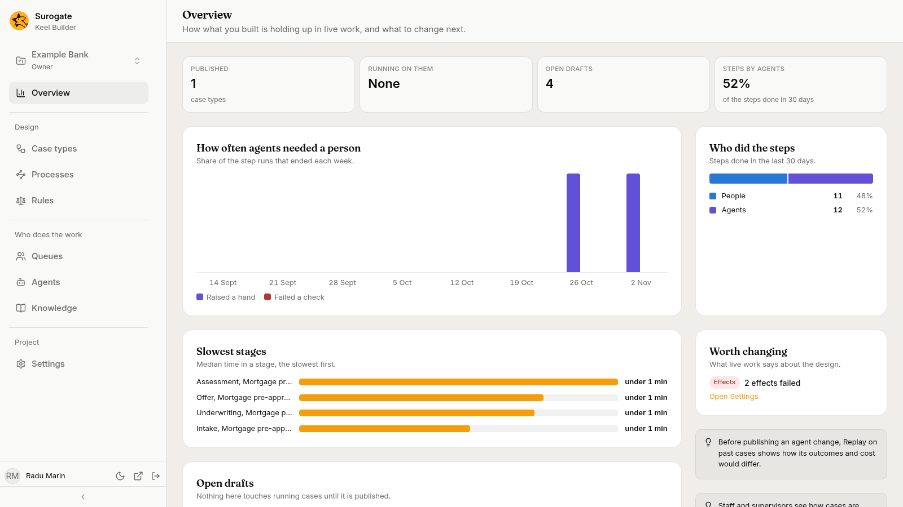
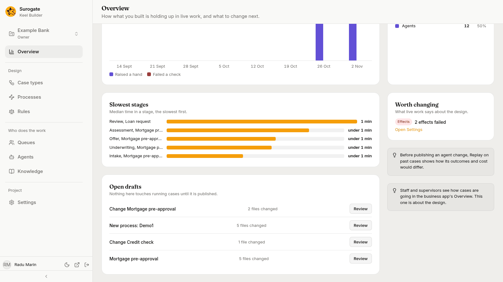

The **Overview** page shows how what you built is doing in live work: "How what you built is holding up in live work, and what to change next." Open it with **Overview**, the first item in the sidebar. It is about the design: how agents fare, who does the steps, which stages are slow, what drafts are open, and what to change. It shows counts only, never a case's data.

Every member of the project sees the page. Viewers see all of it except the **Worth changing** card; see [Who sees what](#who-sees-what).

## Period

The page has no period choice. The figures about steps and stages cover the last 30 days. The chart of agents covers the last eight weeks, this week included. Reload the page to see later work.

## Figures

Four figures sit at the top. A figure Keel cannot give yet reads `—`; a count of 0 reads `None`.

- **Published**: the project's published case types, without the retired ones, such as `1` **case types**.
- **Running on them**: the cases open now on those case types. When some of them run on an older version of their case type, the line under the figure says how many, such as `3 on an older version`. See [Versions](/keel/builder/versions/).
- **Open drafts**: the project's open drafts. They are listed further down; see [Open drafts](#open-drafts).
- **Steps by agents**: the share of the steps done in the last 30 days that agents did, such as `52%`, **of the steps done in 30 days**. With no step done, it reads `—`.

## How often agents needed a person

"Share of the step runs that ended each week." The chart has one group of bars for each of the last eight weeks, oldest first. Each week is named by its Monday, such as `26 Oct`; Keel counts weeks from Monday on UTC. Each week has two bars:

- **Raised a hand**: the share of the agents' step runs that ended that week in which the agent raised a hand to ask a person.
- **Failed a check**: the share of those runs whose answer Keel refused at least once, for example because it did not pass the step's checks.

The bars are scaled to the highest bar on the chart. Point at a bar to read its week, its name and its share, such as `26 Oct, Raised a hand: 100%`. With no hand raised and no check failed in the eight weeks, the card says "No agent needed a person in these weeks."

To see why an agent raised its hands, open it on the [Agents page](/keel/builder/agents/#hands-raised).

## Who did the steps

"Steps done in the last 30 days." One bar is split into **People** and **Agents**, and under it each shows its count and its share, such as `People 11 48%` and `Agents 12 52%`. Keel counts the steps when a case leaves their stage: the steps of a stage that a case is still in are not counted yet. With none, the card says "No step was done in the last 30 days."

## Slowest stages

"Median time in a stage, the slowest first." The card lists up to five stages, each named by the stage and its case type, such as `Assessment, Mortgage pre-approval`. Each has a bar scaled to the slowest stage and its median time: `under 1 min`, whole minutes such as `10 min`, whole hours such as `23 h`, or days such as `2.3 d`. Only the stages that cases left in the last 30 days count. With none, the card says "No case left a stage in the last 30 days."

## Open drafts

"Nothing here touches running cases until it is published." The card lists the project's open drafts, newest first. Each row shows the draft's title, how many files it changes, such as `2 files changed`, and **Review**. **Review** opens the draft's **Review and publish** page, where you see what it changes and publish it; see [Review and publish](/keel/builder/publish/#review-and-publish). With no draft, the card says "No draft is open." See [Drafts](/keel/builder/drafts/).

## Worth changing

"What live work says about the design." Editors and owners see this card. It lists what needs a builder:

- **Policy**: a knowledge base with gaps found in case work over the last 30 days, such as `2 gaps in Lending policy`. A gap is a question the agents kept asking that the policy does not answer. **Open the gaps** opens the knowledge base on the [Knowledge page](/keel/builder/knowledge/#gaps-found-in-case-work).
- **Effects**: effects that failed, such as `2 effects failed`. **Open Settings** opens the Settings page, where you can see each failed effect and retry it; see [Effects](/keel/builder/settings/#effects).

With nothing to show, the card says "Nothing stands out."

## Tips

Two tips sit at the side of the page:

- "Before publishing an agent change, Replay on past cases shows how its outcomes and cost would differ." See [Replays](/keel/builder/agents/#replays).
- "Staff and supervisors see how cases are going in the business app's Overview. This one is about the design." See [The Overview](/keel/business/overview/) in the business app.

## Who sees what

| Part | Viewers | Editors and owners |
|---|---|---|
| Figures, How often agents needed a person, Who did the steps, Slowest stages, Open drafts, the tips | Yes | Yes |
| Worth changing | No | Yes |

## When a part cannot be read

While a card loads, it shows a grey placeholder, and a figure reads `—`. Each card is read on its own. If a card cannot be read, it says why in Keel's words, or "Keel could not be reached. Try again.", with **Try again**. The other cards stay as they are.
