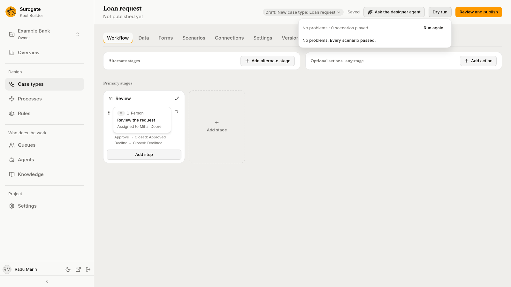
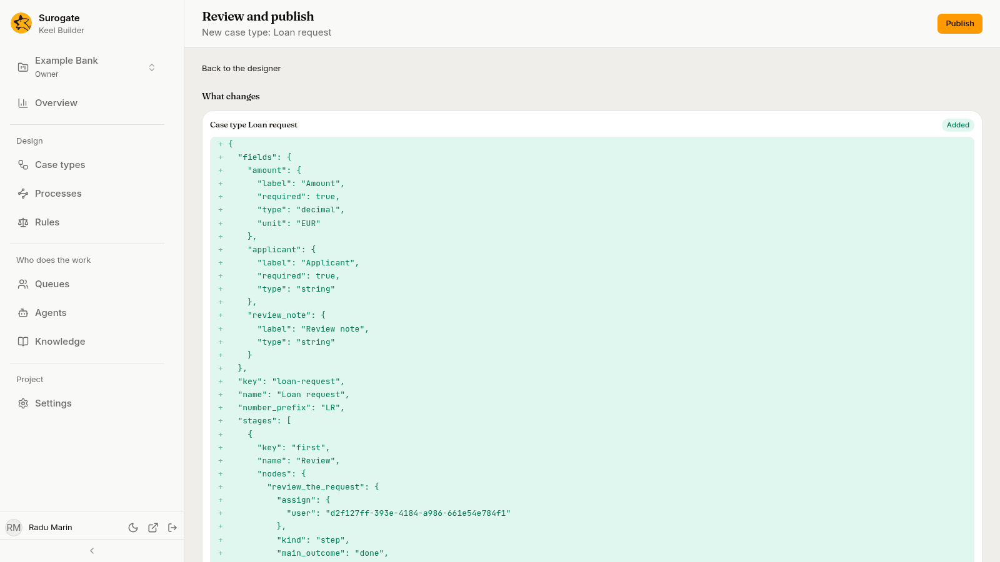
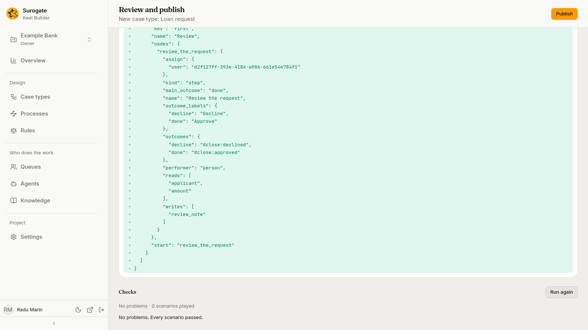

Before a draft goes live, Keel checks it. A **dry run** runs every check and plays the scenarios without publishing anything. **Review and publish** shows what the draft changes, runs the checks again, and publishes the draft once they pass.

## Dry run

Editors and owners see **Dry run** in the header of the designer, a process's page, the Rules page and the Queues page while a draft is open.

1. Press **Dry run**. Keel Builder saves your changes first, then the panel says **Checking the draft…**. If the draft has had a dry run already, the panel shows that one; press **Run again** for a new one.
2. The panel shows how many problems it found and how many scenarios it played, such as `No problems · 3 scenarios played` or `2 problems · 3 scenarios played`.

With nothing wrong, it says **No problems. Every scenario passed.**

Otherwise it groups the problems:

| Group | What it means |
|---|---|
| **Warnings** | Something Keel ignores and never runs in a [BPMN process](/keel/processes/), or a process that Keel Builder and an instance's page cannot draw in full, because it has no diagram or only part of one. [Lay it out](/keel/builder/processes/#laying-out-the-diagram) from the process's Diagram tab. A warning never stops the publish. |
| **Main changed** | Something published since the draft started changed the same things. Update the draft from main on the review page. |
| **Unreachable steps** | No path from the stage's start reaches the node. |
| **Outcomes with nothing connected** | An outcome, branch, case event or action leads to a place that does not exist, or a step has no outcome. |
| **Forms that do not cover a decision's inputs** | A decision, rule, system call, check or authority check reads a field that may have no value there, or a rule node's assignment names a result the rule does not give. |
| **Agents lacking a tool a step requires** | A step names an agent, tool, MCP server or knowledge base the project or the agent does not have. |
| **Steps without a raised-hand target** | An agent step's raised hands go to a queue that does not exist. |
| **Failing scenarios** | A scenario, or a rule's own test, did not give what it expects. |
| **Moving running cases** | A mapping of running cases has a problem. |
| **Other problems** | Anything else, such as a condition that cannot be read, or a connection without `https`. |

Each problem has Keel's message and its place, such as a step, a form or a scenario. Press the place to go there; the panel closes. The designer also pins the problems on the board, on the stage, the card, the outcome or the action.

Press **Run again** after you fix them. If you changed the draft since the dry run, the panel says **You changed the draft since this dry run.** If Keel could not run the dry run, the panel says why, with **Try again**.

## Review and publish

Press **Review and publish** in the designer, a process's page, the Rules page or the Queues page. Viewers get **Only the project's editors and owners publish.**

The page, titled **Review and publish** with the draft's title under it, has **Publish** in its header and a link back to where you came from, such as **Back to the designer**. Under it are these parts:

- **What changes**: each thing the draft changes, compared with what is published, such as **Case type Loan request**, marked **Added**, **Changed** or **Removed**, with its changed lines. A [process](/keel/builder/processes/) reads by its name, such as **Process Loan review**; its diagram is left out. "This draft changes nothing." when there is nothing.
- **Checks**: Keel saves your changes and runs the dry run again when the page opens. It shows the same line and groups as the Dry run panel. **Run again** runs it once more. The checks also read what each process node and each process's start-a-case task starts, and check a republished case type or process against the versions that start it: see [Checking what starts what](/keel/processes/#check-and-publish). They check a process's calls to systems and the agents that work its tasks too: see [Checking what a process calls and which agents work it](/keel/processes/#check-and-publish).
- **Moving running cases**: what the publish would do with running cases, when the draft holds a [mapping](/keel/builder/versions/#moving-running-cases-to-a-new-version).

**Publish** is turned on only when the last check found no problems other than warnings. It publishes the draft as the checks saw it. If the draft changed since, Keel refuses and the page says "This draft changed since the checks ran. Run them again."

### Updating from main

When something was published after the draft started, the dry run reports **Main changed**. The review page shows it as a warning at the top that names what changed: "Main changed since this draft started: …". Press **Update from main** beside it to bring those changes into the draft.

When main and the draft both changed the same thing, Keel Builder asks: **Main and this draft changed the same files**, with **Keep this draft's version**. After the update, the checks run again.

### Publishing

Press **Publish**. The page says **Published *title*.**, with:

- **Open the business app**, which opens the project's Work page in the business app;
- **Back to case types**, or **Back to the process** when you opened **Review and publish** from a process's page;
- **Running cases are moving. Follow them on the Versions tab.**, when the publish moves running cases.

The draft is closed. Every case type it changed has a new version, and new cases start on it; so has every [process](/keel/processes/) it changed. Rules, calendars and queues it changed take effect too; a rule version can also wait for its own date (see [Rules](/keel/builder/rules/#when-a-version-takes-effect)).

If Keel refuses the publish, the page lists why, with any warnings beside the problems. Fix the problems in the draft and publish again.

## Who can publish

Editors and owners publish. A publish needs no second approval, but it always passes every check and every scenario first.
