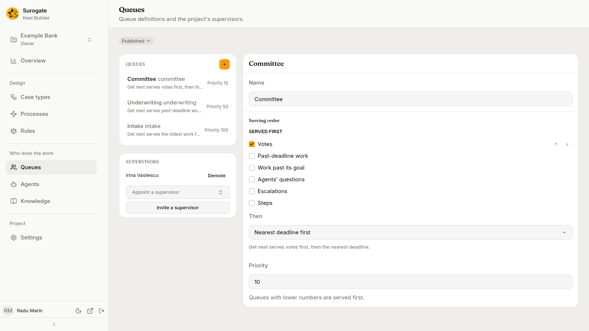
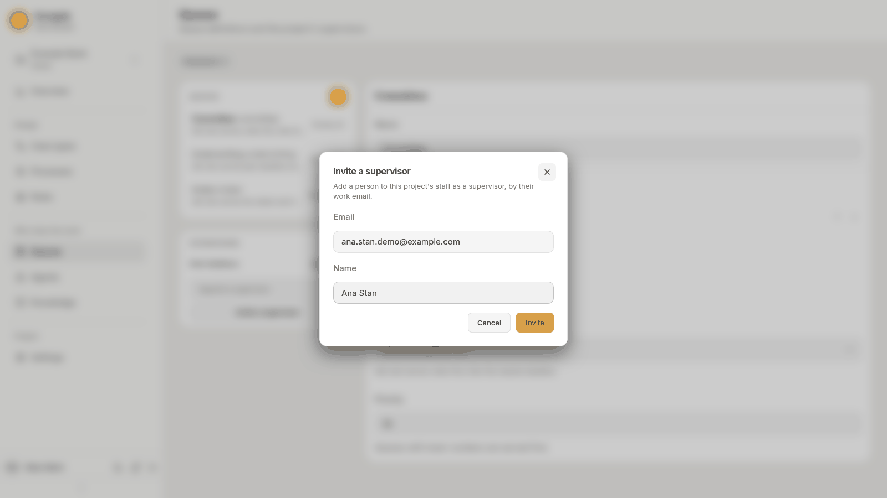

The **Queues** page holds the project's queue definitions and its supervisors: "Queue definitions and the project's supervisors." Builders define what a queue is and in what order it serves work. Supervisors, in the business app, decide who works each queue.

## Queues

The list shows each queue by name, with its key, its serving order in words and its priority, in the order Keel serves the queues. Pick one to open it on the right. With no queue picked, the first one opens.

Queues change in a [draft](/keel/builder/drafts/), like everything else. With no draft open, your first change offers a new draft titled `Change queues`. To add a queue, press **+** (**New queue**) beside the **Queues** heading. The dialog asks for the queue's **Name** and shows the key it gives: "It is made in the draft, serving the oldest work first, at priority 100." Press **Create**.

A queue has:

- **Name**: what staff see, such as `Underwriting`. A blank name is not saved: "Give the queue a name."
- **Serving order**: what **Get next** hands out first.
  - **Served first**: tick the kinds of work to serve before the rest, and order them: **Past-deadline work**, **Work past its goal**, **Agents' questions**, **Escalations**, **Steps**, **Votes**.
  - **Then**: how the rest is served: **Oldest first** or **Nearest deadline first**.

  Under them the order reads in words, as staff see it in the queue, for example: "Get next serves past-deadline work first, then agents' questions, then the nearest deadline."
- **Priority**: a whole number. "Queues with lower numbers are served first." Get next looks at a person's queues in priority order, then by key.

A step, a vote, an agent's raised hands and an escalation each name the queue they go to; see [Steps](/keel/builder/steps/#done-by).

Who works a queue is not part of its definition. Supervisors add and remove members on the business app's [Team page](/keel/business/supervisors/#queues-and-members).

## Supervisors

Under the queues, **Supervisors** lists the project's supervisors by name. Supervisors are staff of the business app with more rights: they staff queues, invite staff, set authority limits, turn agents off and on, and move cases by hand. See [The Team page](/keel/business/supervisors/).

The project's owners manage supervisors here. Editors and viewers see the list only.

### Appoint someone who has an account

Use **Appoint a supervisor**: type two letters of the person's name and pick them. The search lists the people of the project's organisation, with whether each is already staff or a supervisor. Keel says **_name_ is a supervisor.**

### Invite someone new

1. Press **Invite a supervisor**: "Add a person to this project's staff as a supervisor, by their work email."
2. Enter their **Email** and **Name**, and press **Invite**.

   

3. Read the answer and send the person what it gives you:
   - **Send *name* this link to set their password.** with a **Set-password link**. The link works once, until the time shown. When Keel has emailed the person, the dialog says so first: **Keel emailed *name* a link to set their password. If it does not reach them, send them this one.**
   - ***Name* signs in with** the project's sign-in, **using** their email, with a **Sign-in link**, when the project signs in through Google, GitHub or another outside sign-in.
   - ***Name* was on the staff already, and is now a supervisor.**
   - ***Name* can sign in with the account they have.** with a **Sign-in link**, for someone whose account already existed.
4. Press **Done**. The dialog shows the link only this once, so copy it first.

An invitation can be refused:

| Message | Why |
|---|---|
| **More than one account uses this email. Ask an administrator to add the person.** | The email is not unique across accounts. |
| **This person signs in through another sign-in project and cannot be invited here.** | Their account belongs to a different sign-in setup. |
| **This project has no organisation to invite people into. Ask an administrator.** | The project's business sign-in is not set up. |
| **This email or name is not accepted.** | Check the email and the name. |
| **Invitations cannot reach the runtime now; try again shortly.** | A temporary problem. Try again, or ask your administrator if it lasts. |

### Demote a supervisor

Press **Demote** beside their name. Keel asks **Demote *name*?**: "They stay on the staff, in their queues and with their authority." Press **Demote** to confirm. They lose only the supervisor's rights.

Supervisors cannot be removed from the staff in the business app; demote them here first.
