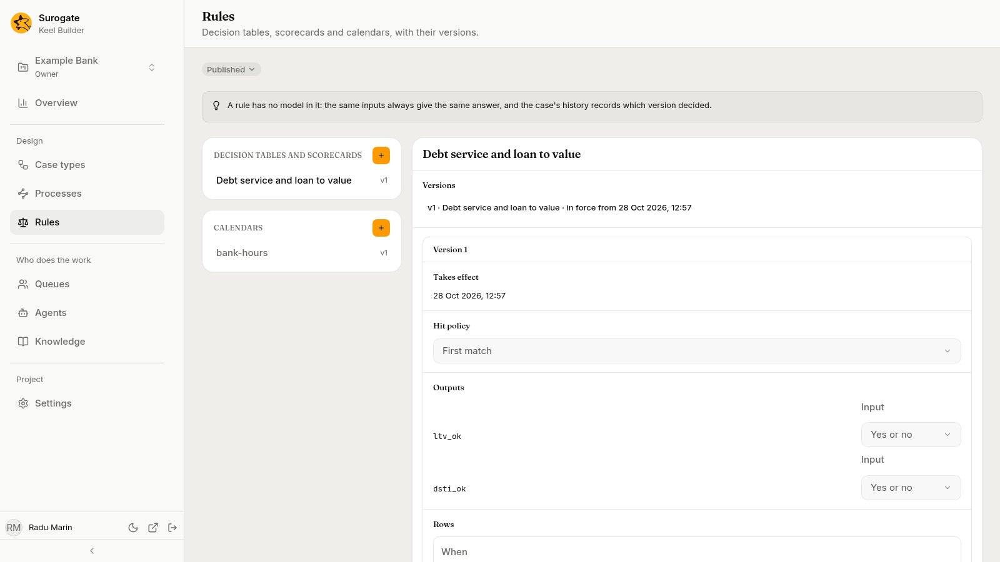
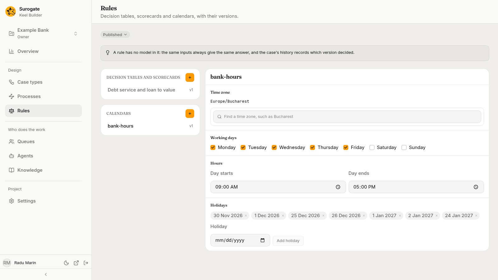

The **Rules** page holds the project's decision tables, scorecards and calendars: "Decision tables, scorecards and calendars, with their versions." Rules are shared by the project's case types: a [rule node](/keel/builder/flow-nodes/#rules) runs one, and a case type's calendar comes from here.

Like everything else, rules and calendars change in a [draft](/keel/builder/drafts/). The page has its own draft bar; with no draft open, your first change offers a new draft titled `Change rules`. In a draft, editors and owners also see **Dry run** and **Review and publish**.

## The lists

- **Decision tables and scorecards**: each rule by name, with its latest version, such as `v3`, or **New** for one not published yet.
- **Calendars**: each calendar by key, with its version.

Pick one to open it. Editors and owners make a new one with **New rule** or **New calendar**, the **+** beside each list.

A note above the lists says: "A rule has no model in it: the same inputs always give the same answer, and the case's history records which version decided."

## Decision tables and scorecards

**New rule** asks for the rule's key and its **Kind**: **Decision table** or **Scorecard**. "It is made in the draft, as a decision table or a scorecard, which it stays."

In a draft, a rule shows its **Name**, its **Versions**, when its next version **Takes effect**, its table or scorecard, and its **Tests**. With no draft open, it shows its **Versions**, with the latest open under them, read-only.

The [designer agent](/keel/builder/designer-agent/) can make and change rules in a draft for you, with their conditions and tests.

### Decision tables

A decision table turns conditions over the case's fields into result values.

- **Hit policy**: **First match** takes the first row whose condition holds. **Exactly one match** expects one row only; more than one is an error.
- **Outputs**: the results the table gives, each with its **Input**: **Text**, **Number** or **Yes or no**. Add one by its **Output name** with **Add output**. An output is written once a row or the default gives it a value.
- **Rows**: each row has a **When** condition and a value per output. **Add row** adds one; rows move up and down.
- **Default**: **No default**, or **A value per output** for when no row matches. With no default and no matching row, the rule gives no answer, and the case cannot go past the node.

A **When** condition compares the case's fields by name, such as `amount > 50000.0`: the field, a comparison, and a value.

A rule node then assigns outputs to fields, for example the output `over_limit` to the field **Over the desk's limit**.

### Scorecards

A scorecard adds points from several characteristics.

- **Points**: **Base points**, the score to start from, and **Most reasons**, how many reason codes to give.
- **Characteristics**: each has a **Name** and its bins. Each bin has a **When** condition, **Points** and a **Reason code**. The first bin whose condition holds gives its points. **Add characteristic** and **Add bin** add them.

A scorecard gives two results: `score`, the total, and `reasons`, the reason codes of the characteristics that lost the most points against their best bin, up to **Most reasons**. Every characteristic needs a bin that holds; otherwise the rule gives no answer.

### Tests

A test gives the rule some field values and says what it must answer. **Add test** adds one; the cross beside a test removes it. With none, the section says "It has no tests yet."

- **Data**: the field values to try. Type each field's name in double quotes, a colon, then its value; separate them with commas and put them all between curly braces. Text and decimals go in double quotes, whole numbers and `true` or `false` do not, such as `{"amount": "250000.00"}`.
- **Expect**: the whole answer the rule must give, each output by name, in the same form, such as `{"over_limit": true}`. The test fails if the rule answers anything else.

Every dry run runs the tests. After one, the section says under them "None of its tests failed in the last dry run.", or lists each failure, with Keel's message, under **Failed in the last dry run**. The dry run lists a failed test under **Failing scenarios** too.

### When a version takes effect

Each publish that changes a rule gives it a new version. Under **Takes effect**, pick:

- **When published**: the version applies from the publish;
- **At a date and time**: the version applies from a later time, in your time zone.

The time must be after the publish, and two versions of a rule cannot share it. A case type that uses a rule needs a version in force when it is published.

A case uses the version in effect when it reaches the rule node, unless its case type [pins the rule](/keel/builder/case-type-settings/#pinned-rules): then it keeps the version in effect when the case started.

The **Versions** section lists each published version with its name and when it takes effect or has been in force from. Pick one to read it.

## Calendars

A calendar says when the working week runs, for service levels and waits that count business time. **New calendar** makes one: "It is made in the draft, in your time zone, working Monday to Friday, 09:00 to 17:00."

| Section | What it holds |
|---|---|
| **Time zone** | **Find a time zone**, such as Bucharest. |
| **Working days** | The days that count, Monday to Sunday. A calendar needs at least one. |
| **Hours** | **Day starts** and **Day ends**. The day must end after it starts. |
| **Holidays** | Days that do not count. Add one with **Holiday** and **Add holiday**; the cross on a holiday removes it. |

A case type uses a calendar by picking it on its [Settings tab](/keel/builder/case-type-settings/#case-type).
