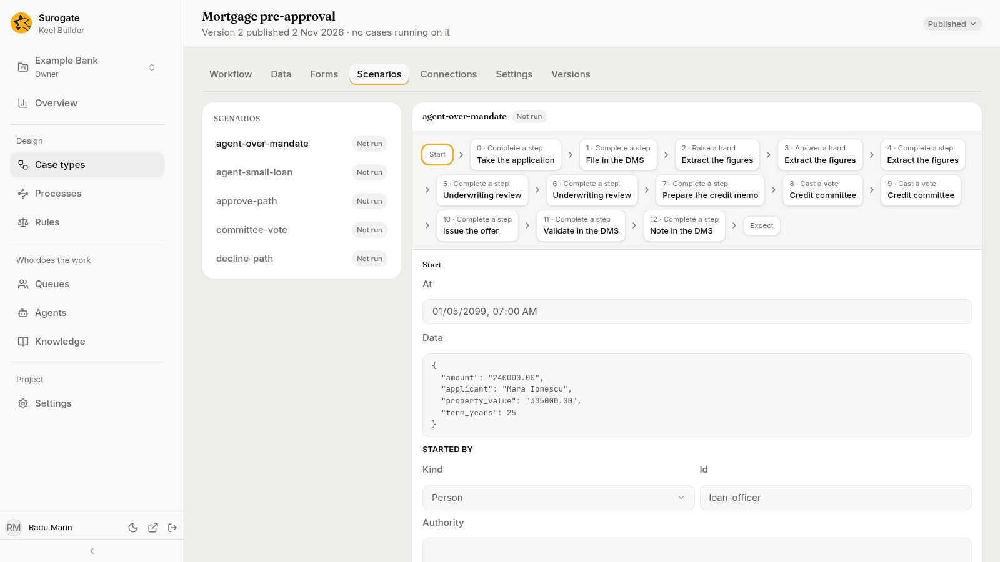
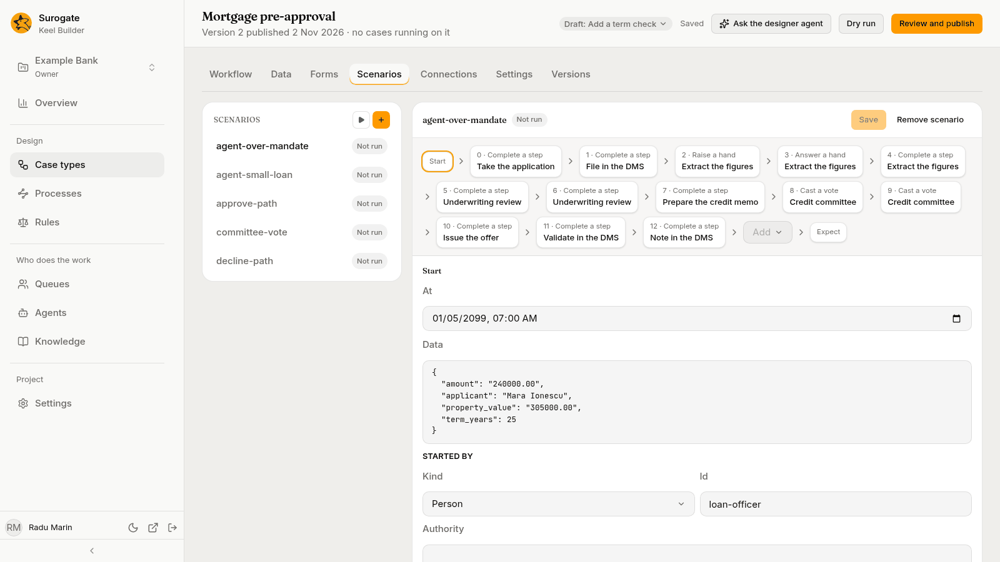

A **scenario** is a stored test of a case type: given how a case starts and what happens to it, the path it should take and how it should end. Every dry run plays the scenarios of the case types a draft changes, and publishing needs every scenario to pass.

You do not have to write scenarios by hand. The [designer agent](/keel/builder/designer-agent/) writes them for you, one for each way a case can end, and fixes them when a dry run finds a problem. Ask it in the draft, such as "Write a scenario where the committee declines the loan."

## The list

The left of the tab lists the case type's scenarios by name, each with how it did in the last dry run: **Passed**, **Failed** or **Not run**. Pick one to see it.

In a draft, editors and owners see two buttons beside the **Scenarios** heading:

- **New scenario** (the **+**): asks for its name. "It is made in the draft. How the case starts, the steps played and what must hold come next."
- **Run** (the play button): dry-runs the draft, which plays every scenario, and updates their results. While it runs, the list says **Checking the draft…**. While a scenario has changes you have not saved, **Run** waits: "Save your changes to run them".

With no draft open, the tab shows the published scenarios, read-only and not run.

## A scenario

A scenario reads as a strip: **Start**, then each step played, numbered from 0 with its kind, such as **0 · Complete a step** and the step's name, then **Expect**. Press a part of the strip to see its details under it. In a draft, the **Add** menu before **Expect** adds a step, and the bin beside a step's title deletes it (**Delete step**).

A failed scenario shows Keel's message under its name.

Your changes stay on screen until you press **Save**, which saves them in the draft. **Discard** drops them. If you leave the scenario with changes not saved, Keel Builder asks **Discard your changes?** first. After you change a scenario, its last result says "This result is of the last saved version." If someone else changes the scenario while you edit it, it says "This scenario changed while you edited it. Saving replaces that change.", with **Use the latest** to drop your changes and read theirs.

### Typing data

Some boxes, such as a scenario's **Data**, take field values. Type each field's name in double quotes, a colon, then its value; separate the pairs with commas, and put them all between curly braces. Text, decimals, dates and choices go in double quotes; whole numbers, and `true` or `false` for yes or no, do not. For example: `{"applicant": "Ioana Popescu", "amount": "20000.00", "term_years": 25}`. A box left blank means none.

If Keel cannot read what you typed, the box says so, such as "Write the data as a JSON object.", and the scenario says "A JSON box holds text that cannot be read. Fix it to save this scenario." Fix the text, or ask the designer agent to write it.

### Start

- **At**: when the case starts, in your time zone.
- **Data**: the values the case starts with, typed as above.
- **Started by**: who starts it. **Kind** is a **Person**, an **Agent** or a **System**; **Id** names them, such as `loan-officer`. **Authority** holds the limits they have, if a step checks authority: each scope and its limit, such as `{"lending": "500000"}`. Blank means none.

### Steps

The things that happen to the case, in order. Steps count from 0. The **Add** menu picks the kind:

| Kind | What you fill in |
|---|---|
| **Complete a step** | The **Step**, its **Outcome**, its **Output** (the values the step writes, typed as above), its **Sources** (for each value, where an agent found it; blank for none), and who did it (**Done by**; by default, **The step's performer**). |
| **Cast a vote** | The **Step**, the **Choice**, and who voted (**Cast by**). |
| **Raise a hand** | The **Step**, the **Question**, the **Choices** it offers (one per line), the **Evidence** (a list between square brackets; blank for none), and who raised it (**Raised by**). |
| **Answer a hand** | The **Step**, the **Reply**, a **Note**, and who answered (**Answered by**). |
| **Send an event** | The **Event**, its **Payload** (the event's values, typed as above), and who sent it (**Sent by**; by default, **No one**). |
| **Start an action** | The **Action**, and who started it (**Started by**). |
| **Move the case** | Where it goes (**To**), the **Reason**, and who moved it (**Moved by**). |
| **End a process** | The **Process**, a process node that waits; its **Status**: **Completed**, **Ended**, **Failed**, **Cancelled** or **Not started**; the **Error** a failed process ended with, or why its start was refused; and the **Variables** it ended with, typed as above. |
| **Let time pass** | A **Duration**, so timers and service levels can fire. |

Who did a step is picked as under **Started by**: a **Kind**, an **Id** and any **Authority**.

Each step but **Let time pass** has an **At**: "A time with its offset, or + and a duration after the step before. A minute after it when blank." For example, `+PT1M` is one minute after the step before.

### Expect

What must hold once the steps are played:

- **Path**: the nodes the case must pass through, in order. The **Add** menu adds one; each has a cross to remove it. Empty, it reads **Any path.**
- **Status**: **Any**, **Open** or **Closed**.
- **Resolution**: how the case closed, such as `approved`.
- **Data**: field values the case must hold, typed as above. Fields you leave out are not checked.
- **Rejections**: steps that Keel must refuse, each by its **Step** number and the refusal's **Code**, such as `authority`. **Add rejection** adds one. With none, it reads **None expected.**

## Remove a scenario

**Remove scenario** asks first, **Remove *name*?**: "Its file is deleted from the draft." Press **Remove**.

## Test one step

Scenarios play a whole case. To try one agent step alone, press **Test this step** in the step's panel: it runs the step's agent once on inputs you give, with no case. See [Test an agent step](/keel/builder/steps/#test-an-agent-step).
