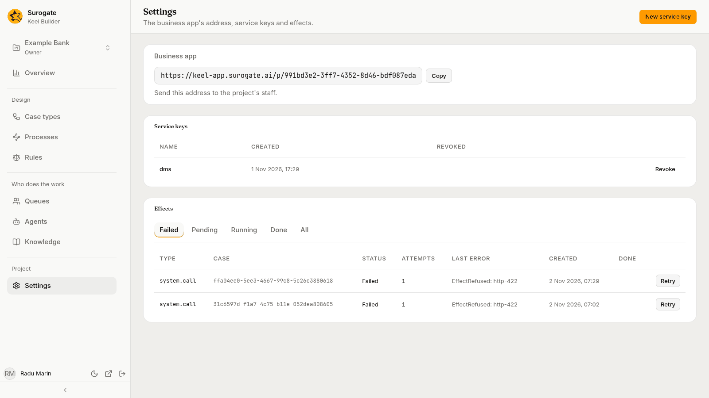
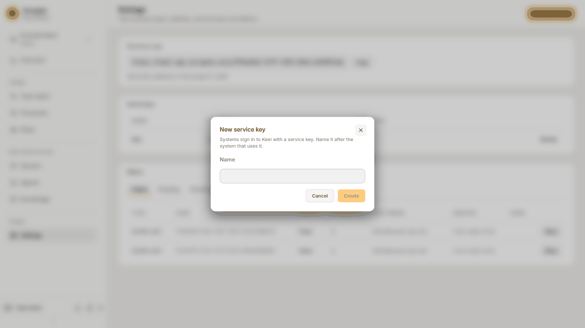

The **Settings** page in Keel Builder's left rail, under **Project**, holds what applies to the whole project: "The business app's address, service keys and effects." It is not the designer's Settings tab, which is per case type (see [Case type settings](/keel/builder/case-type-settings/)).

What you see depends on your role in the project. Every role sees **Business app**. Owners also see **Service keys** and the **New service key** button. Editors and owners see **Effects**.

## Business app

**Business app** shows the address of this project's Work page in the business app: "Send this address to the project's staff." Press **Copy** to copy it, then send it to the people who work the project's cases. Every role sees it.

## Service keys

A **service key** lets another system that your team connects to Keel, such as a core banking system or a web form, start cases on the project's behalf. Treat a key like a password. Only owners see this section.

### Create a key

1. Press **New service key** in the page header.
2. Type a **Name**. The dialog says: "Systems sign in to Keel with a service key. Name it after the system that uses it."
3. Press **Create**.
4. The dialog shows the **Service key**: "Copy the key now. It is not shown again." Copy it, then press **Done**. Until you press **Done**, the dialog stays open, so the key is not lost by a stray click.

Keel cannot show the key again. If the key is lost, create a new one and revoke the old one.

### Revoke a key

The table lists each key by **Name**, when it was **Created**, and when it was **Revoked**. Before the first key, it reads "No service keys yet." Press **Revoke** on a live key. Keel asks **Revoke *name*?**: "Systems using it can no longer sign in." Press **Revoke** to confirm. A revoked key stays in the list with its revoke date, and it cannot be turned back on.

## Effects

An **effect** is work Keel does after a transition: starting or resuming an agent on a step, starting or stopping an agent's work on a work item, calling another system for a system step, starting the process a case's process node asks for, or starting the case a process's task asks for. Keel runs each effect, tries again when it fails, and marks it **Failed** when its last attempt fails. Editors and owners see this section.

The tabs show the effects in one status: **Failed**, **Pending**, **Running**, **Done** or **All**. It opens on **Failed**. A tab with nothing in it says so, for example "No failed effects." The table shows each effect's **Type**, its **Case** (a case's id, or **Process** and the instance's number for an effect of a process, such as `Process P-000003`), its **Status**, its **Attempts**, its **Last error**, when it was **Created** and when it was **Done**. It never shows the effect's content, which holds case data.

Press **Retry** on a failed effect to run it again; Keel says **The effect runs again.** An effect that is no longer failed, or that Keel no longer has, shows Keel's reason, and the list is read again.

What happens to the case when a system step's call fails for good is set on the step, under **When it fails for good** (see [Steps](/keel/builder/steps/#a-system)). An agent step whose agent fails for good goes to people in its raised-hands queue.
