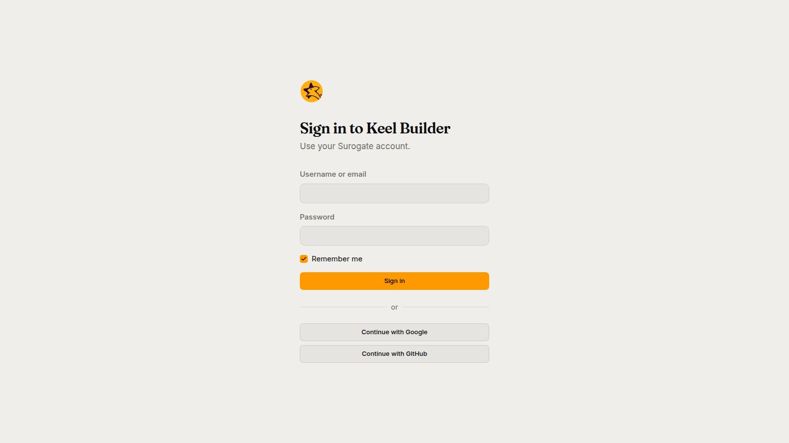
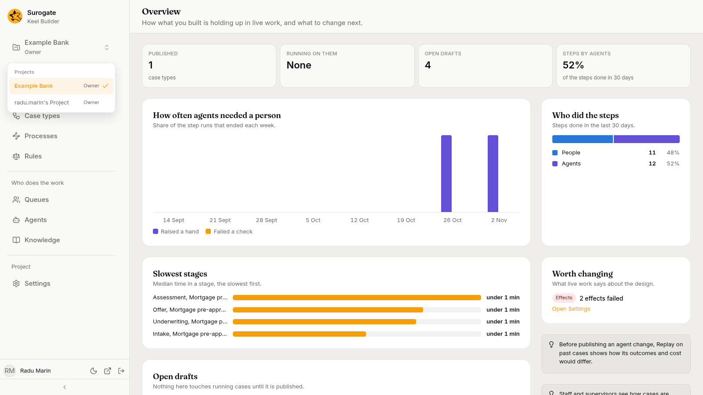

Keel Builder, at https://keel-builder.surogate.ai, is where a project's builders design and publish its case types. You sign in with your Surogate account, the one you use in Studio, and you see the projects you are a member of.

## Signing in

The sign-in page is titled **Sign in to Keel Builder**: "Use your Surogate account."

1. Type your **Username or email** and your **Password**.
2. Leave **Remember me** on to stay signed in on this browser.
3. Press **Sign in**.

Where your Surogate installation offers them, **Continue with Google** and **Continue with GitHub** sign you in with that account instead.

If sign-in does not work, the page says why:

| Message | What to do |
|---|---|
| **Enter your username or email and your password.** | Fill in both boxes. |
| **Wrong username or password.** | Check both and try again. |
| **Too many attempts. Wait a minute and try again.** | Wait, then try again. |
| **Your password must be changed. Change it in Studio, then sign in here.** | Change your password in Studio first. |
| **You have no Surogate account yet. Create one in Studio first.** | Sign up in Studio, then come back. |
| **The browser blocked the sign-in window. Allow pop-ups for this site and try again.** | Allow pop-ups for Keel Builder. |
| **Cannot reach Surogate. Try again.** | A temporary problem; try again. |

## Picking a project

After signing in, Keel Builder opens the **Case types** page of the project you used last, or of the first of your projects by name. The switcher at the top of the left rail shows the project and your role in it: **Owner**, **Editor** or **Viewer**. Press it to see your **Projects**, each with your role, and pick another project to open the same page in that project.

When an editor or owner opens a project, Keel sets up the project's helpers, the case agent and the designer agent, if it lacks them. See [The project's helpers](/keel/builder/designer-agent/#the-projects-helpers).

Projects are made in Studio, not here, and their owners add members there. If you are a member of no project, the app says **You are not a member of any project**, with **Open Studio** and **Sign out**. A link to a project you are not a member of shows **You are not a member of this project**.

## The left rail

The rows are grouped under **Design**, **Who does the work** and **Project**.

| Row | What it holds |
|---|---|
| **Overview** | "How what you built is holding up in live work, and what to change next.": counts of what is published, running and in drafts, how often agents needed a person, who did the steps, the slowest stages, the open drafts, and what is worth changing. |
| **Case types** | The project's case types, and the designer for each. See [Case types](/keel/builder/case-types/). |
| **Processes** | The project's BPMN processes: each one's drawing, its file, its problems, its versions and its connections. See [Processes](/keel/builder/processes/). |
| **Rules** | Decision tables, scorecards and calendars. See [Rules and calendars](/keel/builder/rules/). |
| **Queues** | Queue definitions and the project's supervisors. See [Queues and supervisors](/keel/builder/queues/). |
| **Agents** | How the agents of the project's case types are doing: figures, the steps they work, raised hands, what each may use and its sessions. See [The Agents page](/keel/builder/agents/). |
| **Knowledge** | "The knowledge bases this project's case types and agents read. The same ones every agent in Studio uses." |
| **Settings** | The business app's address, service keys and effects. See [Project settings](/keel/builder/settings/). |

The bar at the bottom shows your name. Its buttons switch between **Dark theme** and **Light theme**, **Open Studio** in a new tab, and **Sign out**.

## What your role lets you do

- **Viewers** see everything but agents' sessions, raised hands and exports, and change nothing. Pages that edit show **You can view this project. Its editors and owners change it.**
- **Editors** change case types, rules, queues and connections in drafts, ask the designer agent, run dry runs, publish, set credentials and retry effects. They also read agents' sessions and raised hands, and export their runs.
- **Owners** do what editors do, and also appoint, invite and demote supervisors, and create and revoke service keys.

The full table is in [Roles and permissions](/keel/reference/roles/).

## Phones

The designer needs a desktop screen. On a phone, a case type shows **The designer needs a wider screen** and asks you to open it on a computer. The other pages work on a phone.
