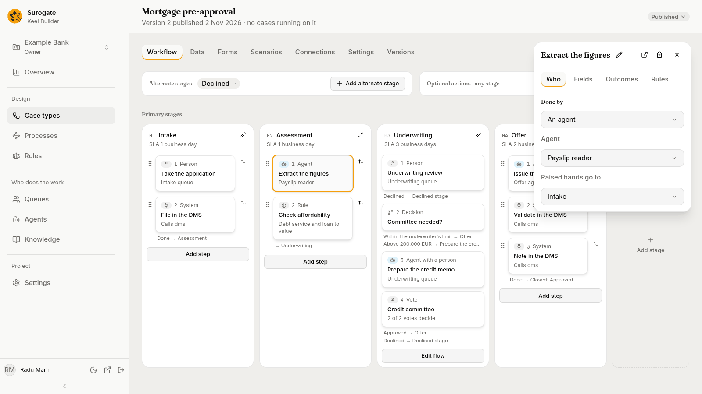
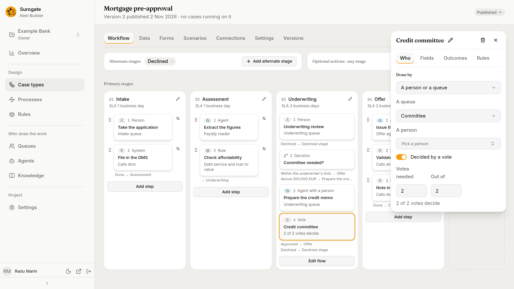
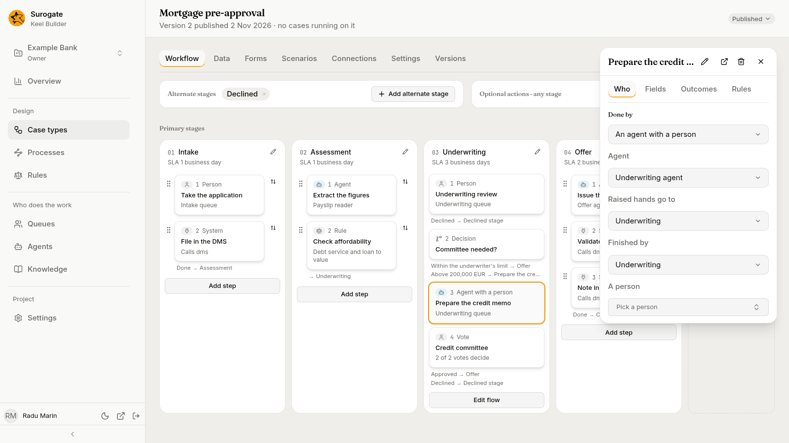
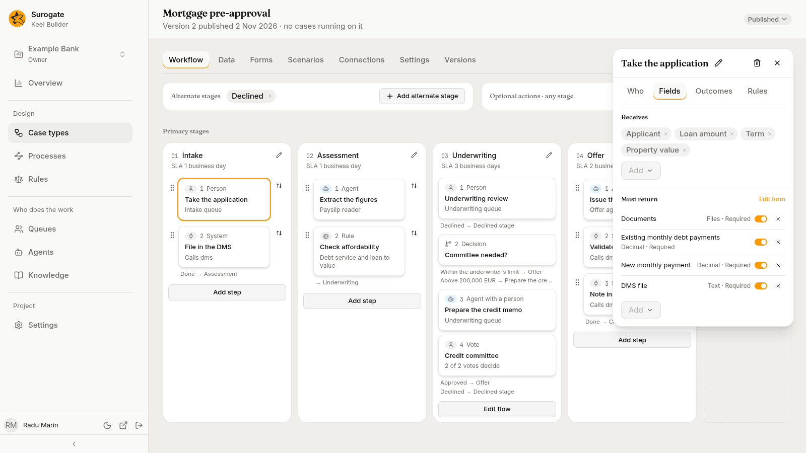
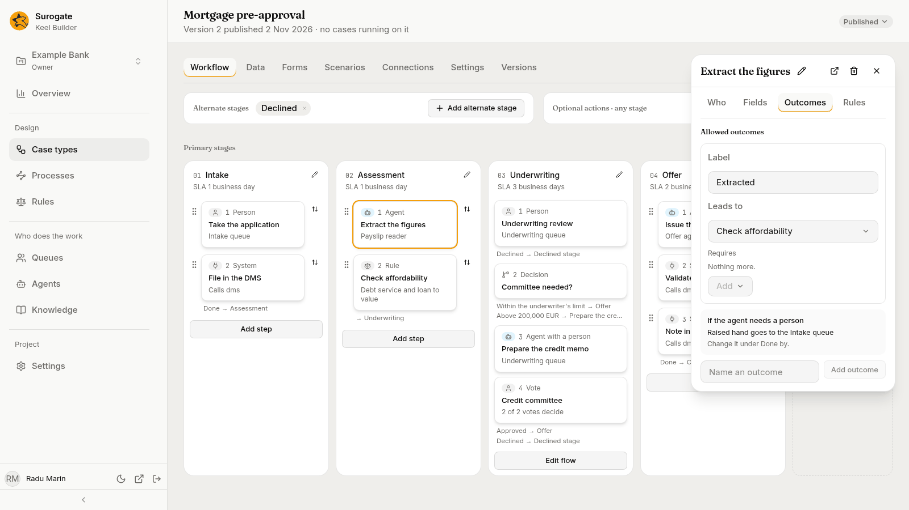
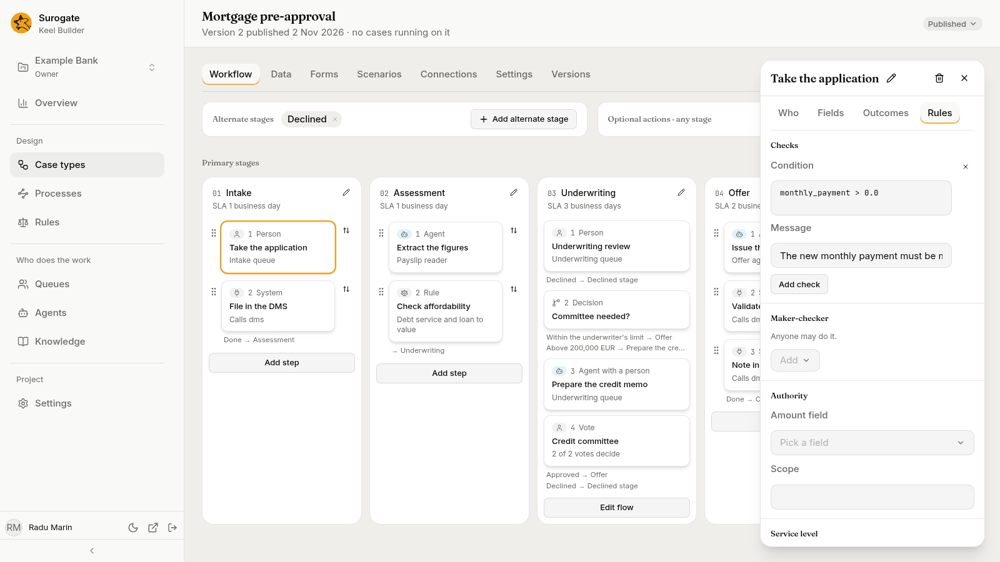

A step is work: something an agent, a person, a queue or another system does before the case goes on. Pick a step on the [board](/keel/builder/workflow/) or in a stage's flow, and its panel opens on the right. The panel is the step's **contract**: who does it, what it reads, what it must return, what must hold, and where each outcome leads.

## The panel

The panel's header shows the step's name, with a pencil to rename it, and these buttons:

- **Open agent**, for a step an agent works: opens Studio's agents page in a new tab, where agents are changed;
- **Test this step**, for a step an agent works, for editors and owners in a draft: see [Test an agent step](#test-an-agent-step);
- **Remove step**, the bin, for editors and owners: Keel asks **Remove *name*?** first, and says where what led to the step will lead instead;
- the close button.

The card on the board names the step's kind: **Agent**, **Person**, **Agent with a person**, **System**, or **Vote** for a step decided by votes.

Under the header, the contract is on four tabs:

| Tab | What it holds |
|---|---|
| **Who** | [Done by](#done-by), and for an optional action, **When it is offered** (see [Optional actions](/keel/builder/workflow/#optional-actions)). |
| **Fields** | [Receives](#receives), [May use](#may-use) for a step an agent works, and [Must return](#must-return). |
| **Outcomes** | [Allowed outcomes](#allowed-outcomes). |
| **Rules** | [Checks](#checks), [Maker-checker](#maker-checker), [Authority](#authority) and [Service level](#service-level). |

## Done by

On the **Who** tab, pick the performer: **An agent**, **A person or a queue**, **An agent with a person** or **A system**. Changing it keeps what the new performer uses and drops the rest.

### An agent

- **Agent**: one of the project's agents, by name. Agents are made and changed in Studio; an agent made there shows here when you come back to the window. The project's helpers, the case agent and the designer agent, are never offered (see [The project's helpers](/keel/builder/designer-agent/#the-projects-helpers)).
- **Raised hands go to**: the queue that gets the agent's questions when it needs a person.

The step needs both. Until both are picked, the panel says **Pick its agent to save it.** or **Pick where its raised hands go to save it.**, and nothing is saved.

The agent works the step in its own session. It gets the values of the fields the step reads, may use only what [May use](#may-use) allows, and must finish with one of the step's outcomes and the fields that outcome requires. Keel also refuses an agent's result that does not say where each value came from.

How the agent does on the step, over a period, shows on the [Agents page](/keel/builder/agents/#steps-it-works).

If the agent fails for good, people take the step: it opens as work in the **Raised hands go to** queue. The same happens to each of its steps that opens while a supervisor has the agent turned off.

### A person or a queue

- **A queue**: one of the project's queues. Its members see the step in the queue and claim it.
- **A person**: one person, found by name. Picking one clears the queue.

With no person picked, you can turn on **Decided by a vote**. Set **Votes needed** and **Out of**; the panel reads, for example, `2 of 3 votes decide`. Every member of the queue may vote, once, choosing one of the step's outcomes. As soon as one outcome has the votes needed, the step ends with it. A vote returns no fields.

A step with neither a queue nor a person opens with no one to work it: nobody can take it in the business app, and a supervisor has to [move the case by hand](/keel/business/supervisors/#move-a-case-by-hand). Give every person step a queue or a person.

### An agent with a person

The agent drafts the step, and one person finishes it: they see the agent's draft in the step's form, change what they need, and submit it. The person, not the agent, is checked against [maker-checker](#maker-checker) and [authority](#authority).

- **Agent** and **Raised hands go to**, as for an agent step.
- **Finished by**: the queue whose member finishes it, or **A person**. It is never a vote.

If the agent fails, or is turned off when the step opens, the person works the step alone.

### A system

The step calls another system through one of the case type's [connections](/keel/builder/connections/), and copies values from the answer into fields. The quickest way to set it up is to describe the call to the [designer agent](/keel/builder/designer-agent/), for example "Look the client up in the DMS by their ID and keep the risk grade it returns", and check what it fills in. To fill it in yourself, keep the other system's documentation at hand:

1. **Connection**: pick the connection the call goes through. The other settings show once one is picked. If the list is empty, the panel says **The case type has no connections yet.**: add one on the **Connections** tab first.
2. **Method**: pick the kind of call the other system's documentation gives for what you want done.
3. **Path**: type where the call goes, after the connection's address, as the documentation gives it.
4. **Query**, **Headers** and **Body**: what the call sends, when the documentation asks for it. Type it as a JSON object of names and values, such as `{"channel": "web"}`, or leave the box empty. Text the box cannot read says **Write this as a JSON object.** and is not saved. To send the value of one of the case's fields, ask the designer agent to write it in.
5. **Outputs**: pick a field from **Add output**, then type, beside it, where in the other system's answer its value is found. The designer agent can fill this in. A field you add here is added to what the step returns.
6. **Accept statuses**: the answer codes that do not mean success but that the step should still read as an answer, such as `404, 409`. Type them as numbers, separated by commas.
7. **Timeout (seconds)**: how long one call may take, in whole seconds. Leave it blank to use the connection's.
8. **When it fails for good**: **Fail the case**; **Send to a queue**, then pick the **Queue**, whose people complete the step by hand; or **Go to**, then pick where the case **Goes to** in the flow.

Credentials never go in a step's call: they belong to the connection. Keel tries a failing call again before it fails for good, and the connection's **Idempotency-key header** lets the other system tell a repeated call from a new one.

## Receives

On the **Fields** tab: the fields the step reads, as chips; a file field is marked `· file`. A chip's × removes it, and the **Add** menu picks another. With none, it says **It reads no fields.** An agent gets these values when it starts.

## May use

On the **Fields** tab, only for steps an agent works. Each list starts with everything the agent has, such as **Everything Payslip reader has**:

- **Tools**: the agent's tools, as Studio lists them;
- **MCP servers**: the agent's MCP servers;
- **Knowledge**: the knowledge bases the case type grants on its [Settings tab](/keel/builder/case-type-settings/#knowledge), **Everything the case type has**.

Press **Narrow** to keep only some, then add them one by one from the **Add** menu; the list names what it leaves out as **Not allowed**. **Use everything** drops the narrowing. "A step can narrow these lists, never widen them."

For tools the agent reaches by a prefix, type the tool's name and press **Add**; a name the agent has no tool by is refused.

## Must return

On the **Fields** tab: the fields the step writes, one row each, with the field's type and whether it is required: **Required**, **Required for** some outcomes, or **Optional**. The row's switch makes it required whatever the outcome, and its × removes it. The **Add** menu adds another. **Edit form** opens the step's form on the [Forms tab](/keel/builder/forms/).

A vote reads **A vote returns no fields.**

## Allowed outcomes

On the **Outcomes** tab. Each outcome has a **Label**, the words people and agents see, and **Leads to**, where the case goes next:

| Choice | Where the case goes |
|---|---|
| A node's name | That node of the same stage. |
| **Next stage:** *name* | The next primary stage. |
| **Done** | Shown instead of Next stage after the last primary stage, and after an alternate stage: the case closes as `completed`. |
| **Stage:** or **Alternate stage:** *name* | The start of that stage. |
| **End of this path** | This path stops. The case goes on along its other paths. |
| **Action:** *name* | Starts that optional action. |
| **Closed:** *resolution* | The case closes with that resolution. |
| **Close as…** | Asks for a new **Resolution**, such as `Approved`, then **Close as**. |

When the step writes fields, each outcome also lists the fields it **Requires** beyond those always required, or **Nothing more.** Its **Add** menu adds one.

When a step of a stage has two outcomes or more, **Main path** picks the one the board follows: "The board follows this outcome to the next step."

Type a label in **Name an outcome** and press **Add outcome** to add one. A step keeps at least one outcome.

For a step an agent works, a box **If the agent needs a person** says where its questions go, such as **Raised hand goes to the Intake queue**: "Change it under Done by."

## Checks

On the **Rules** tab: conditions that must hold when the step completes. Each has a **Condition** and a **Message**. The condition is a short expression over the case type's field names, as the fields will be with the step's values, such as `amount <= 250000.0`; the designer agent can write one from a sentence such as "the amount is at most 250,000". When a condition does not hold, Keel refuses the completion and the person sees the message.

Press **Add check** to add one. With none, it says **It has no checks.** The dry run reports a condition it cannot read.

## Maker-checker

On the **Rules** tab: the earlier steps whose doers may not do this one: "Someone other than whoever did" each of them. Pick them from the case type's other steps with the **Add** menu. With none, **Anyone may do it.** Voters count as doers of a vote.

## Authority

On the **Rules** tab. An authority check needs both:

- **Amount field**: a whole number or decimal field of the case type;
- **Scope**: a name for the kind of authority, such as `lending`.

Until both are set, the panel says **An authority check needs its amount field and its scope.** Whoever completes the step, or votes on it, needs a limit in that scope at least as large as the amount, with the step's own values included. Someone with no limit in the scope is refused. Supervisors set limits on the business app's [Team page](/keel/business/supervisors/#authority-limits). **Clear** removes the check.

## Service level

On the **Rules** tab: a **Goal** and a **Deadline**, each a number and **Minutes**, **Hours** or **Days**. A goal without a deadline is not saved: "A service level needs a deadline."

Once there is a deadline:

- **Count business time**, when the case type has a calendar, counts only working time. It is on by default.
- **Past the deadline, escalate to** picks a queue. When the deadline passes, an escalation opens there; the step stays with whoever works it.

**Clear** removes the service level.

## Test an agent step

**Test this step** runs the step's agent once on inputs you give, without a case. It is in the header of the panel of a step an agent works, for editors and owners in a draft.

1. Press **Test this step**. The dialog **Test *step*** says: "Runs the agent as it is published now on this step as the draft has it, with the inputs you give. It touches no case. It runs without terminal, process or browser tools, and without MCP servers unless you let it use them."
2. Fill in the step's inputs, the fields it reads. Add files to its file fields.
3. Tick **Let it use its MCP servers** if the test needs them.
4. Press **Run the test**. While the agent works, the dialog says "The agent is at work on these inputs.", with **Stop**.

When the test ends, the dialog shows how it ended, such as the outcome it finished with or the hand it raised, the results of the step's checks, what Keel refused, how long it took, what it cost, and the agent's version, with the agent's session beside it. **Test again** goes back to the inputs as you left them, but for the files, which you add again. Closing the dialog while the test runs asks **Stop the test?**: "Closing stops the agent's run."
