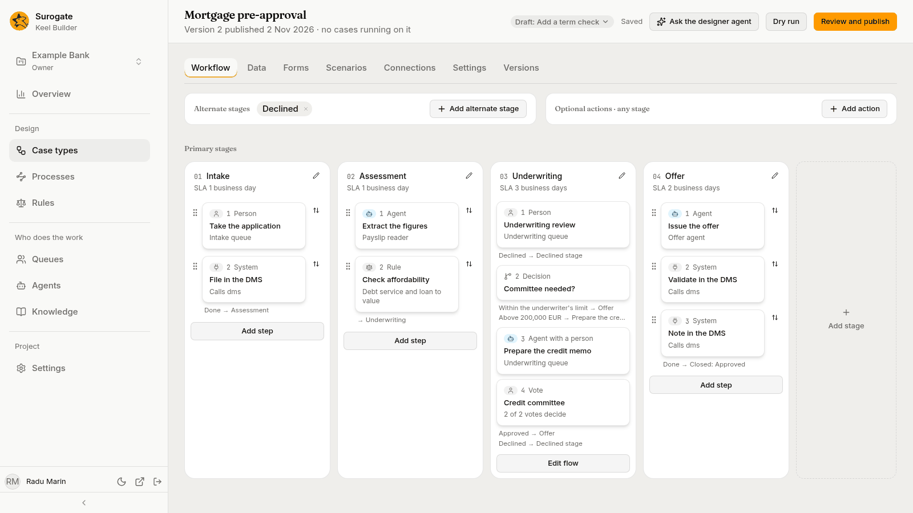
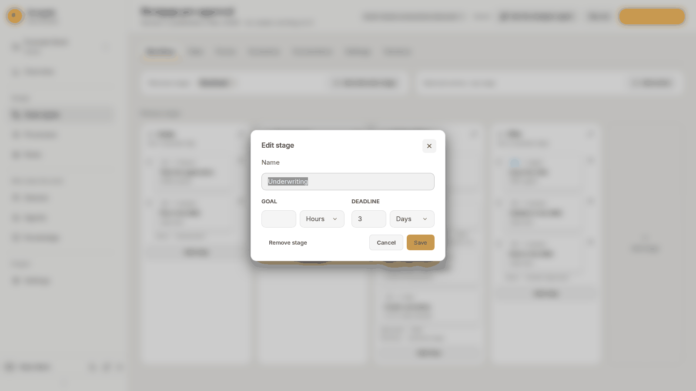
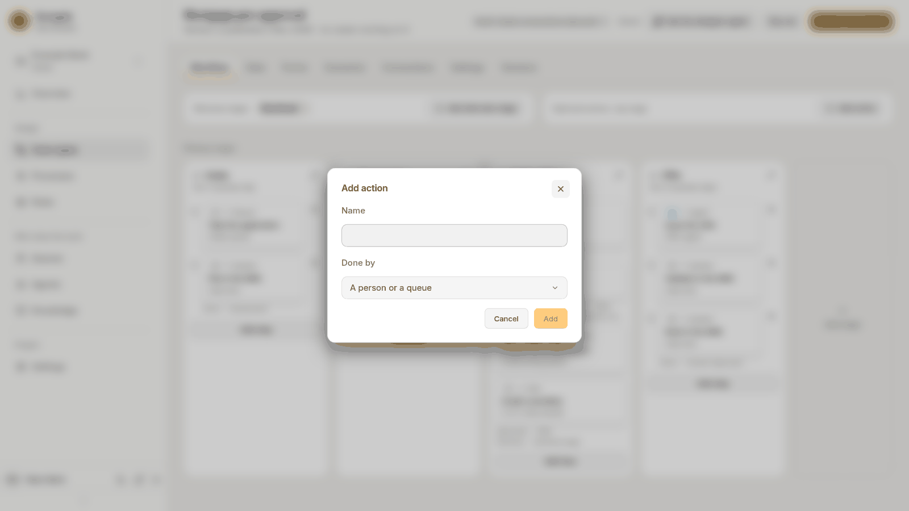
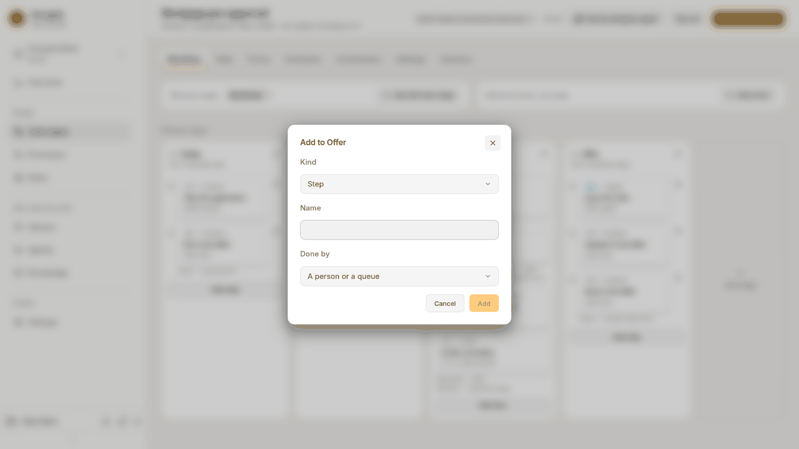
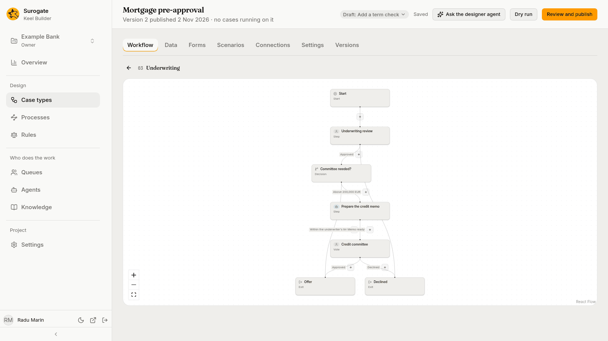
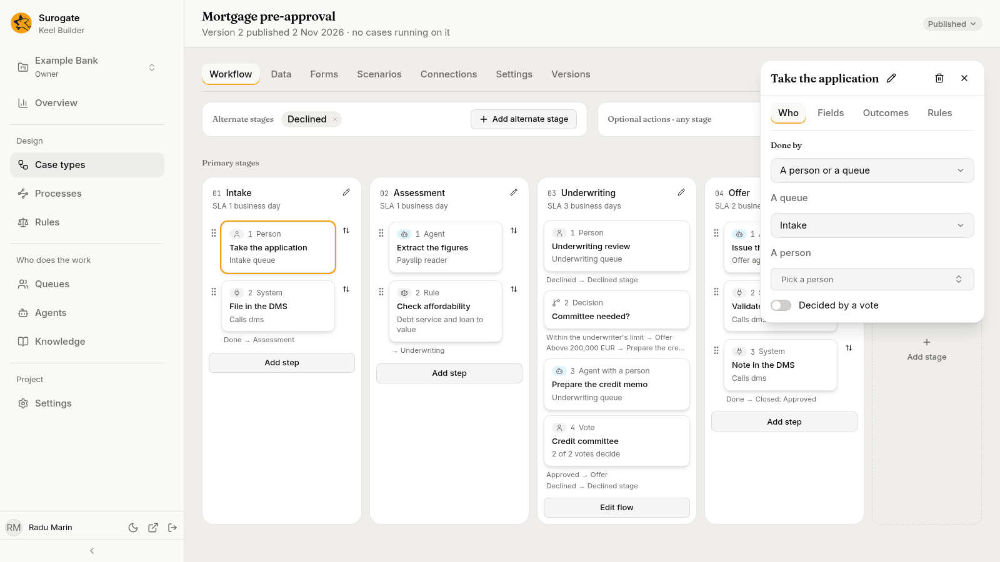

The **Workflow** tab is where you draw a case type: its stages, the steps in each stage, and the flow between them. It has three parts:

- the **stage board**: **Alternate stages** and **Optional actions · any stage** at the top, then the **Primary stages** as columns of cards;
- the **flow** of a stage, which opens in the board's place;
- the **panel** of the node or action you pick, on the right.

Viewers see all of it and change nothing. If no draft is open, your first change asks for one (see [Drafts](/keel/builder/drafts/#starting-a-draft)). While the [designer agent](/keel/builder/designer-agent/) takes its turn in the draft, the tab is read-only until the turn ends.

## The stage board

### Primary stages

The **Primary stages** are the columns, left to right, in the order a case goes through them. Each column shows:

- its number (`01`, `02`, …) and its name;
- its service level, such as `SLA 3 business days`, when it has one;
- a card for each node of the stage, numbered in the order of its flow.

Each card shows its number and its kind, such as `1 Person`, `2 System` or `3 Agent with a person`; the node's name; and a line that says who does it and how:

| Card | Its line |
|---|---|
| **Agent**: a step done by an agent | The agent's name |
| **Person**: a step done by a person or a queue | The queue, such as `Underwriting queue`, or `Assigned to` and the person |
| **Vote**: a step decided by votes | `2 of 3 votes decide` |
| **Agent with a person**: a step an agent drafts for a person | The queue that finishes it, such as `Underwriting queue`, or `Assigned to` and the person |
| **System**: a system step | `Calls` and the connection's name |
| **Rule** | The rule's name |
| **Wait** | `Waits up to 5 days`, `Waits for` an event, or `Waits until` a condition |
| **Process** | `Starts` and the process's name, with `and waits` when it waits for the process |
| **Decision** | No line |

A node that a parallel split starts reads `Parallel with` and the split's other paths instead. Under a card, the board lists the ways out that its place on the board does not show, each as the outcome's label and where it leads, such as `Declined → Declined stage`.

A parallel split shows as `Parallel ·` and its name, with each path it starts as a branch of cards under it, and `All branches meet at` and the join's name where they meet.

Press a card to open its panel. Press a stage's name to open its flow.

Editors and owners also see:

- under a stage whose nodes run in one line, **Add step**, to add a node at its end. Beside each card, a grip drags it to another place in the column, and the **Move** button offers **Move up** and **Move down**;
- under a stage that branches, **Edit flow** instead, which opens its flow;
- **Add stage** after the last column, which asks for the new stage's **Name**;
- a pencil beside each stage's name, which opens **Edit stage**: its **Name**, its service level's **Goal** and **Deadline**, **Remove stage**, and **Save**. A case type's only primary stage has no **Remove stage**.

Removing a stage asks **Remove *stage*?**: "Its steps go with it. Outcomes that lead to it will need a new target."

A node that nothing leads to shows under **Not connected**, at the foot of its column: "Nothing leads to these. Point an outcome of another step at one, or remove them."

### Alternate stages

**Alternate stages** are listed above the board as chips. A case reaches one only when an outcome, a case event or a supervisor sends it there; it is not on the primary path. Press **Add alternate stage** to add one, its name to open its flow, and its × to remove it.

After an alternate stage, **Done** leads to the end of the case: it closes as `completed`.

### Optional actions

**Optional actions · any stage** are steps people can start from a case's header while the case is open, such as "Ask the client for a document". Press **Add action**, give it a **Name**, and pick who does it under **Done by**. Press **Add**.

Press an action's chip to open its panel. Its **Who** tab has one more section, **When it is offered**:

- **Condition**: a condition over the case's fields; "Blank offers it always."
- **Stages**: the stages it is offered in; with none, "In every stage."

Remove an action with its ×, or with **Remove action** in its panel. Keel asks first: "Outcomes and case events that lead to it will need a new target."

## Adding nodes

**Add step** under a column opens **Add to *stage***, and the **+** on a line of a stage's flow opens **Add between *node* and *node***:

1. Pick the **Kind**. **Add step** offers **Step**, **Rule**, **Wait** and **Process**; the **+** offers every kind: **Step**, **Decision**, **Rule**, **Wait**, **Parallel split**, **Join** and **Process**.
2. Type a **Name**. It must have a letter or a digit; the node's key is made from it.
3. For a step, pick **Done by**: **An agent**, **A person or a queue**, **An agent with a person** or **A system**.
4. Press **Add**.

A new node leads on to the next stage until you say where it goes. A new step has one outcome, **Done**. A new rule names no rule yet, a new wait waits one day, and a new process node names no process yet and waits for it. The first node you add to an empty stage becomes the stage's start.

## A stage's flow

Press a stage's name, or **Edit flow**, and the stage's flow opens in the board's place, under its number and name. The canvas draws the stage's start, every node with its kind, where each outcome leads with its label, and the ways out of the stage.

- Press a node on the canvas to open its panel.
- The **+** on a line adds a node between the two it joins.
- The buttons in the corner zoom in, zoom out and fit the flow to the canvas.
- The back arrow, **Back to board**, closes the flow.

Keel draws the flow from the case type as you edit it. While it redraws, the canvas keeps the last drawing; until the first one is ready, it says **Drawing the flow…**.

## The node panel

Picking a card, a node on the canvas, or an action opens its panel on the right. Its header shows the node's name, a pencil to rename it, and a close button. For a step an agent works, it also has **Open agent**, which opens Studio's agents page in a new tab, and, for editors and owners in a draft, **Test this step** (see [Steps](/keel/builder/steps/#test-an-agent-step)).

- A step's panel is its contract, on four tabs: see [Steps](/keel/builder/steps/).
- Decisions, rules, waits, splits, joins and process nodes: see [Decisions, rules, waits and parallel paths](/keel/builder/flow-nodes/).

Editors and owners remove the node with the bin in the panel's header: **Remove step**, **Remove decision**, **Remove rule**, and so on. Keel asks **Remove *name*?** and says what changes: what led to the node will lead where the node led instead. A node of the stage that would then have nothing leading to it is named, and shows under **Not connected** until you point an outcome at it. Case events and optional actions that pointed at the removed node keep pointing at it; the next dry run lists them.

## Problems on the board

After a [dry run](/keel/builder/publish/), its problems are pinned where they are: a red count on the stage, the card, the action, and on the canvas's nodes. A problem on a step's outcome shows on its panel's tab, such as `Outcomes · 1`, and the panel opens on that tab. A problem with the case as a whole shows beside **Primary stages**, as `2 problems on the case`; press it to open the dry run's list. A node's panel lists the problems the last dry run found at it, under its header.

A dry run of an older state of the draft pins nothing, since its problems may be gone.
