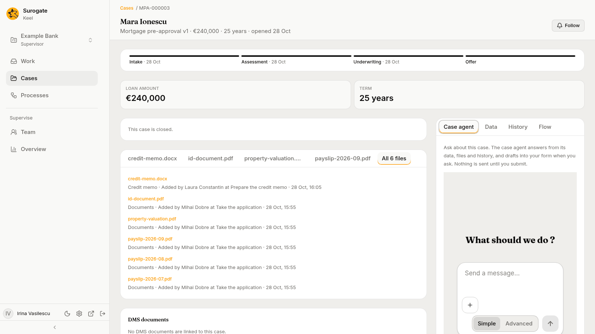

The **case agent** answers your questions about one case, from the case's data, files and history. When you ask, it fills in the form of a step you hold, for you to check. It never submits: nothing is sent until you submit the form yourself.

The case agent also answers about a process instance, from the **Process agent** tab on its page: see [The Process agent tab](/keel/business/open-process/#the-process-agent-tab).

Each project has one case agent. It is one of the project's two helpers, which Keel sets up when an editor or owner opens the project in Keel Builder (see [The project's helpers](/keel/builder/designer-agent/#the-projects-helpers)). It is not one of the agents that work steps: it never holds a step, a work item or a question.

## Opening it

- On a case, pick the **Case agent** tab in the side panel. It is the first tab; a case still opens on **Data**.
- On the [Cases page](/keel/business/cases/#the-preview), press **Ask the case agent** in a case's preview. The case opens on the tab.

The tab says: "Ask about this case. *The case agent* answers from its data, files and history, and drafts into your form when you ask. Nothing is sent until you submit."

The chat is yours. Each person has their own chat with the case agent on each case; the rest of the staff do not see it. When you come back to the case, the tab opens on the same chat.

## Asking

Type a question and send it. The case agent reads the case before it answers, and answers only from what it read: the case's data, the steps open on it, its history and its files. When the case does not hold the answer, it says so.

After each fact it gives, it names where the fact comes from, in square brackets:

- a field of the case's data, by its label, such as `[Data: Amount]`;
- an entry of the case's history, by its step and day, such as `[History: Review the request, 12 Oct]`;
- a file, by its name.

You can stop the agent while it answers. When it cannot answer, the chat says "The case agent could not answer."

Keel records what the case agent reads for you as your own views of the case, made through the case agent.

## Filling in your form

Ask the case agent to fill in your form, for example from a file of the case. It fills in only a form of yours: an open step of this case that you hold. It fills in only the fields that form has, and leaves out a value it is not sure of. Then it tells you which fields it filled, where each value came from, and which it left for you.

The chat marks each draft with a line such as "Drafted into your form: Net income, Term".

In the step's form, each field it filled is marked "Drafted by the case agent at your request. Nothing is sent until you submit." Check each value, change what you need, choose an outcome and press **Submit**, as on any step.

- A field you changed is yours. A later draft does not fill it again, and its mark goes.
- On a step an agent drafts for you, the newer draft of a field wins: the step agent's, or the case agent's.
- Your draft belongs to you and the step's work item. When you return or delegate the item, or a supervisor reassigns it, the draft is dropped: whoever holds it next starts with none. When you are away and the item goes to your substitute, the draft goes with it; when it goes back to its queue, the draft is dropped.

When you submit, the step's entry in [History](/keel/business/open-case/#case-agent-data-history-and-flow) names the agent that drafted its fields, such as "Case agent drafted Net income and Term". A field you changed before submitting is recorded as yours.

## What it never does

The case agent reads the case and fills in your form. It cannot:

- submit a form, complete a step, vote, answer an agent's question or move the case;
- change the case's data or files;
- fill in a step you do not hold;
- bring in anything from another case.

It never takes files. Add a file to the case instead, through a step's file field, then ask the case agent about it.

## When it cannot answer

| Message | Why |
|---|---|
| **The project's case agent is not set up yet: a builder opens the project in the builder app to set it up.** | Keel has no case agent for the project, or it is switched off. Ask an editor or owner to open the project in Keel Builder. |
| **The case agent's session cannot be reached now; try again shortly.** | A temporary problem. Send your message again. |
| **The case agent takes no files. Add them to the case instead.** | The message had a file or an image. Nothing was sent. |
| **A message to the case agent is at most 20,000 characters.** | The message is too long. Nothing was sent. |
| **The case agent could not answer.** | Its turn failed. Ask again. |
