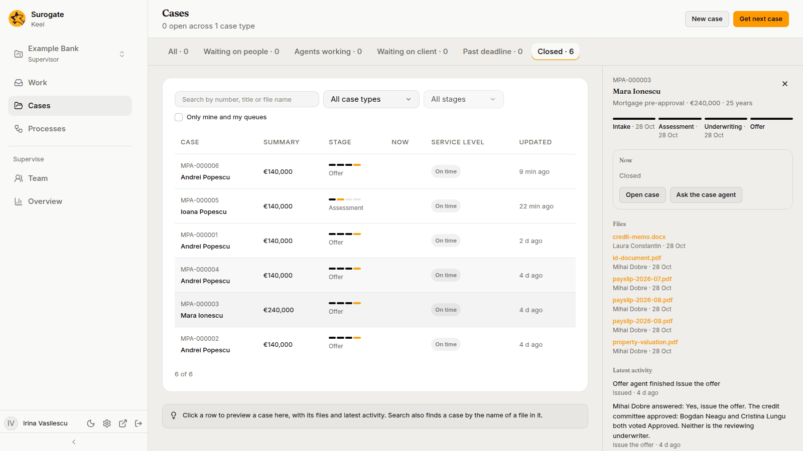
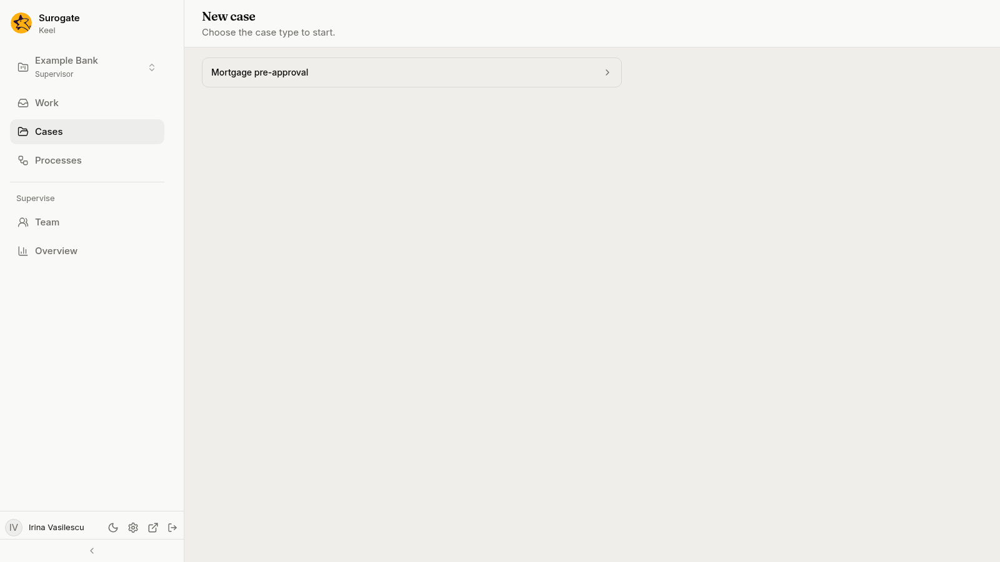

The **Cases** page lists every case of the project, open and closed. Its header says how many are open, such as `128 open across 3 case types`, and offers **New case** and **Get next case**. All staff see all the project's cases. The page keeps itself current.

## Finding a case

The tabs sort cases by who they wait on. Each shows its count.

| Tab | What it lists |
|---|---|
| **All** | Every open case. |
| **Waiting on people** | Open cases where a person or a queue holds a step, or an agent's question waits for an answer. |
| **Agents working** | Open cases where an agent is working a step. |
| **Waiting on client** | Open cases waiting on the client. |
| **Past deadline** | Open cases past a deadline. |
| **Closed** | Closed cases. |

While cases are open, **Who the open cases wait on** heads the list: a bar split between people, agents and the client, and a line such as "4 waiting on people, 2 with agents, 1 waiting on the client. 1 past deadline."

The filters narrow the list and the tabs' counts:

- **Search by number, title or file name**: matches the case number, its title, its summary values and the names of its files. It searches once you type two characters and pause.
- **All case types**, or one case type.
- **All stages**, or one stage of the picked case type.
- **Only mine and my queues**: cases with a step you hold, or a step you may take from one of your queues.

The address keeps the tab, the filters and the case you preview, so you can share a link to them.

### What a row shows

| Column | What it shows |
|---|---|
| **Case** | The case number and its title. |
| **Summary** | The first of the case type's summary values, such as the amount. |
| **Stage** | The case's stages as a bar, with the current one named. |
| **Now** | Each open step, with who holds it: a person (you as **You**), an agent that holds it, a queue, an agent at work with what it is doing, such as `Document checker · working`, the client with the day of the wait, such as `day 2 of 7`, a third party, a system, or the process a case waits on, such as `Know your customer · KYC check`, which reads **A process** until Keel has tried to start it. A step no one holds reads **Unassigned**. |
| **Service level** | **Past deadline**, with how long ago, such as **Past deadline · 2 h**; **Past goal**; **Due today**; the time left to the deadline, such as **3 d left**; or **On time** when there is no deadline. **Waiting on the client** while the client is waited on. |
| **Updated** | When the case last changed. |

Under the list, a count such as `20 of 128` says how many show, and **Show more** loads more cases.

## The preview

Press a row to preview the case beside the list, or in a sheet on a phone:

- its title and summary, and its stages with their dates;
- **Now**: what the case waits on, with **Open case** and **Ask the case agent**, which opens the case on its [Case agent](/keel/business/case-agent/) tab; a closed case says **Closed**, and an open one with nothing open says **Nothing waits now**;
- **Files**: the case's files, each with who added it and when; each opens the case on that file;
- **Latest activity**: what happened last, in sentences, newest first, and **Full history**, which opens the case's history.

## Starting a case

1. Press **New case**. The page asks you to "Choose the case type to start."

   

2. Pick a case type. Its start form opens, with the case type's required fields and any others its builders added.
3. Fill in the form and press **Start**. **Cancel** goes back to the cases.

The case opens. Every case type the project has published is listed, except retired ones. With none, the page says **No case type to start**: "Cases start once the project's builders publish a case type." When every case type is retired, it says "Every case type of this project is retired."

If Keel refuses the form, the reason shows beside the field it names, or above the form. Pressing **Start** twice, or again after an error, never starts two cases from the same form.

Cases can also start without you: an [intake agent](/keel/builder/case-type-settings/#intake-agents) can start them, and so can another system your project's builders connect to Keel.

If your project uses the DMS, a case's page also lists the documents of the DMS linked to the case, and lets the people who work it link more. See [DMS documents](/keel/business/open-case/#dms-documents).

## Get next case

**Get next case** gives you your next piece of work, as **Get next** on the Work page does, and opens its case. When nothing is waiting, it says **Nothing is waiting for you.** See [Get next](/keel/business/work/#get-next).
