This example follows one case type from the builder's board to a closed case. A bank, Example Bank, pre-approves mortgage loans. People take the application and review it, agents read the payslips and write the offer, a rule checks the loan against the bank's limits, and a committee votes on large loans.

Every picture was taken in a demo project, with made-up names and figures. The example uses most of what Keel offers in one case type, so you can see how the parts work together. Each part has its own page for the details: the links lead to them.

## What the case type does

A person at the bank takes a mortgage application: the applicant, the loan amount, the term in years and the documents. Then:

1. An agent, the **Payslip reader**, reads the payslips and works out the applicant's income. If something does not add up, it asks a person.
2. A **rule** checks two limits: the debt service and the loan against the property's value.
3. An underwriter reviews the case. Above 200,000 EUR, an agent drafts a credit memo, the underwriter finishes it, and a credit committee of two people votes.
4. An agent, the **Offer agent**, writes the offer to the client. A declined case gets a decline letter instead.

## The board

In Keel Builder, the **Workflow** tab of the case type shows the whole path. The four **primary stages** run left to right: **Intake**, **Assessment**, **Underwriting** and **Offer**. Each stage has a service level, such as **SLA 3 business days**. **Declined** is an **alternate stage**: a case only gets there when an outcome sends it there.

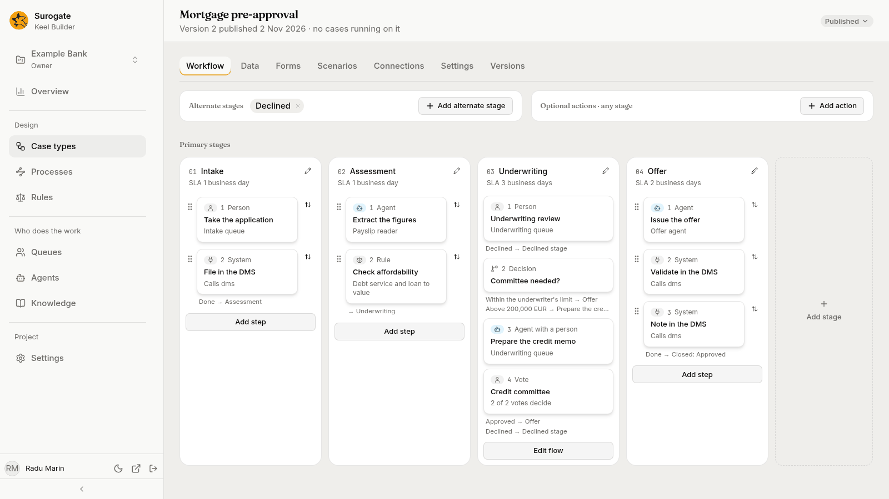

Each card is a step. The icon and the line under the name say who does it.

| Stage | Step | Kind | Done by |
|---|---|---|---|
| Intake | Take the application | Person | The **Intake** queue |
| Intake | File in the DMS | System | Another system, through a connection called `dms` |
| Assessment | Extract the figures | Agent | The **Payslip reader** |
| Assessment | Check affordability | Rule | A decision table, **Debt service and loan to value** |
| Underwriting | Underwriting review | Person | The **Underwriting** queue |
| Underwriting | Committee needed? | Decision | Nobody: Keel picks a branch from the loan amount |
| Underwriting | Prepare the credit memo | Agent with a person | The **Underwriting agent** drafts, a person from the **Underwriting** queue finishes |
| Underwriting | Credit committee | Vote | The **Committee** queue: 2 of 2 votes decide |
| Offer | Issue the offer | Agent | The **Offer agent** |
| Offer | Validate in the DMS and Note in the DMS | System | Another system |
| Declined | Send the decline letter | Agent | The **Offer agent** |

The two **System** steps that file the case in a document system are an example of how Keel calls another system. A project that has no such system leaves them out.

## The steps, one by one

Press a card and its panel opens on the right. The panel has four tabs: **Who**, **Fields**, **Outcomes** and **Rules**. See [Steps](/keel/builder/steps/) for every setting.

**A person step.** *Take the application* goes to the **Intake** queue: whoever works that queue claims it. **Outcomes** has one, *Application taken*, which leads to the next step, *File in the DMS*.

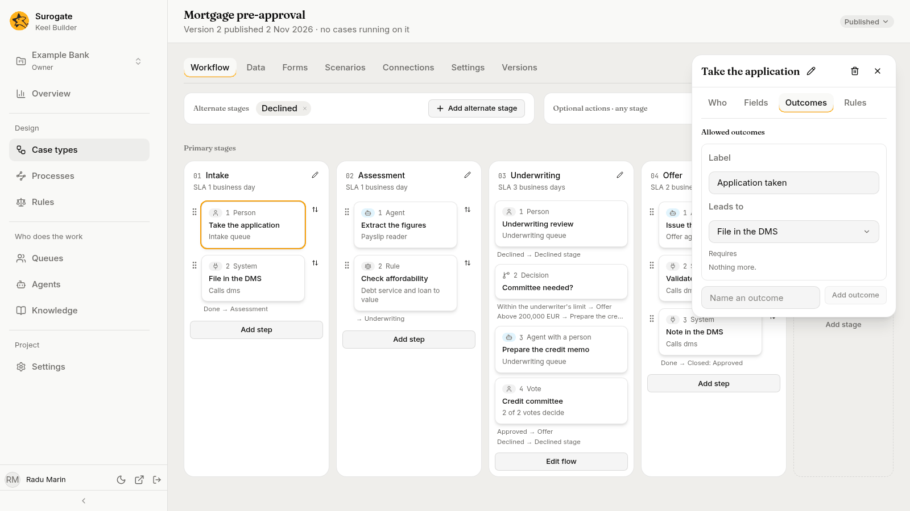

**An agent step.** *Extract the figures* is done by the **Payslip reader**. **Raised hands go to** names the queue that gets the agent's questions: **Intake**. The agent never decides what happens next: it returns one of the outcomes the step offers, or it asks a person.

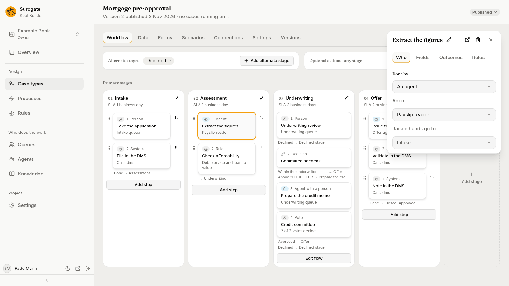

**A rule step.** *Check affordability* runs a decision table and writes its two results into two yes-or-no fields, **Loan to value within limit** and **Debt service within limit**. The same inputs always give the same answer, and the case's history records which version of the rule decided.

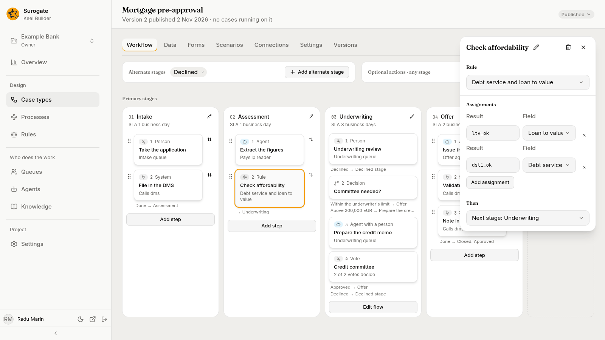

The decision table lives on the **Rules** page, with its versions.

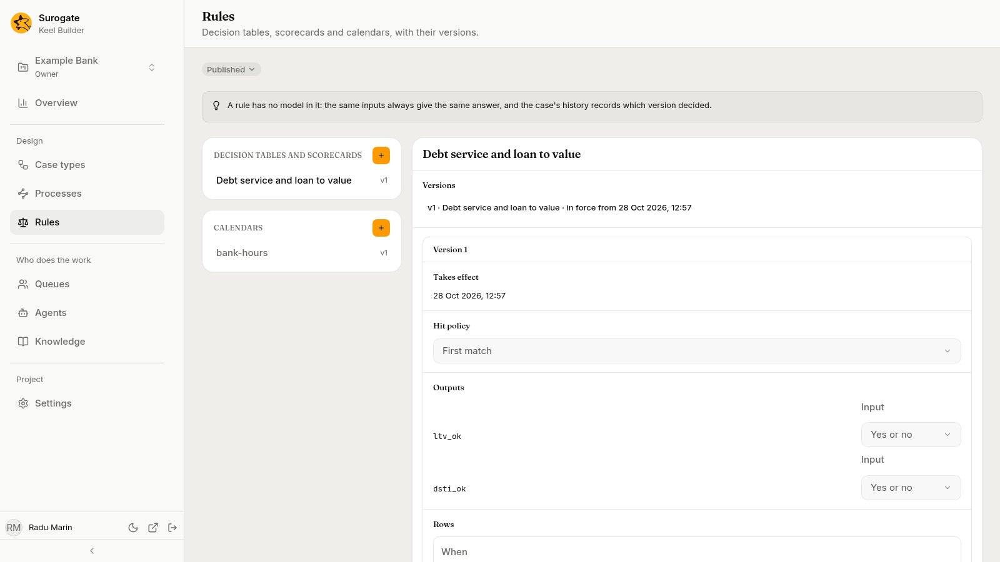

**A decision.** *Committee needed?* has a condition on the loan amount. Above 200,000 EUR the case goes to the credit memo; otherwise it goes to the offer.

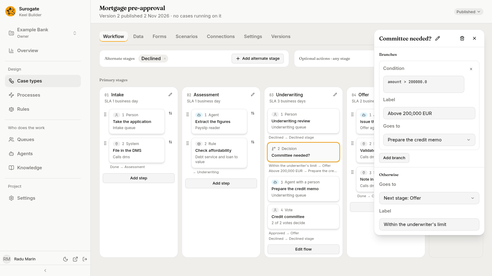

**An agent with a person.** *Prepare the credit memo* is drafted by the **Underwriting agent**, and a person from the **Underwriting** queue checks the draft, changes it if needed and submits it. This is the way to use an agent where a person must stay responsible.

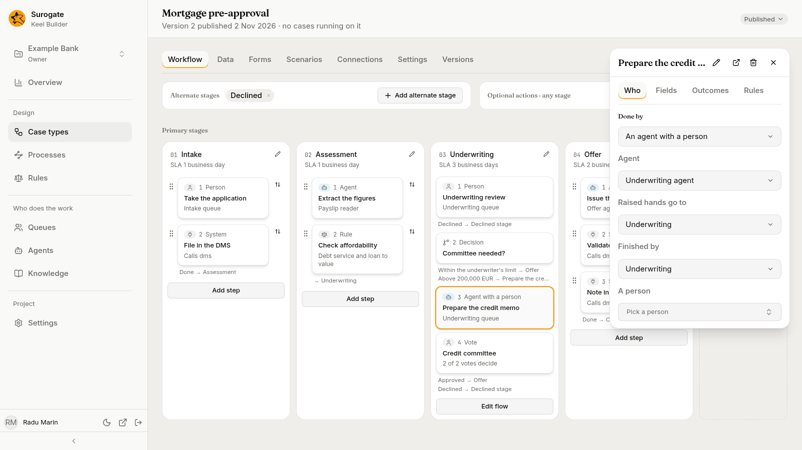

**A vote.** *Credit committee* is decided by two of two votes of the **Committee** queue's members. Its **Rules** tab adds two safeguards. **Maker-checker** says someone other than whoever did *Underwriting review* or *Prepare the credit memo* must vote. **Authority** compares the **Loan amount** with each voter's limit in the scope `committee`.

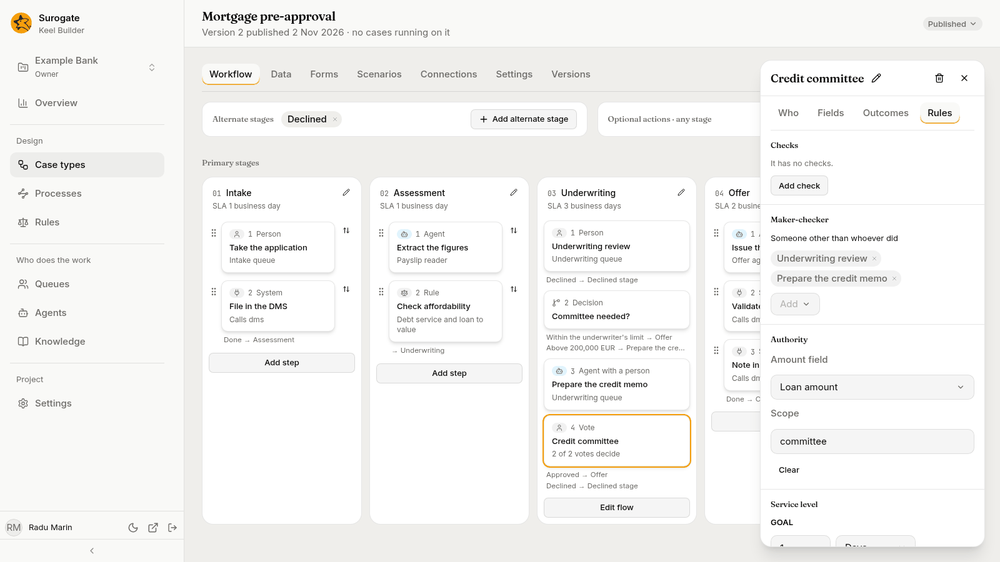

## The data

The **Data** tab lists the case type's fields, and for each one which steps read it and which step writes it. A form is made from the fields a step writes. The **Forms** tab lays out the form a case starts with.

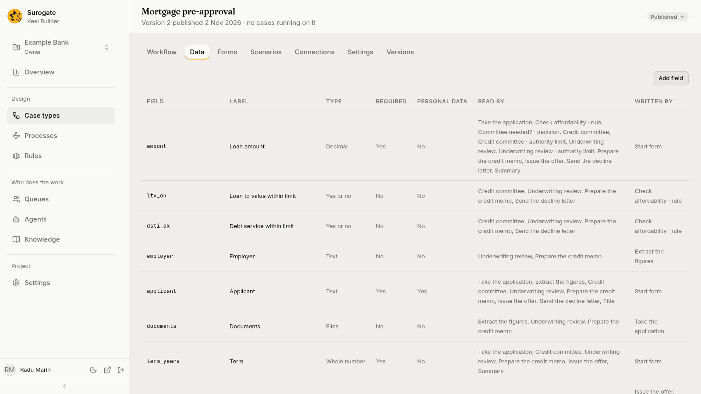

## The people and their limits

Builders define the queues: **Intake**, **Underwriting** and **Committee**, each with a serving order and a priority. A queue only says how work is served. The project's supervisors decide who works each queue, on the **Team** page of the business app.

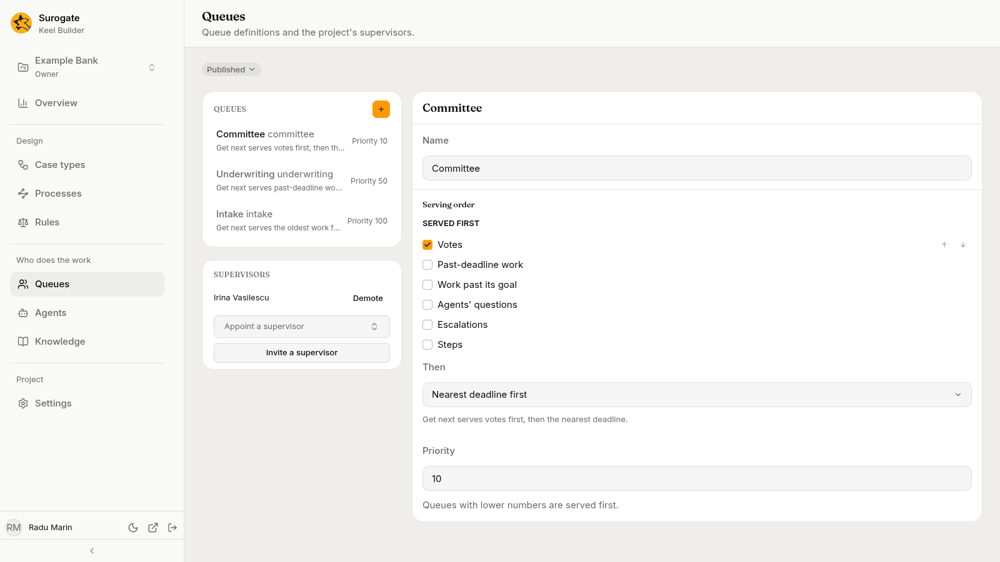

On **Team**, a supervisor also sets each person's **authority limits**: the most a person may approve in each scope. In this project, the underwriter may approve up to 1,000,000 in the *Underwriting* scope. The two committee members have limits of 300,000 and 200,000 in the *Committee* scope.

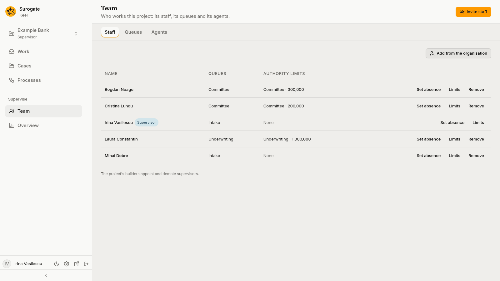

See [Queues](/keel/builder/queues/) and [The Team page](/keel/business/supervisors/).

## A case from start to end

The case below is a loan of 240,000 EUR for 25 years. It is above 200,000 EUR, so it goes to the committee.

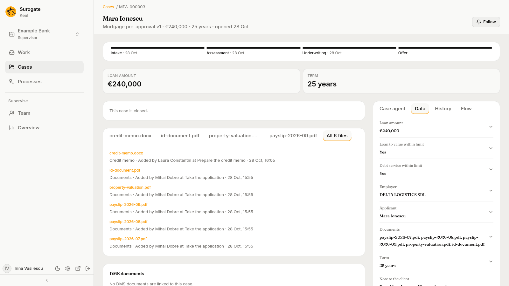

1. **Intake.** A staff member takes the application: the applicant, the amount, the term, and the documents: three payslips, an identity document and a property valuation. These appear as the case's files.
2. **Assessment.** The Payslip reader reads the payslips and writes the employer, the net monthly income and the existing monthly debt payments. The rule checks the limits and answers yes to both.
3. **Underwriting.** An underwriter reviews the case and writes a note. The amount is above 200,000 EUR, so the Underwriting agent drafts a credit memo as a document, and the underwriter finishes it. Two members of the committee vote, and neither is the underwriter who reviewed the case.
4. **Offer.** The Offer agent writes the offer. It stops and asks a person to confirm that the committee approved it, because the policy requires that for loans above the underwriter's limit. A staff member answers, and the agent finishes.

The case's **History** records each step: who did it, when, and the outcome. For a step an agent drafted, it says so.

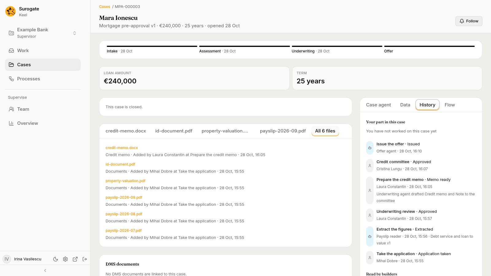

## When an agent asks

In another case, the Payslip reader found two problems: the name on the payslips was not the applicant's, and a third payslip was missing. It could not go on, so it **raised a hand**: it asked the **Intake** queue. The question shows in the work of whoever can answer, with the evidence the agent found. The agent waits, with no time limit, until a person answers.

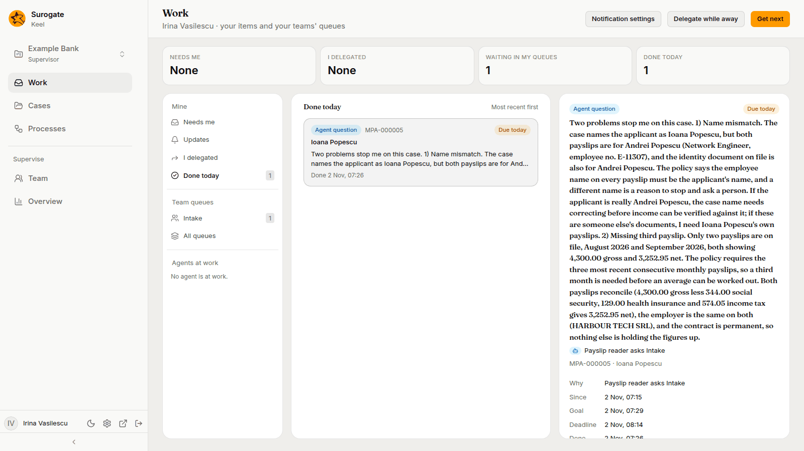

See [Working with agents](/keel/business/agents/).

## What the builder sees afterwards

After a few cases, **Overview** in Keel Builder shows how the case type holds up: how often agents needed a person, who did the steps and which stages are slowest.

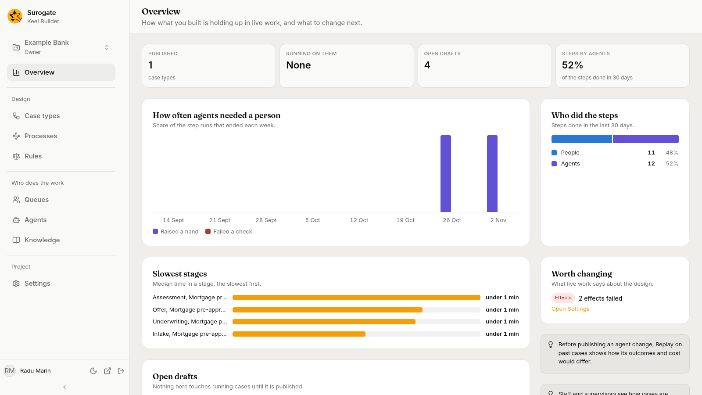

The **Agents** page keeps every session of an agent. A session shows what the agent read, the question it asked and the answer it was given, with its time and cost.

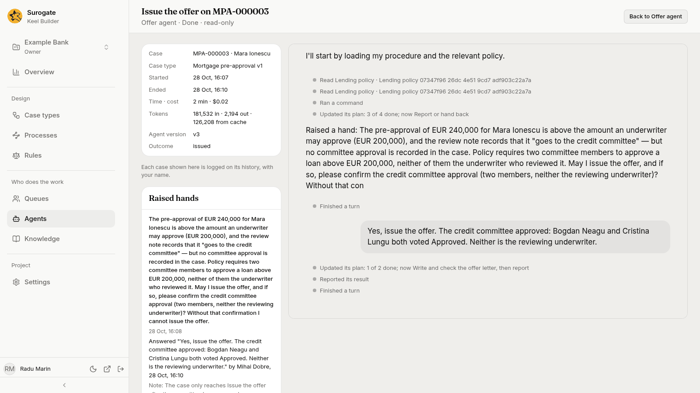

## Build it yourself

1. Create the case type with the fields above, as [the quickstart for builders](/keel/quickstart/) shows.
2. Add the stages and steps on the [Workflow](/keel/builder/workflow/) tab. Give each step its kind in [Steps](/keel/builder/steps/).
3. Make the decision table on the [Rules](/keel/builder/rules/) page.
4. Define the queues on the [Queues](/keel/builder/queues/) page, and the agents in Studio. Pick each agent in its step.
5. Write [scenarios](/keel/builder/scenarios/) for the paths: a small loan, a large loan, a declined loan. Every dry run plays them.
6. [Publish](/keel/builder/publish/), then ask a supervisor to add people to the queues and set their limits.

Or describe the process to [the designer agent](/keel/builder/designer-agent/) and let it draft the first version, which you then check and change in the draft.
