This page is for the people who work cases: staff and supervisors. It takes you from the sign-in page to your first finished step, and shows the places you will use every day. It takes about ten minutes.

The pictures were taken in a demo bank, so the names, cases and queues you see are not yours. Your supervisor or a builder of your project has already published at least one case type. If you are a builder who has not, start with [the quickstart for builders](/keel/quickstart/).

You need an invitation from your project's supervisor: a link that sets your password, or a sign-in link.

## 1. Sign in

1. Open the link your supervisor sent you. If it is a set-password link, enter a **Password**, repeat it in **Repeat the password**, and press **Set password**. The app signs you in.
2. Next time, open the business app at https://keel-app.surogate.ai, enter your **Email** and **Password**, and press **Sign in**. **Remember me** keeps you signed in on this computer.

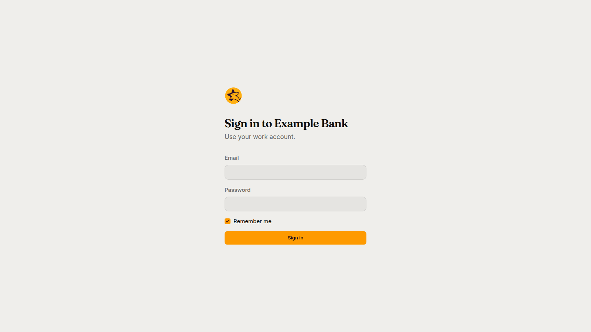

If the app says "Which project?", open the link your supervisor sent you: it names the project. See [Sign in to the business app](/keel/business/sign-in/).

## 2. Find your way around

The left rail has **Work**, **Cases** and **Processes**. Supervisors also see **Team** and **Overview**, under **Supervise**. The project's name and your role are at the top of the rail, and your name is at the bottom, with your settings, the theme and sign-out.

**Work** is your home page. Four cards count what needs you, what you handed to others, what waits in your queues and what you finished today. Below them, three columns:

- on the left, the lists you can open: **Needs me**, **Updates**, **I delegated** and **Done today**, then your team queues and the agents at work;
- in the middle, the list you picked;
- on the right, the item you picked.

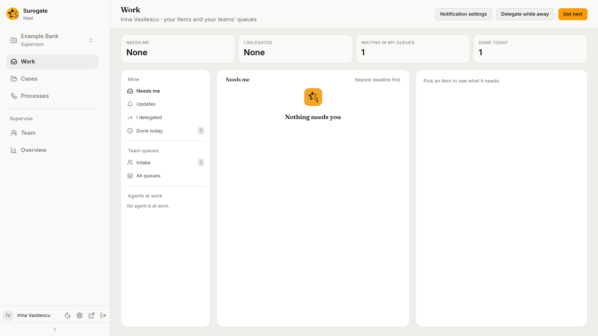

**Needs me** holds the work that is yours: steps assigned to you or that you claimed, votes you owe, and agents' questions assigned to you. See [The Work page](/keel/business/work/).

## 3. Take a piece of work

Work waiting in a queue of yours is not yours until you take it. There are two ways.

- Press **Get next** in the page header. Keel hands you the next item from your queues, in the order the queue serves work.
- Open a queue under **Team queues**. The queue's page counts what waits, what is claimed and what agents asked, and lists the **Unclaimed** work. Press **Claim** on the row you want.

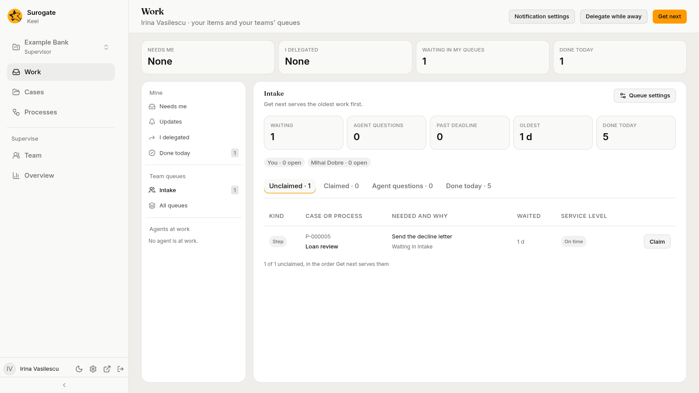

Open the case of a row you want. A step nobody holds says "Nobody holds this step yet: it waits in *queue*. Claim it to work on it." Press **Claim**: the step becomes yours.

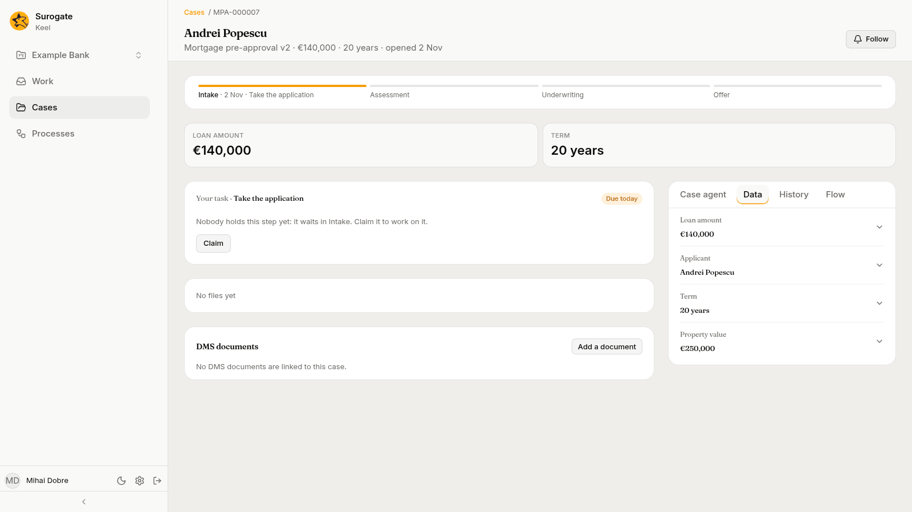

The step now shows in **Needs me**, as **Your step**, with **Open case**, **Delegate** and **Return to queue**.

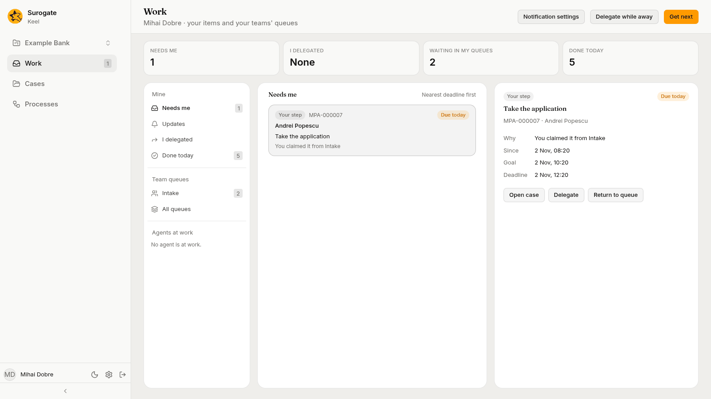

**All queues** lists every queue of the project, with what waits in each.

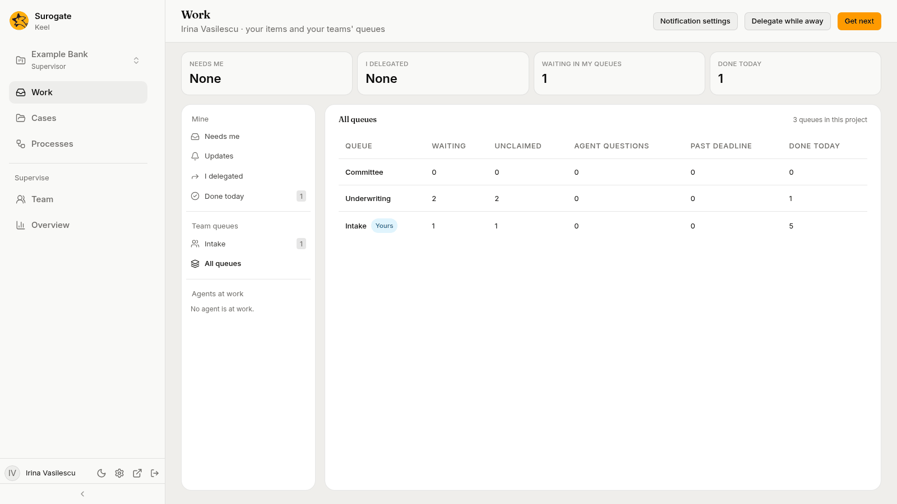

## 4. Do the step

Pick the item in **Needs me**, then press **Open case** (or **Open process** for a task of a process). The case page opens with a card **Your task** and the step's name. The card shows the step's form: the fields the step writes, and the choice of **Outcome**.

1. Fill in the fields. A field the chosen outcome requires must be filled before you submit.
2. Choose an outcome.
3. Press **Submit**.

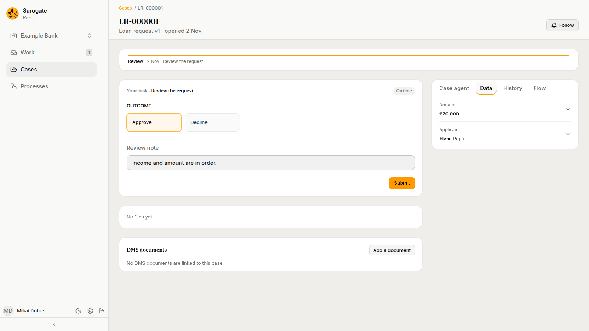

For a vote, choose your vote and press **Submit vote**.

The card goes away and the case moves to the next step. If you chose the outcome that closes the case, the page says **This case is closed.** See [An open case](/keel/business/open-case/).

## 5. Answer an agent's question

Some steps are done by agents. When an agent needs a person, it asks, and the question lands in the queue the step names, or with you. It shows as an **Agent question** in your list.

Pick it. The right pane shows who asks, the question, the case, the step that is paused, and the evidence the agent found. Choose one of the agent's answers, or type yours, add a note if you like, and press **Send answer**. The agent goes on with your answer, and the note is kept in the case's history.

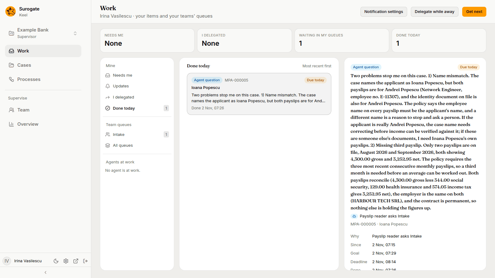

An agent never stops waiting by itself. See [Working with agents](/keel/business/agents/).

## 6. Start a case

1. Open **Cases** and press **New case**.
2. Pick the case type.

   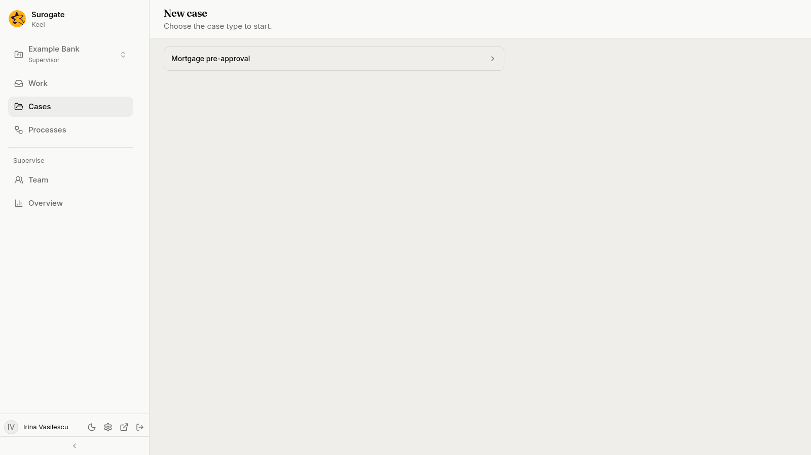

3. Fill in the start form, which asks for the fields the case type needs to begin, and press **Start**.

   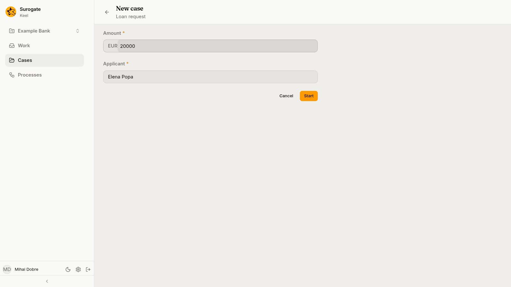

The case opens. Its number, such as `LR-000001`, is in the breadcrumb, and the stage bar shows where it is.

## 7. Read a case

The **Cases** page lists every case of the project, open and closed. The tabs sort them by who they wait on. Press a row to preview a case beside the list, with its files and its latest activity.

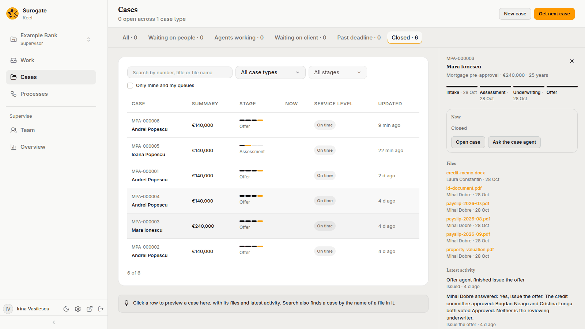

Press **Open case** to see all of it. The case page shows the stage bar, the values that sum the case up, its files, and a side panel with four tabs: **Case agent**, **Data**, **History** and **Flow**.

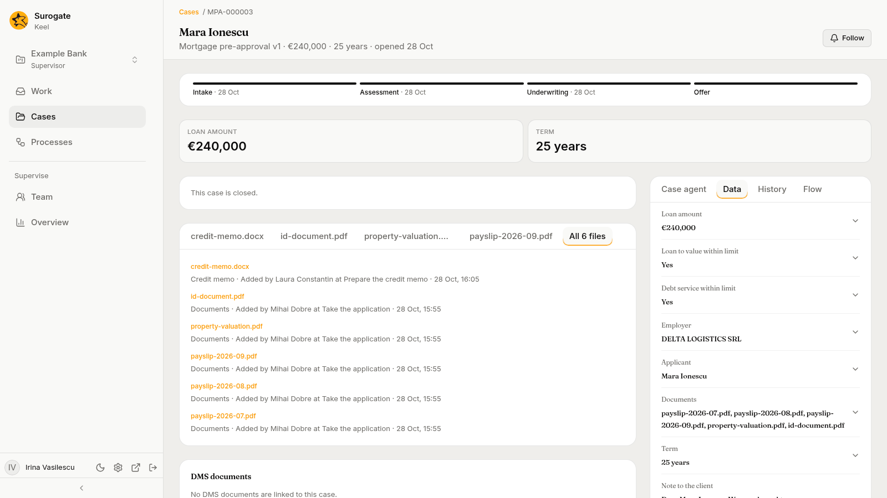

- **History** lists each step done, who did it, when, and what came of it.

  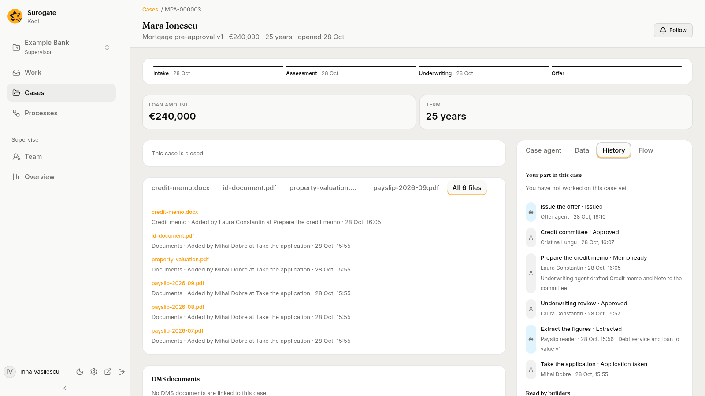

- **Flow** draws the path the case follows.
- **Data** lists every field of the case.
- **Case agent** is a chat about this case. Ask it what you need to know, or ask it to fill in your form. It never submits; you do.

  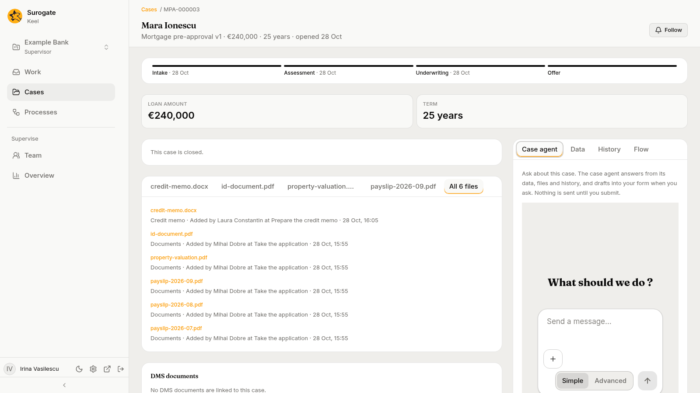

**Follow**, in the case's header, puts the case's changes in your **Updates**.

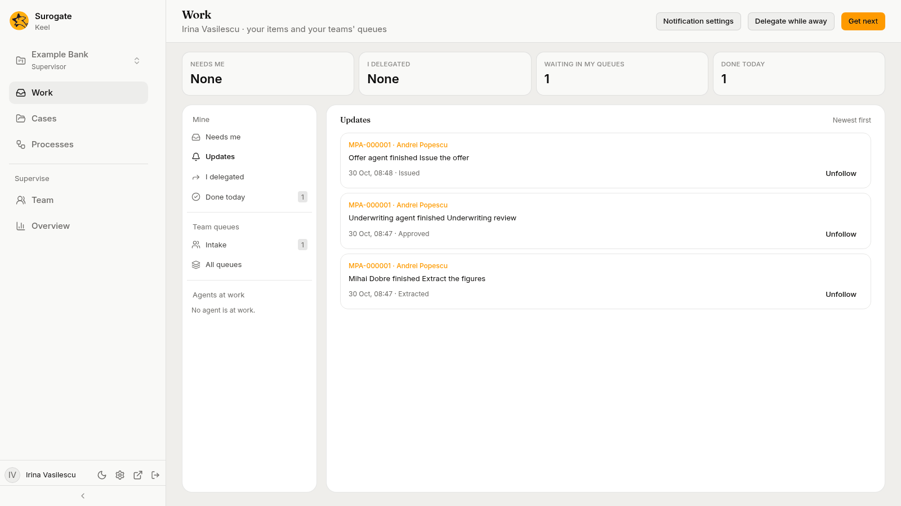

## 8. Start a process

**Processes** lists the instances of the project's BPMN processes. **New process** starts one. Its page shows a diagram of where the instance is, its tasks and its history, and a **Process agent** tab to ask about it. See [Processes in the business app](/keel/business/processes/).

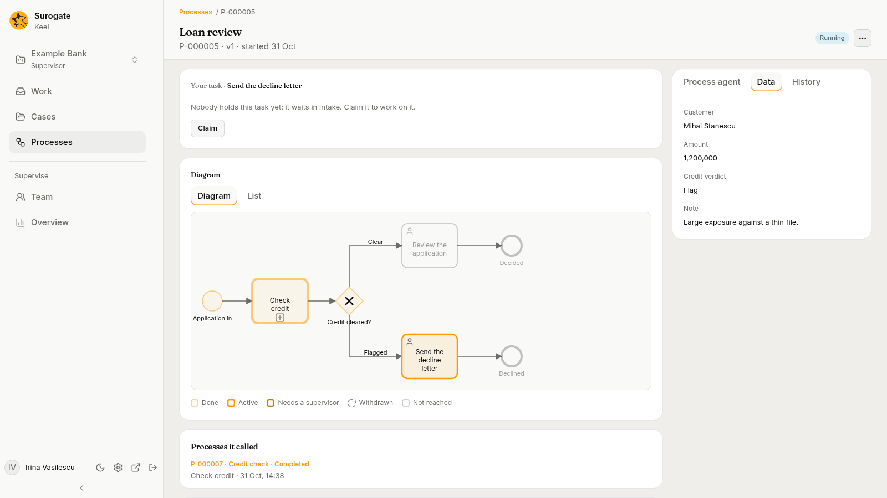

## 9. Be away

When you will be away, press **Delegate while away** in the header of **Work**. Pick a colleague or choose to return your items to their queues, set the day you are back, and press **Set absence**. **Get next** gives you nothing until you are back.

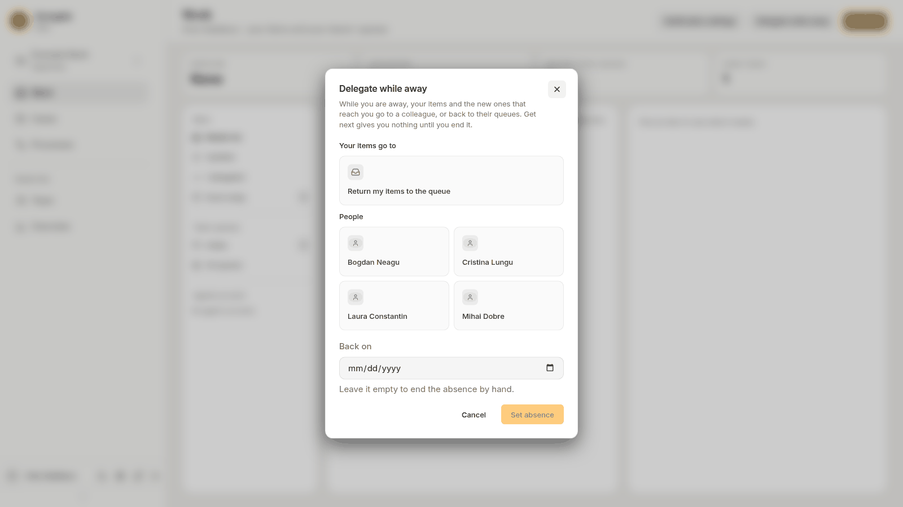

**Notification settings**, in the same header, chooses which emails Keel sends you. See [Your settings](/keel/business/settings/).

## If you are a supervisor

Supervisors work cases like staff, and also see **Team** and **Overview**.

- **Team** is where you invite staff, add people and agents to queues, set authority limits and absences, and turn agents on and off.

  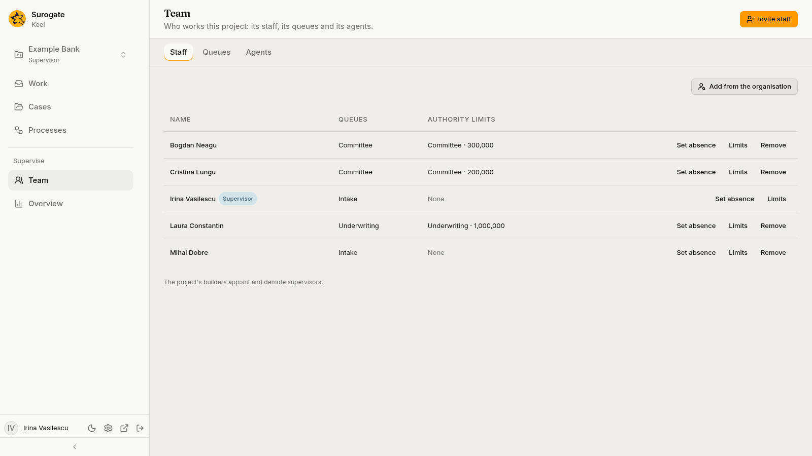

- **Overview** shows how the project's work is going: cases opened and decided, cases by deadline, and where cases wait.

  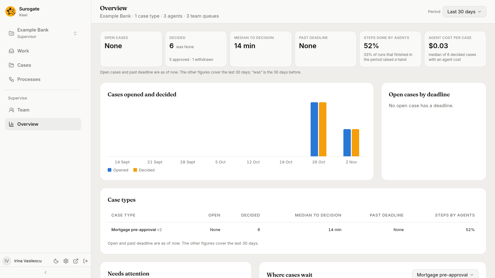

See [The Team page](/keel/business/supervisors/) and [The Overview](/keel/business/overview/).

## Next steps

- [The Work page](/keel/business/work/): every list, delegating, reassigning and answering agents.
- [Cases](/keel/business/cases/) and [An open case](/keel/business/open-case/): finding, previewing and working cases.
- [The case agent](/keel/business/case-agent/): ask about a case and have it fill in your form.
- [Example: mortgage pre-approval](/keel/examples/mortgage-pre-approval/): a case worked by people, agents and a committee.
