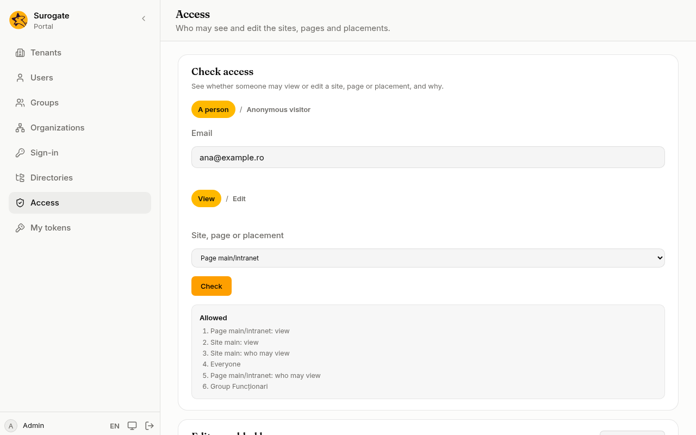
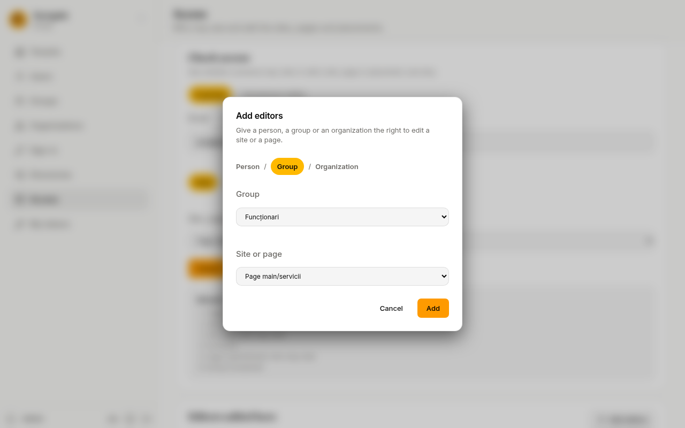

On **Access**, an administrator checks who may see or edit the portal's sites, pages and placements, and adds editors. Who may *view* a page is written in the site's files: see [Who sees a page](/portal/sites/permissions/).

## Check someone's access

1. Under **Check access**, choose **A person** and type their **Email**, or choose **Anonymous visitor** for someone who has not signed in.
2. Choose **View** or **Edit**.
3. In **Site, page or placement**, choose what to check.
4. Press **Check**.

The console says **Allowed** or **Not allowed**. When access is allowed, it lists the steps that allowed it: for example, the site lets everyone view it, and the page lets the group **Funcționari** view it.

## Add editors

Editors may edit a site or a page, and so they can also see it, whatever its files say about viewing.

1. Under **Editors added here**, press **Add editors**.
2. Choose **Person** and type their **Email**, or choose a **Group** or an **Organization**. An organization includes the organizations below it.
3. In **Site or page**, choose what they may edit.
4. Press **Add**.

To take the right away, press the bin next to the editors and confirm. Editors also go when the person, group or organization is deleted, or when the site or page is removed from the site's files.

Administrators always edit and see everything; they need no entry here.
