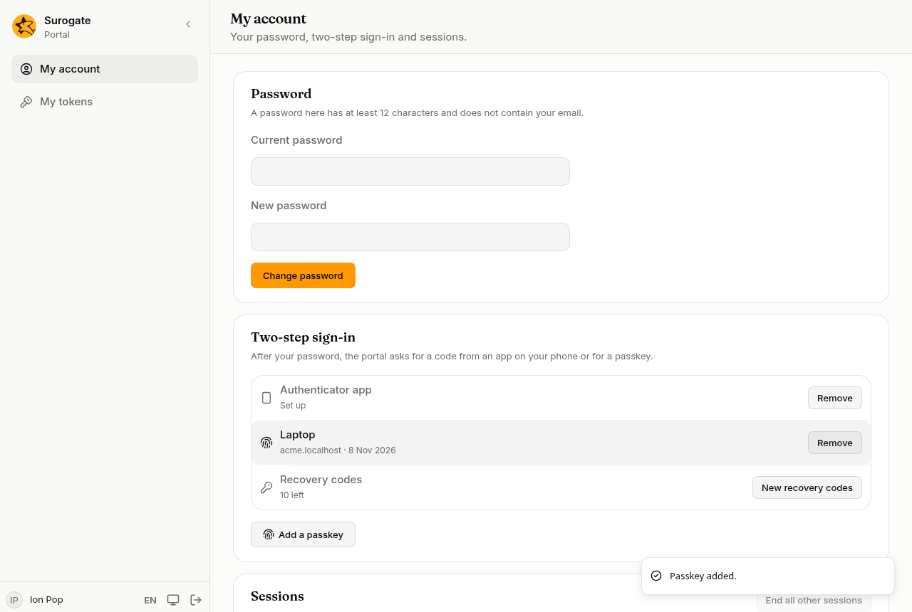

**My account** is your own page in the console: your password, your two-step sign-in and where you are signed in. Everyone who signs in has it.

## Password

Type your **Current password** and a **New password**, then press **Change password**. The page says how long a password must be here. A password cannot contain your email. Your other sessions end.

People who sign in through a directory change their password there.

## Two-step sign-in

After your password, the portal can ask for a second step: a code from an app on your phone, or a passkey.

Before any change here, the console asks for your password, or for a code from your app or a recovery code. If you sign in only through your organisation's account and have no second step yet, it asks for nothing within 10 minutes of signing in.

- **Authenticator app:** press **Set up**, scan the code with the app (or type the key shown under it), then type the code the app shows and press **Confirm**. **Remove** takes it away.
- **Passkeys:** press **Add a passkey**, give it a name such as "Laptop", and confirm on your device. A passkey works on the address you added it on. **Remove** beside one takes it away.
- **Recovery codes:** when you set up your first app or passkey, the console shows ten recovery codes, once. Keep them somewhere safe: each one signs you in once if you lose your phone. **New recovery codes** replaces them all. The row says how many are left.

If your portal requires a second step, you cannot remove your last one: add another first.

## Sessions

**Sessions** lists where your account is signed in now: the browser, the address and when it was last used. The one you are using is marked **This session**.

- **End** beside a session signs it out at once.
- **End all other sessions** signs out everywhere but here.

A session an administrator opened while [impersonating](/portal/console/users/#impersonate) you is listed too, with their name.
