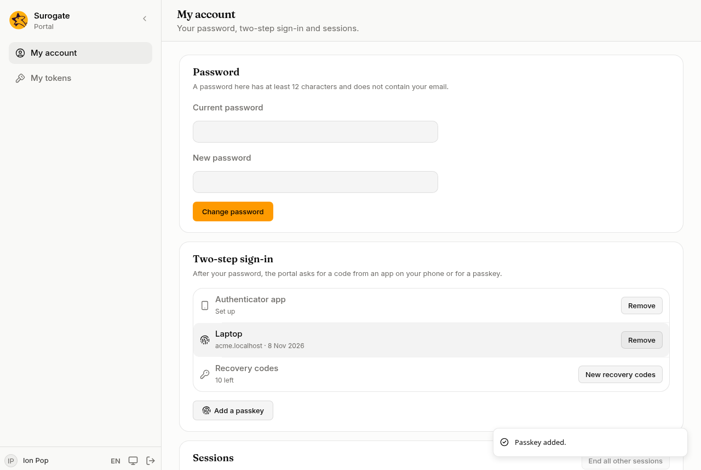

**My account** is your own page in the console: your password, your notifications, your two-step sign-in and where you are signed in. Everyone who signs in has it.

## Password

Type your **Current password** and a **New password**, then press **Change password**. Under the new password, the page lists the rules of your portal and ticks each as you meet it: its length, perhaps capitals, digits or symbols, no part of your email or name, and perhaps not one of your last passwords. The portal checks them again and says what the password still needs. Your other sessions end.

When your portal makes passwords expire, a banner says how many days are left and brings you here.

People who sign in through a directory change their password there.

## Notifications

What the portal tells you shows on its pages and under the bell at the bottom of the console's menu, with how many you have not read. Open one to go to its page; **Mark all read** clears the count.

Turn on **Email me my notifications** to get each one by email too. It is off until you turn it on.

### Notifications in this browser

Under **Notifications in this browser**, press **Turn on** to have the portal's notifications appear on this device, even when no page of the portal is open; the browser asks you to allow them. Clicking one opens its page and marks it read, after you sign in if you are not signed in. **Turn off** stops them here.

- Each browser and device is turned on by itself, on the address of the portal you use there. You can have up to 10; the oldest gives way to an eleventh. Your other browsers are listed under **Your other browsers**, each with **Remove**.
- A browser stays on while you stay signed in there. Signing out, or a session that ends, turns it off; signing in again in the same browser turns it back on. Changing your password, and **End all other sessions**, turn off your other browsers, not this one.
- A notification shows its title and words as they are in the portal, on lock screens too. One you already read in the portal is not shown, and a browser offline for more than a day misses what came meanwhile.
- At most 60 notifications an hour reach your browsers, each browser counting; past that, they show only in the portal and your email.
- A browser that got no notification for 60 days, and where you did not sign in again, is turned off.
- When the portal sends no notifications to browsers, or this browser cannot show them, or you blocked them in its settings, the card says so. To unblock them, allow notifications for the portal's address in the browser's settings. On iPhone and iPad, browsers show the portal's notifications only for a site added to the Home Screen, so the card says this browser cannot show them.

## Pages you visited

Shown when a site of the portal remembers the pages signed-in people visit (see [Remembered pages](/portal/sites/personalization/#remembered-pages)). It lists the pages kept of the last 30 days. **Clear** removes them. Turning off **Let sites remember the pages I visit** stops it and removes what was kept.

## Two-step sign-in

After your password, the portal can ask for a second step: a code from an app on your phone, or a passkey.

Before any change here, the console asks for your password, or for a code from your app or a recovery code. If you sign in only through your organisation's account and have no second step yet, it asks for nothing within the minutes your portal sets for [confirming who you are](/portal/console/sign-in-policy/#confirming-it-is-you-again) (10 at first) after you signed in or confirmed.

- **Authenticator app:** press **Set up**, scan the code with the app (or type the key shown under it), then type the code the app shows and press **Confirm**. **Remove** takes it away.
- **Passkeys:** press **Add a passkey**, give it a name such as "Laptop", and confirm on your device. A passkey works on the address you added it on. **Remove** beside one takes it away.
- **Recovery codes:** when you set up your first app or passkey, the console shows ten recovery codes, once. Keep them somewhere safe: each one signs you in once if you lose your phone. **New recovery codes** replaces them all. The row says how many are left.

If your portal requires a second step, you cannot remove your last one: add another first.

## Sessions

**Sessions** lists where your account is signed in now: the browser, the address and when it was last used. The one you are using is marked **This session**.

- **End** beside a session signs it out at once.
- **End all other sessions** signs out everywhere but here.

A session an administrator opened while [impersonating](/portal/console/users/#impersonate) you is listed too, with their name.

## Your connections

Some [connectors](/portal/sites/connectors/#each-persons-own-account) sign in with each person's own account on a service. **Your connections** lists them. **Connect** asks for your account's credentials, which are kept sealed and never shown again. **Disconnect** forgets them.
