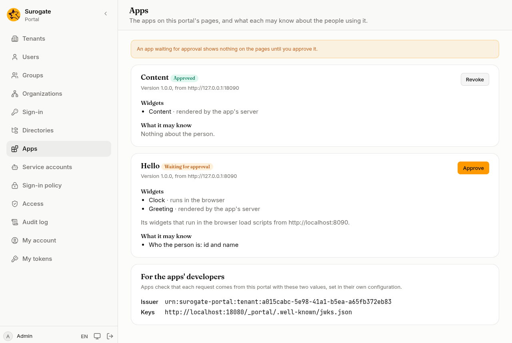
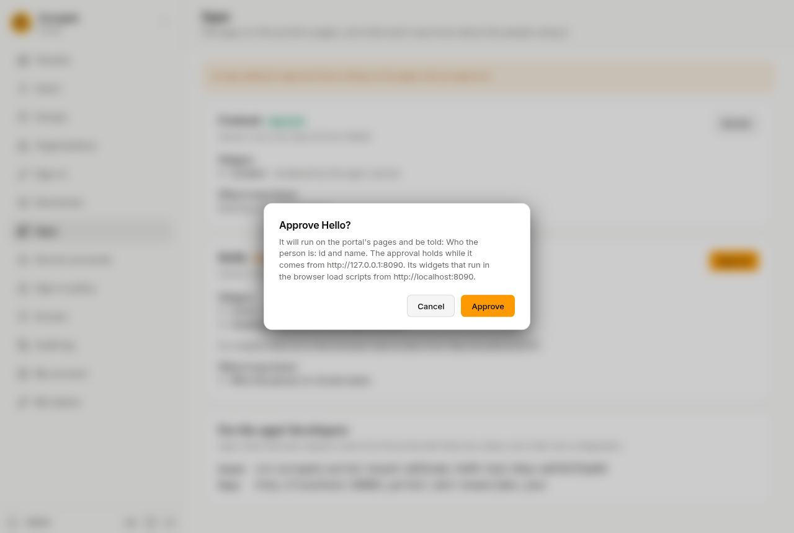

An app puts something on the portal's pages: a news list, a form, a clock. **Apps** is where an administrator adds the apps the portal knows, decides whether each may run, and what it may know about the people using the portal. Its widgets are then [placed on pages](/portal/sites/apps/).

## What you see

For each app:

- its name, its version, the address it comes from, and its status;
- **Widgets**: the parts of a page it offers. A widget **rendered by the app's server** is made by the app and sent to the portal. A widget that **runs in the browser** is a program the visitor's browser loads from the app.
- where its widgets that run in the browser load their programs from;
- **What it runs on the portal's server**: its [hooks](/portal/sites/apps/#hooks), such as a check of each person created or changed on the console or through the API, and what it sees of them;
- **What it may know**: what the portal tells the app about the person looking at the page.

| It asks for | The portal tells the app |
|---|---|
| Nothing about the person | nothing |
| Who the person is | their id and name |
| Their email | their email address |
| Their profile fields | the profile fields your portal has |
| Their roles | their roles in the portal, such as administrator |

## Add an app

1. Press **Add an app**.
2. Give it an **Id**: lower-case letters, digits and hyphens, starting with a letter. It cannot be changed later, and `portal` is the portal's own.
3. Give it a **Name**, and its **Manifest address**: where the app serves its manifest, an `http:` or `https:` address with no user name or password. The manifest's id must be the app's id.
4. Say what it does with **A person's data**: **It keeps no personal data**, or **It exports and erases at an address**, with that address and how long to wait (1,000 to 60,000 milliseconds; 10,000 when left empty). An address on a private network is asked only when the install allows it, or when it is on the server this app was approved from. When an administrator [exports or erases a person](/portal/console/users/), the portal asks every app.
5. When the app has a backend of its own that it calls as the person signed in, tick **It has a backend of its own** and give its **Audience**, its **Scopes** (one per line) and the **Token lifetime** (60 to 3,600 seconds; 300 when left empty).
6. Press **Save**. The portal reads the manifest: when it cannot reach it, or the manifest is wrong, nothing is saved and the address says why. Another app the portal cannot reach also keeps the save from going through, and is listed above the form.

A new app waits for approval. **Edit** on its card opens it again. Moving the manifest to another server starts the app over: it waits for approval again, its event wires go, API clients no longer act as it until given it again, and its [connectors](/portal/console/connectors/) need their credentials set again. The editor says so before you save.

An app whose settings have a problem, or whose manifest could not be read, shows as **Not running**, with **Edit** to see why. An app that says nothing about a person's data makes exporting or erasing anyone fail for the whole portal: the editor says so.

## Remove an app

Open it with **Edit** and press **Remove**. The portal refuses while a page, a connector or a job still uses the app, and says where. Its approval and its event wires go, and no API client acts as it any more. The data the app holds is not erased: ask the app first if a person's data must go.

## Approve an app

An app shows nothing on the pages until you approve it. People who may edit a page see **This app is waiting for an administrator's approval.** where it would be. Visitors see the page without it.

1. Read what the app asks to know.
2. Press **Approve**. The dialog lists it again, with what it runs on the portal's server and the addresses it comes from.
3. Press **Approve** in the dialog. The app shows on the pages at once.

Approving decides what the portal **sends** the app, and what it may run on the portal's server. A widget that runs in the browser runs with the visitor's authority, like any program on the page, and a hook runs with what its app may know about people; the approval trusts the address the app comes from for whatever it serves there. Approve only apps you trust.

An app's check can refuse a change to a person, with a message on the field it names. If an app's checks stop working and block changes, **Revoke** its approval: its checks stop at once.

## When an app changes

The status says whether the app needs you again:

- **Approved**: it runs, and is told what you approved.
- **New permissions**: a new version asks to know more, or to run something new on the portal's server. What it adds is marked **New**. It shows nothing until you approve again.
- **Waiting for approval**: it has never been approved, or it now comes from another address. It shows nothing until you approve it.

A new version that asks for the same things, or less, stays approved. If the app changed while you were reading, approving it is refused: look at it again and approve what it is now.

If an app shows **Its manifest has not been read yet**, the portal has not yet read from the app what it offers. Open it with **Edit** and press **Save**: saving reads the manifest, and says why when it cannot.

## Revoke an app

Press **Revoke** and confirm. The app stops showing on the pages at once. Approve it again to bring it back. **Revoke** is there whenever an approval is held, also for an app waiting for new permissions.

When an app is removed, its approval goes too. An app added later under the same id waits for approval.

Each approval and revoke is in the [audit log](/portal/console/audit/), with who did it and what the app was told.

Apps can also send and take [events](/portal/console/events/): an approval also decides what an app is told about the person an event is about.

## For the apps' developers

At the bottom of the page, **For the apps' developers** shows the portal's **Issuer** and **Keys** for this tenant. An app's developers set both in the app's configuration, so the app can check that each request comes from this portal. Give them these two values when they set up an app.

## Change a widget on a page

People who may [edit](/portal/sites/permissions/#editors) a page see a small menu on each widget:

- **Preferences** opens the widget's settings, such as a greeting or a number of items. Press **Save**, and everyone sees the change. A field left empty goes back to what the site's files say; a required one cannot be left empty. **Reset to defaults** goes back to what the site's files say for every field.
- **Help** shows the app's help for the widget, if it has one.
- **Back to the section** leaves the settings or the help.

The menu also has **Maximize**, so the widget fills the page, and **Minimize**, which leaves only its title. Anyone who sees a maximized or minimized widget, editor or not, can **Restore** it.

A change made with **Preferences** stays with that widget on that page. If the site's files remove the widget or put another one in its place, the change goes too.
