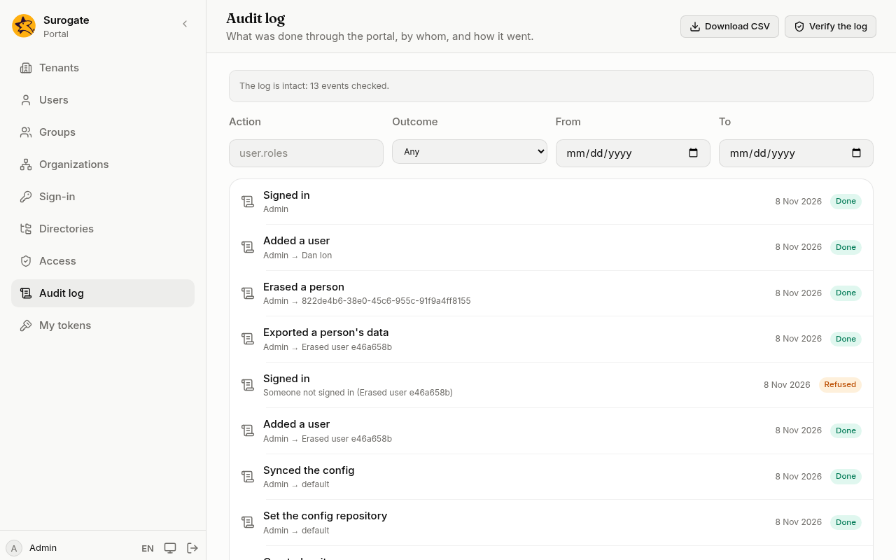

On **Audit log**, an administrator sees everything that changed something in the portal: who did it, to what, and whether it worked. Sign-ins and sign-outs are there too, and so are attempts that were refused, such as a sign-in with a wrong password or a change someone was not allowed to make.

## Find an event

Narrow the list with:

- **Action**: what was done, such as `user.roles` for role changes.
- **Outcome**: **Done**, **Refused** or **Failed**.
- **From** and **To**: the days to look at.

Press **Load more** at the bottom for older events. To see what one person did, open their page under **Users** and press **See their audit events**.

**Download CSV** saves the events the filters show, for a spreadsheet or an auditor.

## Check that the log was not changed

Press **Verify the log**. The portal checks every event against the one before it:

- **The log is intact: N events checked.** Nothing was changed or removed.
- **The log was changed at event N.** Someone with access to the database altered or removed events from that one on. Tell whoever runs the portal.

Passwords, tokens and what people typed into forms are never in the log. A refused sign-in keeps the login that was tried only when it is an email address.

Events are kept for two years unless whoever runs the portal sets another period. When a person is erased, their name, email and address are removed from the events about them; the events themselves stay.
