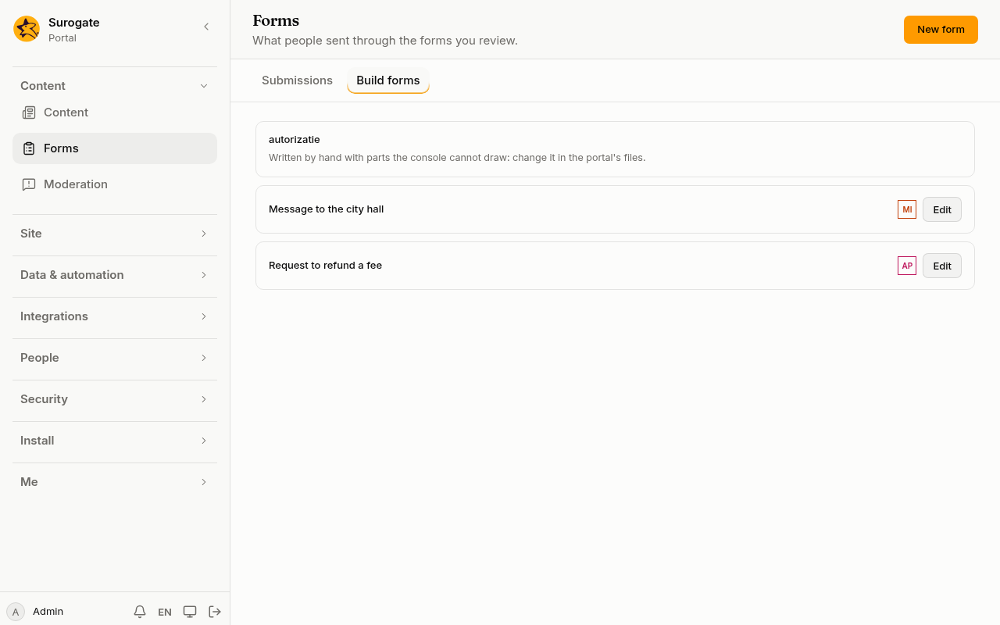
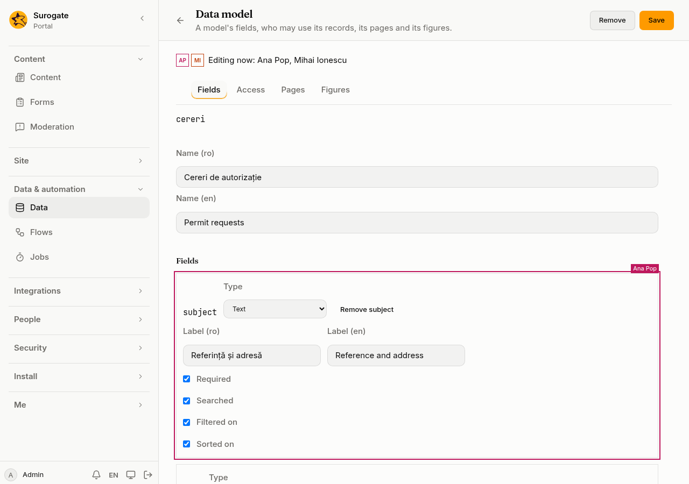
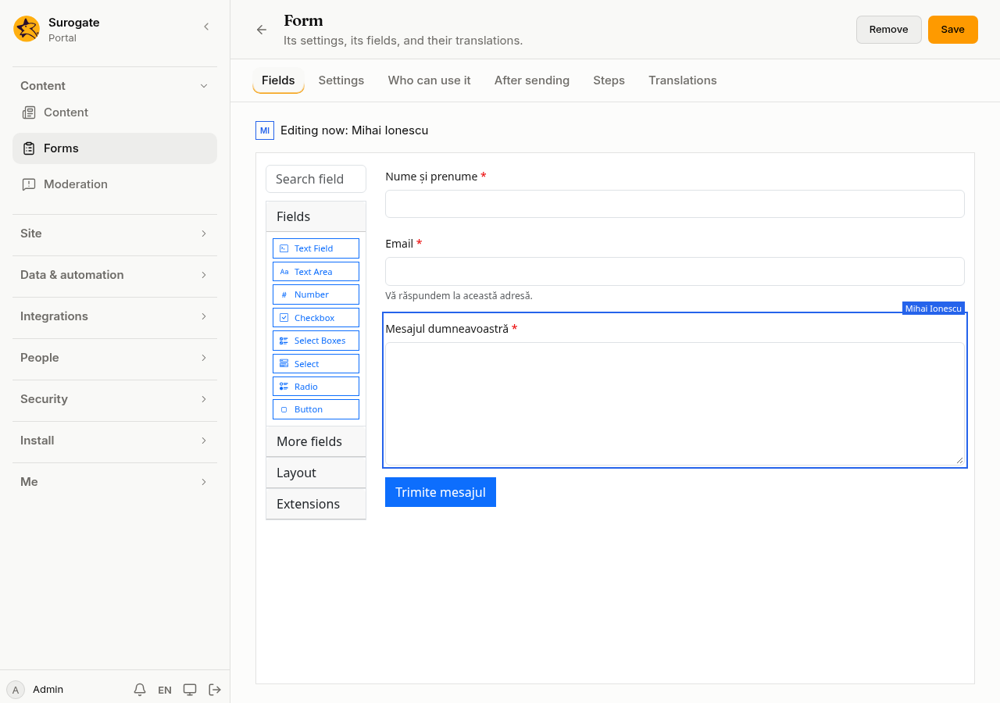
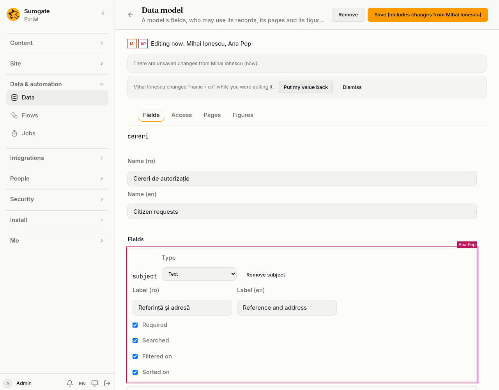
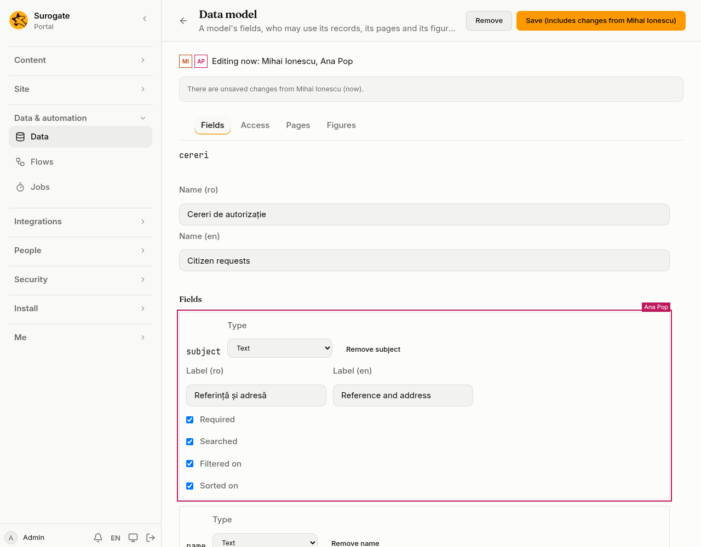
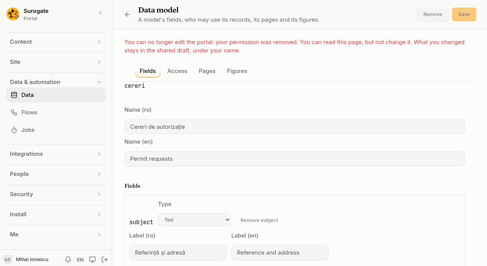
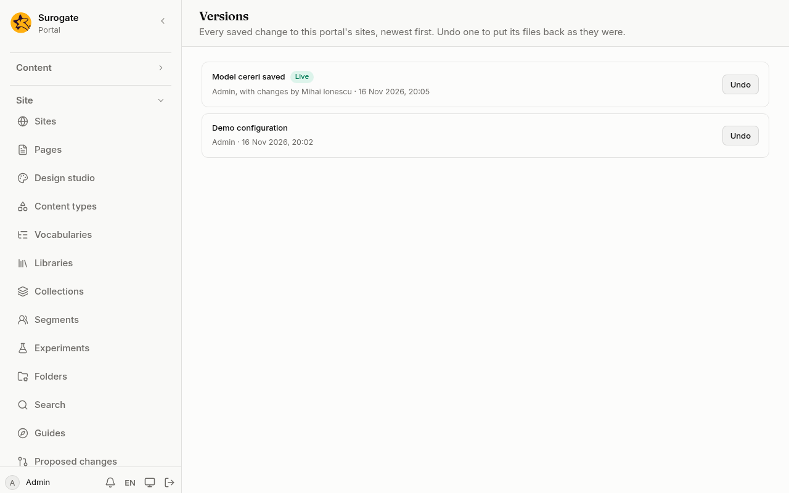

Several administrators can build the same portal at the same time. The console shows who is editing what, keeps what each person changes in a draft they all share, and turns the draft into a single [version](/portal/console/versions/) when anyone presses **Save**. Nobody has to reload the page or lose a change because someone else saved first.

This is for the administrators of the portal, in the console. Visitors, and editors of a site who are not administrators, never see it.

## See who is editing what

In a list, such as **Forms**, **Data**, **Flows**, **Jobs**, **Endpoints** or **Pages**, a small square with a person's initials appears beside every item someone has open now. Hover over it to see the name. Screen readers read the name too.

Inside an editor, the top shows **Editing now:** and the names of the others who have the same item open. In the editors of data models, flows and pages, and in the form builder, the field, step or block a person is working on is outlined in their own colour, with their name on the outline. The same person has the same colour for everyone.

In the form builder, the field another person chose is outlined the same way.

Good to know:

- What people do shows up within a couple of seconds. Someone who closes the tab disappears at once, and someone whose connection drops disappears after at most 30 seconds.
- Only administrators who may edit the portal see this, and are seen.
- Opening and leaving an editor is not written to the [audit log](/portal/console/audit/). Saves are, as always.
- An administrator seeing the portal as someone else is not part of this, and cannot edit the configuration while doing so.
- Lists and editors of every kind of item show who is there. The items that are edited together are listed under [Which editors share a draft](#which-editors-share-a-draft).

## Edit the same item together

Everyone who opens the same item edits one shared draft, kept by the portal. Each change appears for the others within a couple of seconds, without a reload, whether it adds, moves or deletes a field, a block or a step, changes a setting, or types text.

When two people change the same thing at once:

- **Different parts.** Both changes stay. One person adds a field while another drags a different field to a new place: both see the field added and the field moved, in the same order.
- **The same long text.** Two people can type in the same text, such as the text of a page, at the same time. Their changes are merged word by word, so what both wrote is kept. If both rewrite the very same word, the later change stands.
- **The same short setting,** such as a label or a tick box. The last change wins and everyone sees it. The person whose value was replaced sees a note: **Mihai Ionescu changed "name › en" while you were editing it.** Press **Put my value back** to restore their value for everyone.
- **A deletion against an edit.** If one person deletes a field while another edits it, the deletion wins. The person who edited it sees **"…" was deleted by Ana Pop** and can press **Restore**.

When you open an item that someone has changed but not saved, a line above the editor says so: **There are unsaved changes from Mihai Ionescu (2 days ago).** What they changed is already in the editor, and the **Save** button names whose changes it includes.

### If you lose the connection

The editor goes on working. A line says **Disconnected. Your changes are kept here.** When the connection comes back, your changes are merged into the shared draft the same way, and the others see them.

After more than 10 minutes without the connection, your changes are no longer merged on their own. The editor offers **Download my unsynced changes**; open the item again to carry on from the shared draft.

### Limits

- At most 20 people edit the same item at once. The 21st sees the item for reading only, with a message, and can open it again when someone leaves.
- A shared draft nobody has changed for 7 days is thrown away.
- Connector credentials are never part of a shared draft and are never shown to other editors. Set them as before. Connectors show who is editing them, but have no shared draft.

### If you lose the right to edit

If an administrator takes away your permission to edit the portal while you have an item open, the editor turns read-only and says **You can no longer edit the portal**. Your tab stops taking part: you no longer appear to the others, and nothing more of yours is sent. What you changed before stays in the shared draft, under your name, and is saved with the others' changes.

## Save together

Anyone who edits the item can press **Save**. The button says what it includes, for example **Save (includes changes from Mihai Ionescu)**.

- Pressing **Save** makes one version with everyone's changes in it. The other editors see **Ana Pop saved.** and carry on from the new version, in the same place, with nothing to reload.
- [Versions](/portal/console/versions/) shows who saved it and who else shared in it, for example **Admin, with changes by Mihai Ionescu**. The [audit log](/portal/console/audit/) keeps a line for each person who shared in the version, as well as the one for the person who saved.

- The usual checks apply to the shared draft. A save that would break the site is refused, and the problems are shown, as always.
- If two people press **Save** at the same moment, one version is made. The other is told nothing changes.
- A [proposed change](/portal/console/proposals/) from the portal's AI is not part of the shared draft. It stays a proposal until an administrator approves it.

### When the site changes from somewhere else

A change can reach the site without going through this editor: a save from another editor, an **Undo** or **Go back** in [Versions](/portal/console/versions/), an approved proposal, a change from the command line or from Git. The shared draft then goes on from the new version for everyone editing:

- Everything you did not change takes the new value.
- Where the draft and the new version both changed the same thing, the draft keeps its value and a note says **"…" also changed in version …**. Press **Use the value from the version** to take the version's value instead.
- Nothing is lost without being shown.

When a save is refused because the site moved on while you were editing, the console takes in the newest version and saves again by itself, unless the newest version changed what you changed.

## Which editors share a draft

| Editor | Who is editing | Shared draft |
| --- | --- | --- |
| Pages (with their style sheet) | yes | yes |
| Forms | yes | yes |
| Data models | yes | yes |
| Flows, contracts, named values | yes | yes |
| Jobs, endpoints | yes | yes |
| Collections, segments, guides, experiments, apps | yes | yes |
| Connectors | yes | no, because of their credentials |

A connector's editor still shows who else has it open, so that you can agree who changes it. Saving there works as it always did: if someone saved the same connector meanwhile, the console says so and offers to load the newest version.
