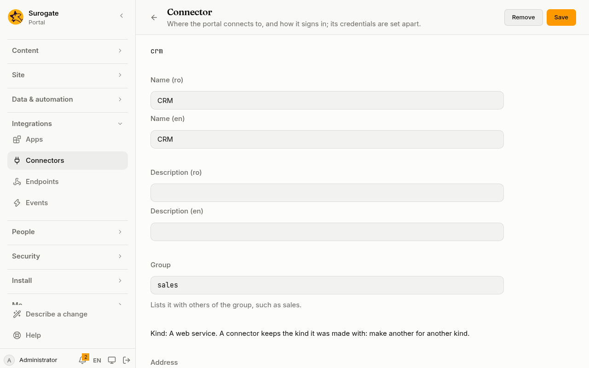

**Connectors** shows administrators the portal's [connectors](/portal/sites/connectors/), grouped by the group each is given. Each shows its name, its address, how it signs in, and whether it is connected. A connector each person connects themselves shows how many people did.

**New connector** makes one and **Edit** changes one: see [Make or change a connector](#make-or-change-a-connector). Developers can also write connectors in the site's configuration: see [Developer: Connectors](/portal/developer/connectors/).

## Make or change a connector

**New connector** asks for its id (lower-case letters, digits and hyphens, fixed once saved), its name and description in each language, a group to list it under, and its **Kind**:

- **A web service:** its address, how it **Signs in** (nothing, a token, a user and password, or a header and its name), whether **Each person connects their own account**, a **Connection test** path, and how long a call waits.
- **A secret:** a value actions sign or check with; whether each person has their own.
- **A mailbox:** IMAP or POP3, the server, its **Security** and **Port** (the usual port when left empty), and for IMAP the folder read.
- **An app's connector:** the app and the connector type it defines.
- **A bucket (S3):** the endpoint, the bucket, its region (`auto` when left empty), and whether the bucket is addressed as a host of its own.
- **An FTP or SFTP server:** the server, its port, for FTP its security, for SFTP the server's keys (paste the lines `ssh-keygen -lf` prints) and whether the portal signs in with a password or a key, and the directory paths start from.
- **A mail account:** SMTP, Microsoft 365 or Google Workspace, the sender's address and name, and for SMTP its server, or for Microsoft 365 the directory and app ids.
- **Text messages:** Twilio or Clickatell, the sender, and for Twilio the account SID. Once saved, **Replies** shows the address to give the service so a [job](/portal/sites/jobs/#when-a-text-message-arrives) hears the messages the number receives.
- **A Slack channel:** its name; the channel's webhook is its credential.

A connector keeps the kind it was made with. Each problem is said at its field, and **Save** waits until there are none; a problem in another file, such as a folder whose storage is no longer a bucket, is listed with that file. Credentials are never written in the editor: set them here once the connector is saved. A change to what its credentials are for, such as its address, server or sender, is said before **Save**: it is **Not connected** until they are set again. **Remove** takes the connector away and forgets its credentials, after asking.

## Set credentials

**Set credentials** asks for what the connector's sign-in needs: a token, a user name and password, a key, or a secret. They are kept sealed, and they are never shown again. To change them, set them again. **Remove** forgets them, after asking; actions that use the connector then fail until it is connected again.

Credentials hold to the connector as it was when they were set. If its address or sign-in changes in the portal's configuration, it shows **Not connected** until they are set again.

## Test

**Test** calls the connector's test path with its credentials, and says what it answered and how long it took. A connector can be tested once every 2 seconds.
