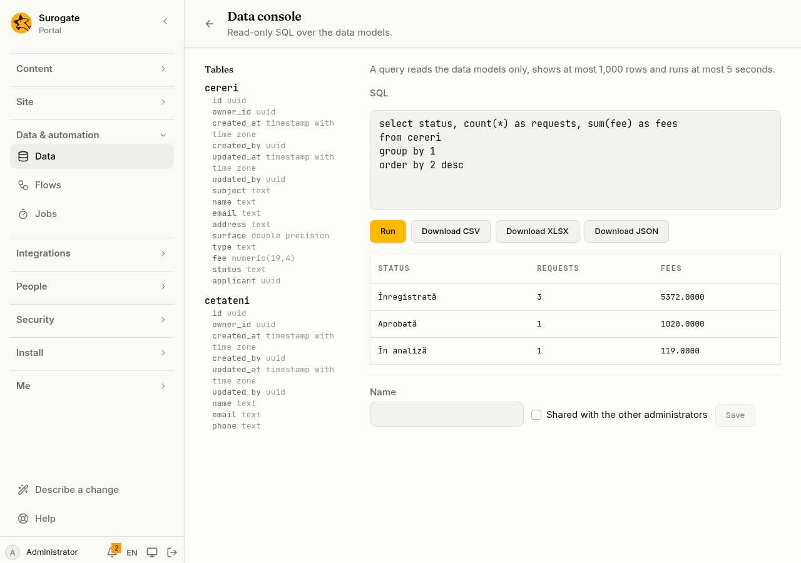

The **Data console** lets the portal's administrators ask questions of the [data models](/portal/sites/data-models/) in SQL: how many requests came in each month, which records have no owner, what a link table holds. It only ever reads. Open it from **Data**, with **Query**.

## What you see

The page lists the tables a query may read, with their columns, beside a box for the SQL. **Run** shows the answer as a table below it:



## Turn it on

The console is off until the portal's files hold `data-console.yaml` (see the [config example](#config-example)). `rows` and `seconds` may be left out; the values in the example are what they are then. If the page says the console cannot run here, the install's operators have to allow the portal to set it up.

## What a query may read

A query is one `SELECT`. It reads:

- each model's table, by the model's id, with its fields as columns and `id`, `owner_id`, `created_at`, `created_by`, `updated_at` and `updated_by`;
- each many-links field's table, `<model>__<field>`, with `from_id` and `to_id`.

The page lists these tables and their columns beside the query. Joins, subqueries, `WITH` (not recursive), `GROUP BY`, window functions, `CASE` and casts to the usual types work. So do the common functions for counting, adding up, text, numbers and dates. A query that asks for anything else, or names a table by another prefix, is refused before it runs, and the page says why.

```sql
select date_trunc('month', created_at) as month, count(*)
from requests
group by 1
order by 1
```

A query shows at most `rows` rows and says when there were more. One that takes longer than `seconds` stops. One query of the portal runs at a time.

## Download and keep

**Download CSV**, **Download XLSX** and **Download JSON** run the query again and save its answer as a file. In the CSV, a text cell that a spreadsheet would read as a formula starts with `'`.

Give a query a **Name** and **Save** it to find it again in **Saved queries**. A query is yours unless you share it with the other administrators. Only you may change or delete yours.

## Who may use it

Only the portal's administrators, never while seeing the portal as someone else. An app's token needs the `tenant:read` and `data` access. Every query run is in the [audit log](/portal/console/audit/), with the tables it read and how many rows it showed, never the query itself.

## Config example

In `data-console.yaml`, at the top of the portal's files:

```yaml
enabled: true
rows: 1000     # the most rows a query shows, 1 to 10000
seconds: 5     # the most time a query may take, 1 to 30
```

- `enabled: true` turns the console on.
- `rows`: the most rows a query shows, 1 to 10,000; 1,000 when left out.
- `seconds`: the most time a query may take, 1 to 30; 5 when left out.

